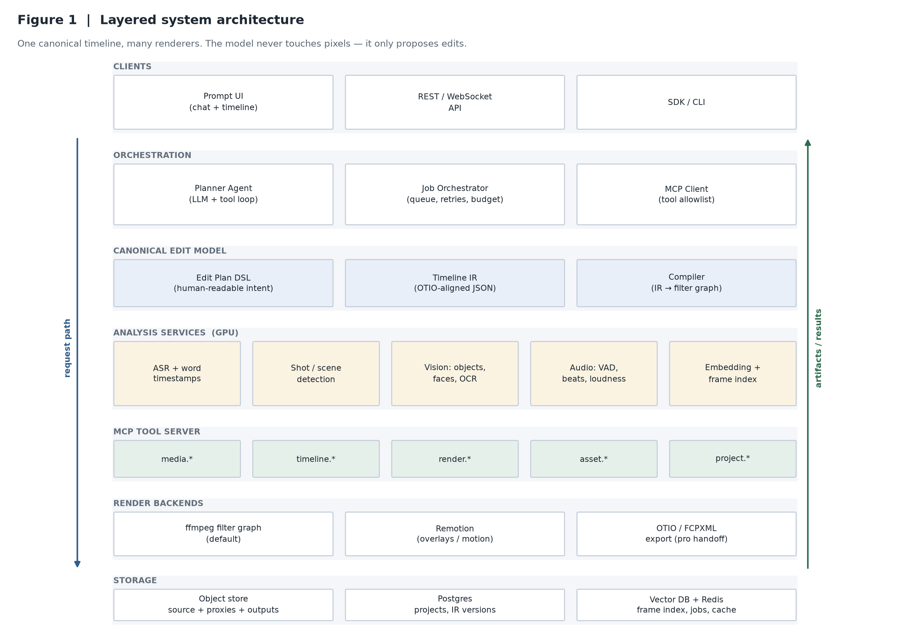
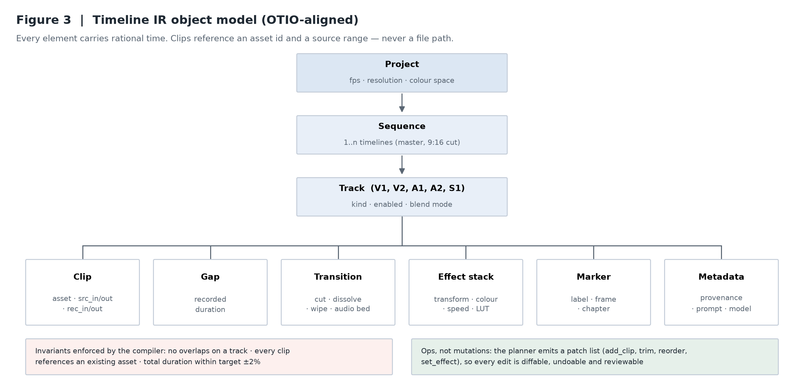
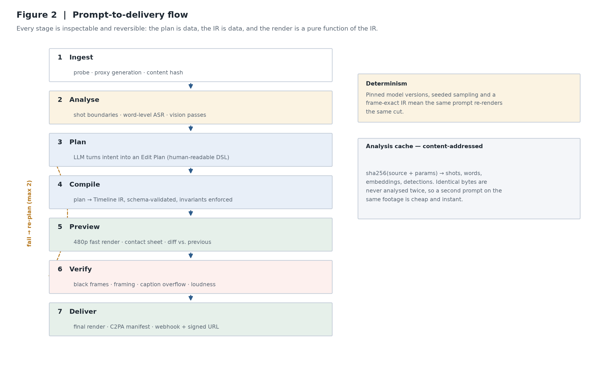

SYSTEM ARCHITECTURE & DESIGN  ·  VERSION 1.3

Prompt-Driven AI Video Editor

Executable contracts and corrected figures: a migration that builds a fresh database, a wire format for exact time, and 4K60 capacity with its evidence labelled.

| Document | Technical design specification, v1.3 (supersedes v1.2) |
|---|---|
| Status | P0-ready on contracts; performance figures remain targets |
| Change basis | Third technical review — 17 findings resolved (§0) |
| Verified in build | Migration parsed and dependency-checked; every figure computed, not typed |
| Date | 19 November 2026 |

# Contents

- 0   What changed in this version
- 1   Executive summary
- 2   Requirements
- 3   Engine decision
- 4   System architecture
- 5   Time and frame model
- 6   The Timeline IR, version 1.3
- 7   Prompt to plan
- 8   Identity and constraint resolution
- 9   The MCP tool layer
- 10  Vision and media analysis
- 11  The render engine
- 12  Performance, hardware and 4K60
- 13  Data model and database design
- 14  Multi-tenancy and isolation
- 15  API contracts
- 16  Security and privacy
- 17  Observability and operations
- 18  Recovery, retries and cancellation
- 19  Testing and evaluation
- 20  Cost model
- 21  Roadmap
- 22  Risks and open questions

A   Appendix A — worked end-to-end example

B   Appendix B — MCP tool schemas

C   Appendix C — glossary

# 0  What changed in this version

v1.3 is a contracts-and-evidence release. No new architecture was added. Every change below makes something that was described executable, or corrects a figure that was wrong.

The third review approved the architecture and withheld approval of “complete P0 readiness”. That was the right call, and three of its findings were errors rather than omissions: the multi-track duration rule contradicted itself, the P010 frame sizes were computed at two bytes per pixel instead of three, and the preview cost ignored decode. Those are fixed and, where possible, now proved by code rather than asserted in prose.

Table 0  |  Third-review findings and their resolution

| Finding | What was wrong | Resolution in v1.3 |
|---|---|---|
| Multi-track duration contradicted itself | sequence.duration = max(trackEnd) and primaryDuration == duration_frames could not both hold when a music bed ran past the video. | §6.2 separates three quantities: track_end_frames per track, content_duration_frames (primary video), render_duration_frames (export, user-controlled). The reviewer's 45 s / 50 s example is worked explicitly. |
| BigInt has no JSON contract | Internal BigInt, JSON integer, and JSON.parse Number were three incompatible representations. | §5.1 adds a canonical wire format: rates are decimal strings, frame indices are integers bounded by 2^53−1 and asserted at parse. Both directions specified. |
| Audio described as exact | 2,160,558 samples is rounded from 2,160,558.4, not exact. | §5.5 states the rounding policy explicitly and stops claiming exactness. The invariant now applies to the mixed output bus, not to the sum of parallel source clips. |
| Migration incomplete | sequences, asset_derivatives, analysis_artifacts, ops_log, music_licences, audit_log and webhook_endpoints were referenced but never created. | §13.3 is a complete, executable migration: 16 tables in dependency order, parsed by a PostgreSQL parser and checked for forward references. Reproduced verbatim from the tested file. |
| Render could reference a missing revision | renders.revision was a bare integer. | §13.3 adds UNIQUE (tenant_id, sequence_id, revision) and a composite FK from renders. |
| Duplicate constraints | Some UNIQUE (tenant_id, id) appeared both inline and as ALTER TABLE. | §13.3 consolidates every constraint inline; no ALTER TABLE constraint additions remain. |
| trim required a full range | The example sent only source.out while the range schema required in and out. | Appendix B.1 splits the type: opTrim takes a partial source range (in, out or both), everything else takes a complete range. |
| Effect vocabulary drifted | IR used fade_in/fade_out; the tool schema used fade. | Appendix B.1 and §6.4 share one enum. The machine-readable file is authoritative and the document is validated against it. |
| additionalProperties claimed but not applied | Some output schemas allowed extra keys. | Every input and output schema in Appendix B sets additionalProperties: false at every level, including the outputs. |
| P010 frame sizes wrong | 16.59 MB for a 4K 10-bit frame assumed 2 bytes/pixel; P010 is 3. | §12.1 corrected: 4K = 24.88 MB, 1080p = 6.22 MB, 8K = 99.53 MB. 4K60 bandwidth rises from 3.98 to 5.97 GB/s. |
| NVENC figures presented as established | Derived numbers read like vendor specifications. | §12.3 adds an evidence-status table separating hardware specification from estimate from assumption from target. The T4 claim is corrected to “cannot sustain realtime under the assumed workload”. |
| Preview cost understated | 0.11× ignored that a 480p preview still decodes 1080p. | §12.5 recomputes: 0.60× for a 480p preview from a 1080p proxy, 0.22× with a dedicated 540p preview proxy — which is now required. |
| RLS threat model undocumented | current_setting('app.tenant_id') is settable by any role that can run SQL. | §14.2 documents the trust boundary, the injection path, pooled-connection leakage, and the four controls that contain each. |
| Missing endpoints | answer, cancel, delete and upload completion were described but not routed. | §15.2 adds all of them, with the multipart completion flow. |
| Tone-map example conflated HLG and PQ | One command for both, with no input interpretation. | §12.6 gives two separately tested chains with explicit primaries, transfer and matrix on input and output. |
| Worked example: midpoints and rates | Beat table showed planned midpoints beside post-roll positions; every source rate was 30000/1001 despite a mixed-rate manifest. | §A now shows planned and final midpoints side by side, and five clips at four different native rates (23.976, 25, 29.97, 59.94). |
| Reproducibility under-specified | “Same manifest, same bytes” ignored mux metadata. | §11.6 defines determinism as same manifest and same GPU/driver, with -bitexact flags and metadata stripping; cross-GPU bit-identity is explicitly not promised. |

# 1  Executive summary

This specification describes an AI video editor in which a user states an intent and the system produces a finished, frame-accurate video. The engineering problem is not calling a language model. It is making a model's output land on exact frames, deterministically, on media it has never seen, without the model ever touching a pixel.

Five decisions carry the architecture. Three reviews have endorsed all five, and none is changed in v1.3.

A canonical timeline IR. The model never emits video. It emits a declarative edit description with rational time, which a compiler turns into a render.

Three-stage separation: plan, compile, render. Each stage is independently testable and independently editable.

Tools over free text. The model selects among frame-accurate candidate identifiers; it never writes a timestamp from memory.

Analysis is cached and content-addressed, per tenant. Computed once per unique byte, reused forever.

The IR is independent of everything downstream. It knows nothing of the language model, ffmpeg or Remotion. That independence is why 4K60 support is a capacity problem rather than a rewrite (§12.10).

The render engine is a Python core compiling the IR into an ffmpeg filter graph, with Remotion for motion-graphics overlays and OTIO/FCPXML for professional handoff.

On 4K60: the architecture renders it, and nothing structural changes. 4K60 is encode-bound, an L4 is estimated at roughly 2.8 concurrent realtime streams after a 65% pipeline allowance, and the T4 cannot sustain realtime under that workload — it can encode 4K60 output, just not keep up. Those are estimates, not vendor figures, and §12.3 labels each one. The production strategy that makes 4K60 affordable is to edit on a proxy and conform at UHD only on export.

# 2  Requirements

Each requirement has a test. Anything absent is out of scope, and saying so is part of the specification.

## 2.1  Functional requirements

Table 1  |  Functional requirements

| ID | Requirement | Acceptance test | Phase |
|---|---|---|---|
| FR-1 | Ingest mixed codecs, frame rates, resolutions, rotation and dynamic range; preserve the original bit-exact. | Ten heterogeneous clips ingest; original checksum unchanged; 4K60 HEVC Main10 accepted. | P0 |
| FR-2 | Convert a natural-language prompt into an edit that renders without manual intervention. | 80% usable first attempt, 95% after one repair, on the §19 corpus. | P1 |
| FR-3 | Select moments semantically rather than by timestamp. | Correct shot in the top 3 candidates on a labelled set. | P1 |
| FR-4 | Frame-accurate cuts, trims, reorders, speed changes, transitions and multi-track composites, at any rate up to 60 fps and any resolution up to UHD. | Output matches the IR frame-for-frame; 4K60 and mixed-rate fixtures in CI. | P0 |
| FR-5 | Captions with word-level timing and per-language styling, rasterised at output resolution. | Word timing within ±1 frame; no cue exceeds its line budget; crisp at 4K. | P2 |
| FR-6 | Derive 16:9, 9:16, 1:1 and 4:5 outputs from one edit. | Subject stays inside the safe box in every output. | P2 |
| FR-7 | Fast low-resolution preview before committing to a full render. | Preview of a 3-minute timeline under 15 s on reference hardware (§12.9). | P0 |
| FR-8 | Every capability exposed as a typed tool callable by an external agent. | An external MCP client completes a full edit using only the published surface. | P3 |
| FR-9a | The timeline is correctable without discarding prompt context, through the API. | A hand-applied ops batch persists across re-plan and re-render. | P0 |
| FR-9b | The same correction is available through a visual timeline UI. | A user drags a boundary; the preview updates; the revision is recorded. | P3 |
| FR-10 | Export the timeline to a professional NLE. | OTIO export opens in Resolve with correct in/out points and track structure. | P3 |
| FR-11 | Preserve originals; never transcode destructively or delete implicitly. | Originals remain byte-identical and retrievable for the retention period. | P0 |
| FR-12 | Isolate tenants at the data layer, from the first commit. | Cross-tenant probe suite cannot read, write or enumerate any foreign row, object or cache entry. | P0 |
| FR-13 | Resolve a person-identity constraint, and never silently ignore a hard constraint. | Constraint resolves to a filter, or the job holds; never proceeds degraded without explicit acceptance. | P2 |
| FR-14 | Support 3840×2160 at 60 fps end to end, including 10-bit HDR sources. | 4K60 fixtures render frame- and PCM-identically; HDR passes through or tone-maps correctly. | P0 (SDR) / P2 (HDR) |
| FR-15 | A fresh database is buildable from the migration set alone. | Migration applies to an empty PostgreSQL instance with no manual steps; CI asserts it. | P0 |

## 2.2  Non-functional targets

Table 2  |  Non-functional targets and status

| Dimension | Target | Status |
|---|---|---|
| Preview latency | < 15 s for a 3-minute timeline | Target — unvalidated |
| Final render (1080p30) | ≥ 1.5× realtime with transitions and captions | Target — unvalidated |
| Final render (4K60) | ≥ 1.0× realtime per stream; ≈2.8 streams per L4 | Derived target — §12.3, benchmark required |
| Plan latency | < 8 s median for 10–30 tool calls | Target |
| Edit success rate | ≥ 80% first attempt, ≥ 95% after one repair | Target — §19 corpus |
| Frame accuracy | 100% of cuts land on the requested frame, at any rate | Invariant — enforced by tests |
| Determinism | Same IR + manifest + GPU/driver → identical bytes | Invariant — asserted in CI, same hardware |
| Identity matching | False positive ≤ 1%, false negative ≤ 2% | Target — §8.6 |
| Cost per prompt | Recurring planning cost ≈ 10–15 US cents | Estimate — §20 |

## 2.3  Non-goals for v1

Generative video synthesis. The system assembles existing footage.

Speed ramps and time-remapping curves. The field is reserved (§5.6); constant factors only.

8K. Not forbidden by the IR, but the capacity model stops at UHD.

Bit-identical output across different GPU models or driver versions. Same-hardware determinism only (§11.6).

# 3  Engine decision

Table 3  |  Render engine options

| Option | Strengths | Where it breaks | Verdict |
|---|---|---|---|
| ffmpeg filter graph, driven by a compiler | Frame-exact, fast, wide filter coverage, hardware encode | Steep learning curve; complex graphs hard to debug | Default renderer |
| MoviePy / Python compositing | Easy to prototype | Re-encodes per operation, memory-heavy | Prototyping only |
| Remotion (React → video) | Best-in-class motion graphics; deterministic | Per-frame React render is impractical at 4K60 for anything long | Overlay renderer only |
| NLE-native (OTIO / FCPXML / AAF) | Perfect fidelity | Requires an NLE in the loop; lossy for custom effects | Export target only |
| Managed cloud render API | No infrastructure | Per-minute pricing, limited control, lock-in | Burst capacity |

# 4  System architecture



Figure 1  |  Layered architecture. The request path descends through orchestration and tools to the renderer; artefacts flow back up.

Table 4  |  Component responsibilities and boundaries

| Component | Responsibility | Must not |
|---|---|---|
| Prompt UI | Capture intent, show plan and timeline, allow correction | Talk to the renderer directly |
| API gateway | Auth, rate limits, signed URLs, idempotency | Hold long-lived render state |
| Planner agent | Intent + manifest → Edit Plan → ops | Touch media or write free-form timestamps |
| Job orchestrator | Queue, retries, budgets, cancellation, webhooks | Interpret edit semantics |
| MCP tool server | Typed, validated operations | Allow shell, path or network access |
| Analysis workers | Shots, ASR, embeddings, detection, audio features | Mutate the timeline |
| Compiler | Validate the IR, resolve assets, emit a filter graph | Call a language model |
| Render workers | Execute the graph, verify output, publish artefacts | Decide what the edit should be |
| Storage | Object store, Postgres, vector index | Be the only copy of anything user-visible |

# 5  Time and frame model

The most load-bearing section. Every frame-accuracy bug originates in a decision described here.

## 5.1  Exact arithmetic and the wire format

All rates are rationals, never floating point. A project at 29.97 fps stores fps = 30000/1001. A rate is never written as 29.97 in code, storage or the IR, because 29.97 is a rounding of a frame rate, not a frame rate.

v1.2 required arbitrary-precision integers internally. That introduced a new problem the review caught: native BigInt cannot pass through JSON.stringify, and JSON.parse hands back a double. Internal exactness is worthless if the boundary silently degrades it. v1.3 therefore defines the wire format explicitly, so no developer has to decide.

Rates are decimal strings. num and den are quoted integers in JSON, parsed into BigInt on entry and serialised as strings on exit. A schema that accepts a bare number for a rate is invalid.

Frame indices are JSON integers. They are parsed as numbers and asserted to be ≤ 2^53−1 (9,007,199,254,740,991), which at 60 fps is about 4.7 million years of timeline. Any value beyond that is rejected at parse rather than silently losing precision.

Sample counts are JSON integers. Same bound, same assertion.

No arithmetic at the boundary. Parsing converts representation; it never computes. All computation happens inside the exact type.

Listing 1  |  The canonical wire format and its parse contract.

```
// on the wire
{ "fps": { "num": "30000", "den": "1001" },
  "record": { "in": 0, "out": 311 } }

// parse: strings -> BigInt, numbers -> BigInt after a range check
parseRational(s: {num: string, den: string}): Rational
parseFrame(x: number): bigint        // throws if !Number.isSafeInteger(x)

// serialise: BigInt -> decimal string (rates), -> number (frames, range-checked)
// forbidden: JSON.stringify on a Rational; Number() on a rate
```

Listing 2  |  The single conversion surface.

```
type Rational = { num: bigint; den: bigint };   // reduced, den > 0

framesAt(rate: Rational, seconds: Rational): bigint
secondsAt(rate: Rational, frame: bigint): Rational
samplesAt(rate: Rational, frame: bigint, hz: 48000n): bigint
```

## 5.2  Half-open intervals

Every range is half-open: [in, out). Duration is out − in, so an empty range is not expressible and the classic off-by-one cannot be written. The validator rejects out ≤ in.

Listing 3  |  Consequences the compiler relies on.

```
duration(item) = item.record.out - item.record.in
adjacent(a, b) = a.record.out === b.record.in
lastFrame(seq) = render_duration_frames - 1    // seeking only
```

## 5.3  Three frame domains

Table 5  |  Frame domains

| Domain | Rate | Used for | Stored where |
|---|---|---|---|
| Native source frames | The asset's own rate | Referring to a moment in the original file | IR source.in/out with source.rate |
| Conformed frames | Project rate, after ingest | What analysis and the renderer decode | Derivative metadata + pts_map |
| Project record frames | Project rate | Positions on the sequence timeline | IR record.in/out |

## 5.4  Variable frame rate

Detection at probe compares r_frame_rate against avg_frame_rate and inspects packet PTS deltas; a spread beyond 1% of the nominal interval marks the asset VFR. VFR sources are conformed to constant rate at ingest and a pts_map sidecar — (conformed_frame, source_pts, source_duration) — keeps every conformed frame resolvable back to an original timestamp.

## 5.5  Audio: samples, rounding, and what the invariant actually asserts

Audio is not frame-quantised. It runs at 48,000 samples per second and stores in_sample/out_sample. Record positions stay in project frames so A/V alignment is defined once.

The conversion is a rounding, and v1.2 was wrong to call it exact. A sequence of 1349 frames at 30000/1001 is 45.011633 s, and 1349 × 48000 × 1001/30000 = 2160558.4 samples, which rounds to 2,160,558. The sample count is therefore the correctly rounded value under a stated policy, not a mathematical identity, and the specification now says so everywhere.

Rounding policy. Round half away from zero, applied once, at the boundary. Never accumulate.

Absolute conversion. Every boundary converts from its absolute frame index: sample(frame) = round(frame × 48000 × den / num). Segment sample ranges are differences of absolute conversions, so rounding error cannot accumulate across a split.

The invariant also needed restating. v1.2 compared the audio sample total with the frame-derived duration, which is wrong once tracks run in parallel: two overlapping audio tracks legitimately contain more source samples than the output has. What must match is the final mixed bus.

Listing 4  |  The corrected audio invariants.

```
// 1. the mixed output bus, not the sum of source clips
mixed_bus_samples == samplesAt(project.fps, render_duration_frames)

// 2. every segment boundary derives from an absolute conversion
segment[i].in_sample  == samplesAt(fps, segment[i].record_in)
segment[i].out_sample == samplesAt(fps, segment[i].record_out)

// 3. chunked and single-pass are compared by decoded PCM, not by count alone
pcm_hash(chunked) == pcm_hash(single_pass)

// a 1-sample mismatch is a hard failure
```

## 5.6  Speed changes across different frame rates

Source consumption is not round(R × s). A record duration of R frames spans R/fps_project seconds; at speed s that consumes R/fps_project × s seconds of source, which is (R × s × fps_source)/fps_project source frames.

Listing 5  |  The rule, in exact rational arithmetic.

```
S = R * s * (fps_source / fps_project)     // exact, then round half away
// VFR sources: map the record range through pts_map instead of multiplying
```

Table 6  |  Worked conversions. Row one is a 25 fps clip on a 29.97 timeline.

| Record frames | Speed | Source fps | Project fps | Source frames |
|---|---|---|---|---|
| 300 | 1 | 25 | 30000/1001 | 250 |
| 300 | 1 | 30000/1001 | 30000/1001 | 300 |
| 300 | 2 | 25 | 30000/1001 | 501 |
| 300 | 1/2 | 60000/1001 | 30000/1001 | 300 |
| 300 | 1 | 60 | 60000/1001 | 300 |

## 5.7  Transitions

Model. A transition of T frames overlaps two clips and consumes T frames of record time: track total = sum(clip durations) − sum(transition frames).

No cut type. A cut has zero duration, so it is the absence of a transition entry, not a transition with frames = 0. The enum is dissolve, wipe, fade, each with frames ≥ 1.

Alignment. align: center (default) centres the overlap; the perceptual cut is the middle of the overlap, and that is what beat alignment snaps to.

Bounds and handles. T ≤ min(duration(A), duration(B)); a centred dissolve needs T/2 frames of handle each side. Missing handle → shorten and warn, never read past the asset.

## 5.8  Originals are preserved

The uploaded original is written once, checksummed with SHA-256, and never modified or re-encoded in place.

Proxies, preview proxies, conforms and analysis artefacts are derivatives, safe to regenerate or delete.

Deletion is explicit and cascades to derivatives. Nothing removes an original implicitly.

# 6  The Timeline IR, version 1.3



Figure 3  |  Object model. Project holds sequences; sequences hold tracks; tracks hold items — clips, gaps, transitions, effects and markers.

## 6.1  Why an IR rather than generated code

Asking a model to write ffmpeg commands fails four ways: unverifiable until it runs, one wrong flag wastes a render, two attempts cannot be diffed, and nothing can be corrected by hand. An IR is small enough to validate, stable enough to diff, and deterministic enough that a compiler bug is an ordinary bug. It is aligned with OpenTimelineIO so professional export is a translation rather than a rewrite.

## 6.2  Three durations, not one

v1.2 defined sequence.duration as the maximum track endpoint and also required it to equal the primary video duration. Those rules disagree the moment a music bed outlasts the picture, which is normal. v1.3 separates the three quantities that were being conflated.

Table 7  |  The reviewer's example, resolved

| Track | Content | Track end |
|---|---|---|
| V1 | Primary video | 1,349 frames (45.0 s) |
| A1 | Music bed, trailing | 1,499 frames (50.0 s) |
| A2 | Dialogue | 1,349 frames |
| S1 | Subtitles | 1,349 frames |

Listing 6  |  Three quantities with three different jobs.

```
track_end_frames[t]        = max(item.record.out) on track t
content_duration_frames    = track_end_frames[primary_video_track]
render_duration_frames     = include_trailing_audio
                             ? max(track_end_frames) : content_duration_frames

// invariants
content_duration_frames == trackDuration(primary_video_track)     // hard failure
render_duration_frames  >= content_duration_frames                // hard failure
track_end_frames[t] > content_duration_frames  and t != primary
   -> not an error; surfaced to the user as 'trailing audio' with
      a one-click choice: include (render_duration = max) or trim

// in the reviewer's example: content = 1349, render = 1349 by default,
// and 1499 if the user elects to keep the music tail
```

This is the difference between a fade-out that works and one that silently adds five seconds of black to every export. The default is to trim to the picture, the trailing element is reported rather than hidden, and the choice is recorded on the sequence so it survives re-render.

## 6.3  Gaps and intentional silence

Gaps are first-class items with a record range and no asset, so a deliberate pause can be authored. The distinction that matters: a gap is intentional and accepted by the validator; a hole where no item exists is a defect and is reported with positions.

Listing 7  |  Items are a discriminated union.

```
{ "kind": "clip",  "id": "c1", "asset": "ast_a91", "source": {...}, "record": {...} },
{ "kind": "gap",   "id": "g1", "record": { "in": 311, "out": 335 } },
{ "kind": "title", "id": "t1", "text": "...", "record": {...} }
```

## 6.4  Schema

Listing 8  |  timeline/1.3, abridged only in the effect union.

```
{ "$schema": "https://json-schema.org/draft/2020-12/schema",
  "$id": "https://spec.example/timeline/1.3.json",
  "type": "object", "required": ["schema","project","sequence"],
  "additionalProperties": false,
  "properties": {
    "schema": { "const": "timeline/1.3" },
    "project": { "type": "object", "additionalProperties": false,
      "required": ["id","fps","resolution","color_space"],
      "properties": {
        "id": { "type": "string" },
        "fps": { "$ref": "#/$defs/rateString" },
        "resolution": { "type":"array","items":{"type":"integer","minimum":2},
                        "minItems":2,"maxItems":2 },
        "color_space": { "enum": ["rec709","rec2020-hlg","rec2020-pq"] } } },
    "sequence": { "type":"object","additionalProperties":false,
      "required": ["id","primary_video_track","content_duration_frames",
                   "render_duration_frames","tracks"],
      "properties": {
        "id": { "type": "string" },
        "primary_video_track": { "type": "string" },
        "content_duration_frames": { "$ref": "#/$defs/frameIndex" },
        "render_duration_frames":  { "$ref": "#/$defs/frameIndex" },
        "include_trailing_audio": { "type":"boolean","default":false },
        "tracks": { "type":"array","items":{"$ref":"#/$defs/track"} } } } },
  "$defs": {
    "frameIndex": { "type": "integer", "minimum": 0,
                    "maximum": 9007199254740991 },
    "rateString": { "type": "object", "additionalProperties": false,
      "required": ["num","den"],
      "properties": { "num": { "type":"string","pattern":"^[1-9][0-9]*$" },
                      "den": { "type":"string","pattern":"^[1-9][0-9]*$" } } },
    "range": { "type":"object","additionalProperties":false,
      "required": ["in","out"],
      "properties": { "in": {"$ref":"#/$defs/frameIndex"},
                      "out":{"$ref":"#/$defs/frameIndex"} } },
    "track": { "type":"object","additionalProperties":false,
      "required": ["id","kind","items"],
      "properties": { "id":{"type":"string"},
        "kind":{"enum":["video","audio","subtitle","overlay"]},
        "enabled":{"type":"boolean","default":true},
        "items":{"type":"array","items":{"$ref":"#/$defs/item"}},
        "transitions":{"type":"array","items":{"$ref":"#/$defs/transition"}} } },
    "item": { "oneOf": [ {"$ref":"#/$defs/clip"}, {"$ref":"#/$defs/gap"},
                         {"$ref":"#/$defs/title"} ] },
    "gap": { "type":"object","additionalProperties":false,
      "required": ["kind","id","record"],
      "properties": { "kind":{"const":"gap"}, "id":{"type":"string"},
                      "record":{"$ref":"#/$defs/range"} } },
    "title": { "type":"object","additionalProperties":false,
      "required": ["kind","id","text","record"],
      "properties": { "kind":{"const":"title"}, "id":{"type":"string"},
                      "text":{"type":"string","maxLength":2000},
                      "style":{"type":"string"},
                      "record":{"$ref":"#/$defs/range"} } },
    "clip": { "type":"object","additionalProperties":false,
      "required": ["kind","id","asset","source","record"],
      "properties": { "kind":{"const":"clip"},
        "id":{"type":"string","pattern":"^[a-z0-9_]{1,32}$"},
        "asset":{"type":"string"},
        "source": { "oneOf": [
          { "type":"object","required":["in","out","rate"],
            "properties":{"in":{"$ref":"#/$defs/frameIndex"},
                          "out":{"$ref":"#/$defs/frameIndex"},
                          "rate":{"$ref":"#/$defs/rateString"}} },
          { "type":"object","required":["in_sample","out_sample","rate"],
            "properties":{"in_sample":{"type":"integer","minimum":0},
                          "out_sample":{"type":"integer","minimum":1},
                          "rate":{"const":48000}} } ] },
        "record": {"$ref":"#/$defs/range"},
        "speed": {"$ref":"#/$defs/rateString"},
        "effects": {"type":"array","items":{"$ref":"#/$defs/effect"}} } },
    "transition": { "type":"object","additionalProperties":false,
      "required": ["between","type","frames"],
      "properties": {
        "between":{"type":"array","items":{"type":"string"},"minItems":2,"maxItems":2},
        "type":{"enum":["dissolve","wipe","fade"]},
        "frames":{"type":"integer","minimum":1},
        "align":{"enum":["center","start","end"],"default":"center"} } },
    "effect": { "type":"object","additionalProperties":false,
      "required": ["type"],
      "properties": { "type": { "enum": ["transform","color","gain","loudnorm",
        "lut","speed_curve","fade_in","fade_out"] },
        "params": {"type":"object"} } }
  }
}
```

## 6.5  Invariants

Table 8  |  Invariants and enforcement

| Invariant | Checked | On violation |
|---|---|---|
| out > in for every range | Schema + validator | Reject |
| No overlapping items on a track (transitions excepted) | Every write | Reject; return the conflict |
| Every asset id exists in the project manifest | Every write | Reject; name the unknown id |
| Source consumption matches record × speed × rate ratio | Compile | Hard failure (§5.6) |
| source.out ≤ asset native duration | Every write | Clamp and warn, or reject |
| content_duration_frames = primary track duration | Compile | Hard failure |
| render_duration_frames ≥ content_duration_frames | Compile | Hard failure |
| No hole on an enabled track (a gap must be authored) | Compile | Warn with positions |
| Transition ≤ min(neighbours); handles exist | Compile | Shorten and warn, or reject |
| Mixed bus samples = samplesAt(render_duration_frames) | Compile | Hard failure |
| Total duration within target ± 2% | Plan validation | Repair loop |
| Referenced fonts, LUTs and overlays exist and are licensed | Compile | Fail closed |

## 6.6  Ops

The planner never rewrites the document. It emits a patch list applied transactionally against a base revision. Every op has an inverse, so undo is free and the diff drives the review UI, the repair loop and the audit trail. The complete union with per-op required fields is in Appendix B.1.

Listing 9  |  Ops, with the v1.3 trim fix.

```
{ "base_revision": 5,
  "ops": [
    { "op": "trim", "clip": "c3", "source": { "out": 254 } },      // partial range is legal
    { "op": "roll", "boundary": ["c2","c3"], "delta_frames": -1 },
    { "op": "add_clip", "track": "V1", "after": "c3", "asset": "ast_e44",
      "source": { "in": 120, "out": 300 }, "record": { "in": 746, "out": 926 } },
    { "op": "set_effect", "clip": "c1", "effect": "fade_in", "params": { "frames": 12 } },
    { "op": "set_transition", "between": ["c4","c5"], "type": "dissolve",
      "frames": 18, "align": "center" }
  ],
  "dry_run": true }
// -> { ok, new_revision, diff, violations[] }
```

## 6.7  Versioning and migration

The schema string is the contract: a reader accepts the major version it was built for, a writer never emits a version it cannot read back. Migrations are forward-only functions between adjacent versions, tested by replaying a corpus of stored revisions and asserting the rendered output is frame- and PCM-identical before and after. Without that test, a schema change silently becomes a re-render of every customer's project.

# 7  Prompt to plan



Figure 2  |  The seven stages from upload to delivery, with the verify-and-repair loop.

## 7.1  Two passes

Pass 1 — orient. The model receives the manifest plus a cheap summary: shot list with durations, transcript, speakers, object tags, and a contact sheet. It may call retrieval tools. It outputs an Edit Plan in a small DSL.

Pass 2 — compile. A fresh context receives the plan and the candidate ids it named, and emits the ops batch.

## 7.2  The Edit Plan DSL

Listing 10  |  Readable, editable, re-renderable without the model.

```
plan:
  goal: "45s vertical product reel for Instagram"
  duration_target_frames: 1349   # 45.0 s at 30000/1001; tolerance 2%
  aspect: 9:16
  pacing: cut_every: 90-150 frames, on_beat: true, tolerance_frames: 4
  structure:
    - hook:    0-311    shot: ast_a91@1440-1689  (product close-up)
    - build:   311-746  shots: [ast_b07@96-317, ast_c13@60-254]
    - develop: 746-1065 shot: ast_d22@900-1562
    - payoff:  1065-1349 shot: ast_a91@2160-2397  (end card)
  captions: language: hi, style: bold-bottom, max_chars_per_line: 32
  audio: music: "upbeat-electronic", duck_under_speech: true
  must_keep:  ["product close-up", "logo"]
  must_avoid: ["person:ceo", "shaky footage"]
```

## 7.3  Grounding rules

Tools return candidates. A search returns {asset, in, out, score, thumb}; the model may reference only those identifiers.

No free-form numbers in ops. The ops schema has no field for an absolute timestamp.

Arithmetic is a tool. Duration sums, beat alignment, speed conversion and caption fitting are deterministic functions.

Absence must be sayable. If nothing satisfies a must_keep constraint, the tool says so and the planner surfaces it.

## 7.4  Repair loop and budgets

After compilation the system renders a preview and runs checks: schema, invariants, black or frozen frames, framing, caption overflow, loudness, duration. A failure becomes a structured diff fed back to the planner for up to two attempts. Each attempt is budgeted with a call ceiling, a token ceiling and a deadline; exceeding a budget fails the job with a specific reason.

## 7.5  Determinism

Pinned model versions, fixed seeds, deterministic tool ordering, and an IR containing no wall-clock or path-dependent values. Divergence then comes only from model upgrades, versioned in metadata so an old render is reproducible.

## 7.6  P0 has no model

The first phase contains no language model. A deterministic template planner maps structured request fields onto the same Edit Plan DSL and the engine renders it. This proves the compiler before a model writes to it, gives the team a fixture generator, and provides a production fallback.

# 8  Identity and constraint resolution

## 8.1  Identity is an assertion, not an inference

Object detection yields “person”. Face clustering yields “cluster 3”. Neither yields “the CEO”. Identity is a claim made by an authorised party, so the system accepts an enrolment and then matches against it.

## 8.2  The person registry

Each tenant has a person registry: (person_id, display_name, role_label, enrolled_by, consent_ref). Enrolment is explicit — 3–10 reference frames plus a name and label — and reference media is not retained beyond the enrolment window.

## 8.3  Constraint resolution

A constraint such as must_avoid: ["person:ceo"] compiles into a filter before the planner sees candidates, so excluded footage is never offered.

## 8.4  Unknown faces

Faces matching no enrolled person are grouped into unknown-N clusters labelled by position and frequency. The planner may use them but may not name them.

## 8.5  Hard constraints block

A hard constraint has no silent degraded path. If resolution is uncertain, the job holds in awaiting_input; it does not proceed. Proceeding without the guarantee requires explicit user acceptance, recorded on the job and shown in output metadata. A timeout is not consent: an unanswered hold expires as failed, not as delivered.

Listing 11  |  Resolution states for a hard constraint.

```
1. resolve   registry match above threshold, or user confirms via contact sheet
2. uncertain match distance inside the grey band -> DO NOT guess
3. hold      state = awaiting_input; render not started; one question, one deadline
4. proceed   only if resolved, or the user explicitly accepts a degraded result
```

## 8.6  Accuracy criteria

Table 9  |  Identity matching acceptance

| Metric | Definition | Target |
|---|---|---|
| False positive rate | A face matched to the wrong enrolled person | ≤ 1% |
| False negative rate | An enrolled person not matched in their own footage | ≤ 2% |
| Grey band | Matches between accept and reject thresholds | ≤ 8% of detections, never auto-accepted |
| Grey-band routing | Must reach §8.5 step 2 | 100%, asserted in tests |

## 8.7  Privacy boundary

Identity matching is biometric processing, off by default per tenant. Enrolment records consent from the person being enrolled, not only the uploader. Deleting a person removes their embeddings and re-labels clusters as unknown. §16.3 sets out the obligations.

# 9  The MCP tool layer

## 9.1  Why MCP

MCP decouples the editing capability from the agent that drives it. The same server backs an internal planner, a third-party agent, a CLI and a future partner integration, and every tool carries a schema so validation happens before execution.

## 9.2  The canonical catalogue: nineteen tools

Table 10  |  The nineteen tools

| # | Tool | Purpose |
|---|---|---|
| 1 | media.probe | Container and stream facts, VFR and HDR detection |
| 2 | media.ingest | Normalise, conform, proxy, hash, register |
| 3 | media.scene_detect | Shot boundaries with thumbnails |
| 4 | media.transcribe | Word-level speech to text |
| 5 | media.search | Semantic shot retrieval |
| 6 | media.detect | Objects, faces, on-screen text |
| 7 | media.audio_features | Beats, loudness, silence, VAD |
| 8 | media.quality | Blur, shake, exposure, aesthetic |
| 9 | person.match | Match embeddings to the tenant registry |
| 10 | timeline.get | Read the IR or a revision |
| 11 | timeline.apply_ops | Transactional patch |
| 12 | timeline.validate | Check invariants only |
| 13 | timeline.reframe | Derive another aspect ratio |
| 14 | render.preview | Fast low-resolution render |
| 15 | render.final | Full-quality render |
| 16 | render.status | Poll or stream progress |
| 17 | asset.register_music | Attach a licensed track |
| 18 | project.create | Create a project |
| 19 | project.get | Read project settings |

## 9.3  Tool design rules

Return handles, not payloads. Ids and thumbnail URLs, never base64 frames.

Mutating tools are idempotent. Idempotency keys mandatory on apply_ops and render.*.

Responses are self-describing. Errors carry a machine code and an actionable sentence.

Reads are cheap, writes are gated. The orchestrator caps writes per job and requires a preview before a final render.

No tool takes a path or URL. Only ids, resolved server-side inside the caller's tenant.

The machine-readable schema is authoritative. Appendix B is generated from it and validated against it in CI; a divergence fails the build.

## 9.4  Security posture

The model may call only the tools on the current job's allowlist; the server has no egress except to the object store and the render queue; and no tool accepts a URL, path or shell string. Text extracted from media is data, never instruction, and is wrapped as untrusted content before it reaches the model.

# 10  Vision and media analysis

## 10.1  Shots

Shot boundary detection runs on the conformed proxy, producing shots with in/out frames, a thumbnail and quality scores. Everything downstream indexes into this table. At 4K60 the decode is eight times the pixel work of 1080p30, which is why analysis never touches the original.

## 10.2  Semantic index

Each shot gets a visual embedding from a mid-shot frame and a text embedding from its transcript, keyed by (tenant, asset, shot_index). Retrieval is nearest-neighbour with structured filters.

## 10.3  Objects, faces and text

Object detection gives labels and boxes for framing and constraint enforcement.

Face detection and matching groups shots by identity as described in §8; off by default.

OCR recovers on-screen text for search and to avoid duplicating burned-in captions; treated as untrusted data.

## 10.4  Audio intelligence

Word-level transcription with diarisation drives captions, silence removal and sentence-boundary cuts. Beat detection drives rhythmic cutting. Integrated loudness feeds the mix.

## 10.5  Cache key and versioning

Every artefact is addressed by SHA-256 over (tenant_id, source content hash, algorithm version, parameters). Algorithm upgrades bump the version string and invalidate cleanly.

# 11  The render engine

## 11.1  Compilation

The compiler walks the IR and emits one filter_complex graph: trim/setpts per clip, transform and colour chains, xfade and acrossfade for transitions, overlays, ASS subtitles, and a mixed, loudness-normalised audio bus. Compilation is a pure function of the IR, and the graph is stored with the job.

## 11.2  One compiler, two quality levels

Preview and final share one compiler and one filter graph, differing in decode source, output resolution and encoder preset. That keeps edit decisions identical, which is what a preview is for. It does not make the pixels identical: a proxy is a lossy transcode, so a preview and a final of the same IR are visually similar but not pixel-equal. The contract is identical edit decisions, timing and frame count; expected difference in visual quality.

## 11.3  Proxy workflow

Ingest produces a 1080p editing proxy with a fixed keyframe interval, and a second, small preview proxy (540p) used only for previews. The second proxy exists because a 480p preview rendered from a 1080p proxy still decodes 1080p — §12.5 shows that this is a 2.7× cost difference, not a rounding error.

## 11.4  Captions, audio and colour

Captions are generated as ASS with per-language fonts and safe-area margins, then burned in or delivered as SRT/VTT. Rasterisation happens at output resolution: a 1080p caption scaled to 4K is visibly soft, so font size and outline derive from project resolution.

Audio is normalised to a platform-appropriate loudness target with a true-peak ceiling, music ducked under speech with a sidechain, dialogue high-passed and lightly compressed.

Colour is normalised to a working space at ingest, with per-shot matching and a creative LUT applied at the end of the chain. HDR handling is in §12.6.

## 11.5  Chunked rendering and verification

Splitting at clip boundaries and concatenating is not sufficient, and v1.1's acceptance test was wrong: it added a seam crossfade and then verified only video frames, which proves nothing about audio. v1.3 keeps the corrected design and states the test in full.

Boundaries fall only at cut points with no transition spanning them.

Each segment renders with pre-roll and post-roll windows exceeding the longest transition.

Audio segments concatenate sample-aligned with no additional seam crossfade; any smoothing is part of the compiled graph and therefore identical in both paths.

Acceptance is two comparisons against a single-pass render: frame-hash of video, and decoded-PCM hash of audio.

Post-render verification checks container duration, frame count, first and last frame hash, decoded audio length, and black or frozen stretches at joins.

Listing 12  |  What actually proves chunking is safe.

```
chunked.frames     == render_duration_frames  == single.frames
chunked.video_hash == single.video_hash
chunked.pcm_hash   == single.pcm_hash        // decoded audio, not container bytes
chunked.samples    == samplesAt(fps, render_duration_frames)
```

## 11.6  Renderer manifest and what determinism means

Storing the filter graph is not enough to reproduce a render. Every render stores a manifest, and reproducibility is defined precisely — including its limits.

Table 11  |  Renderer manifest

| Field | Why it is needed |
|---|---|
| ffmpeg version and build flags | Filter behaviour and encoder defaults change between builds |
| Container image digest | Pins the whole userland |
| GPU model, driver and Video Codec SDK version | NVENC output differs across driver generations |
| Encoder, preset, tune and rate control | P1 vs P7 is a different picture, not just a different speed |
| Source asset checksums | Proves the same bytes went in |
| Fonts, LUTs and their checksums | Caption rasterisation and grade are part of the output |
| Remotion and browser version (overlays) | Frame-accurate overlay rendering is version-sensitive |
| Colour management configuration | Matrix, transfer, primaries and tone-map operator |
| Mux settings | Container metadata is not automatically stable |
| Output frame hash and PCM hash | The verification that the render matched the manifest |

Two consequences that v1.2 left implicit. First, byte-identity requires controlling the muxer: ffmpeg writes creation timestamps and encoder tags by default, so renders use -fflags +bitexact, -flags:v +bitexact, -flags:a +bitexact and -map_metadata -1, with a fixed creation_time. Second, bit-identity is promised only for the same manifest on the same GPU model and driver. A render on a different card is expected to differ by a few least-significant bits, and the spec says so rather than pretending otherwise.

## 11.7  Overlays and export

Titles, lower-thirds and end cards render through Remotion into an alpha-capable intermediate and are composited at the correct record frames, so a graphics failure degrades to “no titles” rather than “no video”. At 4K60 this path is expensive and §12.8 says when to avoid it. OTIO export preserves clip selection, in/out points, track structure, markers and cuts.

# 12  Performance, hardware and 4K60

Does this architecture work at 3840×2160 and 60 fps? Yes, and nothing in the IR, the tool contracts or the compiler changes. What changes is capacity, colour handling and cost — and v1.3 corrects two figures in the previous version's arithmetic.

## 12.1  The arithmetic of 4K60, corrected

v1.2 computed a 10-bit 4:2:0 4K frame as 16.59 MB, which assumes two bytes per pixel — that is a full-resolution chroma plane, which 4:2:0 does not have. P010 stores luma at full resolution in 16-bit words and chroma at quarter resolution, also in 16-bit words, giving three bytes per pixel.

Listing 13  |  The corrected frame size.

```
frame_bytes(w,h) = w*h*2  +  (w/2)*(h/2)*2*2
                 = w*h*2  +  w*h                // chroma is one byte per pixel in total
                 = w*h*3

1080p : 1920*1080*3 =  6,220,800 bytes =  6.22 MB   (v1.2 said 4.15)
2160p : 3840*2160*3 = 24,883,200 bytes = 24.88 MB   (v1.2 said 16.59)
4320p : 7680*4320*3 = 99,532,800 bytes = 99.53 MB   (v1.2 said 66.40)

// actual GPU surfaces are larger still, because rows are padded to alignment
```

Table 12  |  Pixel rates and P010 frame sizes

| Format | Pixels per frame | Pixels per second | P010 frame | Relative to 1080p30 |
|---|---|---|---|---|
| 1080p | 2,073,600 | 62.2 Mpx/s | 6.22 MB | 1× |
| 1080p60 | 2,073,600 | 124.4 Mpx/s | 6.22 MB | 2× |
| 4K30 | 8,294,400 | 248.8 Mpx/s | 24.88 MB | 4× |
| 4K60 | 8,294,400 | 497.7 Mpx/s | 24.88 MB | 8× |
| 8K30 | 33,177,600 | 995.3 Mpx/s | 99.53 MB | 16× |

For one 4K60 stream the pipeline moves 5.97 GB/s across four passes of the frame (decode write, filter read, filter write, encode read). On an L4 with 300 GB/s that is a theoretical ceiling of about 50 concurrent streams — still not the binding constraint, but 50 rather than the 75 v1.2 claimed, and enough of a difference to matter on a worker that is also running analysis.

## 12.2  Where the bottleneck is

Decode is not the wall. NVDEC on Ada does about 1,520 fps of 1080p HEVC Main10 per engine; 4K is four times the pixels, so roughly 380 fps per engine, and an L4 has four engines.

Encode is the wall. NVENC HEVC at 4K in HQ tuning is estimated near 128 fps per encoder at P4 on Ada, so about 256 fps on an L4 — 4.3× realtime before filtering.

The preset is a capacity decision. The same encoder spans roughly 288 fps at P1 to 46 fps at P7. Choosing P7 for a 4K60 render means one encoder cannot keep up with realtime at all.

Filters add passes. Dissolves, overlays and tone mapping each read and write full frames, which is why §12.4 applies a pipeline allowance rather than quoting encoder numbers as throughput.

## 12.3  Hardware selection, with the evidence labelled

The review was right that these numbers must not read like vendor specifications. The L4's engine counts and bandwidth are hardware facts; the per-engine 4K throughput is an estimate; the pipeline allowance is an assumption; the stream count is a derived target. They are separated below and every one of them is replaced by a measurement in P0.

Table 13  |  Evidence status of each capacity figure

| Figure | Status | Source |
|---|---|---|
| Engine counts (NVENC/NVDEC per card) | Hardware specification | NVIDIA product data |
| Memory bandwidth per card | Hardware specification | NVIDIA product data |
| Per-engine 1080p decode throughput | Indicative vendor measurement | NVDEC application note |
| Per-engine 4K encode throughput | Estimate | Derived from 1080p and 4K figures, scaled by pixel count |
| Pipeline allowance of 65% | Assumption | Engineering judgement, to be replaced |
| Concurrent streams per GPU | Derived target | Product of the above |
| Actual simultaneous renders | Unknown | P0 benchmark (§12.9) |

Table 14  |  Derived 4K60 capacity

| GPU | Arch | NVENC | NVDEC | Enc fps @4K P4 (est.) | Encode × rt | Streams @1× (est.) | Binding |
|---|---|---|---|---|---|---|---|
| L4 | Ada | 2 | 4 | 256 | 4.27× | 2.77 | encode |
| L40S | Ada | 3 | 3 | 384 | 6.4× | 4.16 | encode |
| A10G | Ampere | 1 | 2 | 109 | 1.82× | 1.18 | encode |
| T4 | Turing | 1 | 2 | 88 | 1.47× | 0.95 | encode |

Read the table as a planning estimate, not a specification. Three conclusions survive the uncertainty, because each has margin.

A T4 cannot sustain realtime 4K60 under this workload. Its single encoder is estimated near 88 fps at 4K P4 — 1.47× before overhead, 0.95× after. It can encode 4K60 output; it cannot keep up with a realtime 4K60 render. Those are different claims and v1.2 overstated the second.

An A10G is estimated at about one realtime 4K60 stream, an L4 about 2.8, an L40S about four.

Consumer GeForce cards are unsuitable for multi-tenant use regardless of raw speed: NVENC session counts are driver-limited and there is no ECC memory.

## 12.4  Capacity planning

Listing 14  |  Capacity arithmetic, to be re-run with measured numbers.

```
streams_per_gpu = min(encode_capacity, decode_capacity, bandwidth) / 60
                  * pipeline_allowance (0.65 until measured)

gpus_for_finals   = ceil(concurrent_final_renders / streams_per_gpu)
gpus_for_previews = ceil(concurrent_previews / (streams_per_gpu * 12))
total             = gpus_for_finals + gpus_for_previews + 1 spare

// 10 concurrent 4K60 finals on L4: ceil(10 / 2.77) = 4, plus previews and a spare
```

## 12.5  Preview cost, recomputed

v1.2 claimed a 480p preview costs 0.11× of a full render, counting only output pixels. The review is right that this ignores decode: rendering 480p from a 1080p proxy still decodes every 1080p frame. Relative work is therefore decoded pixels plus output pixels.

Table 15  |  Relative work per second of timeline (1080p30 final = 1.0)

| Path | Decode | Output | Relative work |
|---|---|---|---|
| Final 4K60 from original | 4K60 | 4K60 | 8 |
| Final 1080p30 from original | 1080p30 | 1080p30 | 1 |
| Preview 480p from 1080p proxy | 1080p30 | 480p30 | 0.599 |
| Preview 480p from 540p preview proxy | 540p30 | 480p30 | 0.224 |

The correction is material: a preview from the 1080p proxy costs 0.599×, not 0.11×. Adding a small 540p preview proxy brings it to 0.224×, which is why §11.3 now requires two proxies. A user who iterates ten times and exports once pays 10.2 units of pixel work instead of 88 if every iteration were rendered at UHD.

## 12.6  HDR: two paths, not one

4K60 source is frequently 10-bit HDR — HLG on phones and broadcast cameras, PQ/HDR10 on others — in BT.2020. v1.2 gave one command for both, which is the kind of example that gets copied and then fails on half the footage. HLG and PQ are different transfer functions with different reference levels, and each needs its own tested chain with explicit input interpretation.

Both paths share four rules. Preserve 10-bit end to end (P010) when the project is HDR; never drop to 8-bit mid-chain and back. Tag output correctly, or a player will assume BT.709 and render HDR as neon. Strip mastering-display and content-light metadata when the output is SDR, or the file carries SEI describing a signal it no longer contains. And record the operator and peak luminance in the render manifest, because two legitimate tone maps are different pictures.

Listing 15  |  PQ (HDR10) to SDR BT.709.

```
zscale=tin=smpte2084:min=bt2020nc:pin=bt2020:rin=tv:t=linear:npl=100,
format=gbrpf32le,
zscale=pin=bt2020:p=bt709,
tonemap=tonemap=hable:desat=0,
zscale=t=bt709:m=bt709:r=tv,format=yuv420p,
sidedata=mode=delete:type=MASTERING_DISPLAY_METADATA,
sidedata=mode=delete:type=CONTENT_LIGHT_LEVEL

// output tags: -color_primaries bt709 -color_trc bt709 -colorspace bt709 -color_range tv
```

Listing 16  |  HLG to SDR BT.709. Different input transfer, and npl is not applied.

```
zscale=tin=arib-std-b67:min=bt2020nc:pin=bt2020:rin=tv:t=linear,
format=gbrpf32le,
zscale=pin=bt2020:p=bt709,
tonemap=tonemap=hable:desat=0,
zscale=t=bt709:m=bt709:r=tv,format=yuv420p,
sidedata=mode=delete:type=MASTERING_DISPLAY_METADATA,
sidedata=mode=delete:type=CONTENT_LIGHT_LEVEL

// treating HLG as PQ is the single most common HDR bug: dark, wrong-gamma output
```

HDR is a test category, not a checkbox. The fixture corpus includes an HLG phone capture and a PQ HDR10 clip, and §19 gates release on: 10-bit preservation, correct metadata on output, highlight roll-off without clipping, no banding in gradients, acceptable saturation shift, and a side-by-side against a reference SDR grade where one exists. Automatic tone mapping is a compromise — a dark scene and a bright scene want different curves — so the operator is a per-project setting, not a global constant.

## 12.7  Storage and transfer

Table 16  |  Storage per hour of footage

| Material | Bitrate | Per hour |
|---|---|---|
| 4K60 HEVC, phone / consumer capture | ≈ 45 Mbps | 20.3 GB |
| 4K60 HEVC, high quality | ≈ 100 Mbps | 45 GB |
| 4K60 ProRes 422 HQ (intermediate) | ≈ 1.8 Gbps | 810 GB |
| 1080p60 editing proxy | ≈ 12 Mbps | 5.4 GB |
| 540p preview proxy | ≈ 2 Mbps | 0.9 GB |
| 4K60 final deliverable | ≈ 40 Mbps | 18 GB |

A 40 GB upload on a 100 Mbps link takes about 53 minutes, so the product must make that tolerable: resumable multipart upload with per-part retry, a visible ETA, and analysis starting the moment the last part lands. The 540p preview proxy is generated first because it is small enough to be useful within a minute of the upload finishing.

## 12.8  60 fps edit semantics

59.94 and 60 are different rates. A project is created at 60000/1001 or 60, chosen from its highest-rate source. A 60.000 source on a 59.94 timeline conforms by dropping one frame per thousand.

Slow motion becomes a product feature. 60 fps captured into a 30 fps project is genuine 2× slow motion with no interpolation.

The beat grid gets finer. At 124 BPM a beat is 29.0 frames at 59.94 rather than 14.5 at 29.97.

Captions must rasterise at output resolution. A 1080p caption scaled to UHD is soft.

Overlays are the expensive path at 4K60. A per-frame React render at UHD is impractical beyond a few seconds. Simple titles composite as ASS or drawtext in the graph; Remotion is for short designed sequences, cached and reused.

Audio is unaffected by frame rate. The sample timebase is independent (§5.5), which is exactly why a 60 fps project needs no special audio handling.

## 12.9  Benchmark protocol

Table 17  |  Benchmark matrix

| Dimension | Values | Gate |
|---|---|---|
| Duration | 30 s, 3 min, 10 min, 45 min | Scales sub-linearly |
| Resolution and rate | 1080p30, 1080p60, 4K30, 4K60 | 4K60 within 8× of 1080p30, not worse |
| Source codec | H.264, HEVC, HEVC Main10, ProRes, VFR phone | No codec exceeds 1.5× the H.264 baseline |
| Timeline shape | cuts only; 20 dissolves; 3 tracks + captions; overlays; tone-mapped HDR | Each addition within its stated allowance |
| Preset | P1, P4, P7 at 4K60 | P7 documented as a throughput cost, not a default |
| Chunking | 1, 2, 4, 8 workers | Frame- and PCM-identical to single-pass |
| Concurrency | 1, 4, 16 simultaneous jobs per GPU | Linear queue growth; no VRAM pressure |
| Reproducibility | Same manifest, same GPU, run twice | Byte-identical output |

Results are committed as a file per release, so a regression is a diff rather than an argument, and the derived numbers in §12.3 are replaced by measured ones the first time the matrix runs.

## 12.10  What does not change

The honest answer to “will it work at 4K60” is that the architecture already does. The IR stores frame indices and rational rates, not pixels, so resolution and frame rate are properties of the project rather than of the edit model. The tool contracts take asset ids and frame ranges, which are rate-agnostic. The compiler emits a filter graph parameterised by resolution and rate. What genuinely needs work is what this section specifies: proxy-first editing, an HDR colour pipeline, a capacity model, and an honest cost per output minute.

# 13  Data model and database design

## 13.1  What changed and why

The review's requirement was blunt and correct: a fresh PostgreSQL instance must be buildable from the migration set alone, without a developer creating missing tables by hand. v1.2 referenced seven tables it never created, left renders.revision unconstrained, and duplicated some unique constraints between inline and ALTER TABLE forms. v1.3 replaces it with one complete, ordered migration.

## 13.2  Tenant-safe relationships

Row-level security on a child row does not constrain what its foreign key points at: a row in tenant A could reference an asset id belonging to tenant B, and RLS would allow it because the child row is in tenant A. Composite keys make that structurally impossible. Every tenant-scoped table declares UNIQUE (tenant_id, id), and every relationship carries tenant_id in the key.

Listing 17  |  The pattern, applied throughout.

```
UNIQUE (tenant_id, id),
FOREIGN KEY (tenant_id, project_id) REFERENCES projects (tenant_id, id) ON DELETE CASCADE

// a mismatched pair cannot be inserted, whatever the application layer does
```

## 13.3  The complete migration

Reproduced verbatim from the tested file. It creates 16 tables in dependency order, applies RLS to all 14 tenant-scoped tables in one loop, and creates the runtime roles. No ALTER TABLE constraint additions remain, so no constraint is declared twice.

Listing 18  |  schema.sql — complete and executable.

```
-- =====================================================================
--  Prompt-Driven AI Video Editor — schema, v1.3
--  Complete, executable migration. Dependency order; every tenant-scoped
--  relationship carries tenant_id so cross-tenant references cannot exist.
-- =====================================================================

CREATE EXTENSION IF NOT EXISTS pgcrypto;
CREATE EXTENSION IF NOT EXISTS citext;

CREATE SCHEMA IF NOT EXISTS app;

-- ---------------------------------------------------------------------
-- Tenancy
-- ---------------------------------------------------------------------
CREATE TABLE tenants (
  id          uuid PRIMARY KEY DEFAULT gen_random_uuid(),
  name        text NOT NULL,
  plan        text NOT NULL DEFAULT 'free',
  settings    jsonb NOT NULL DEFAULT '{}',
  created_at  timestamptz NOT NULL DEFAULT now()
);

CREATE TABLE users (
  id          uuid PRIMARY KEY DEFAULT gen_random_uuid(),
  email       citext UNIQUE NOT NULL,
  created_at  timestamptz NOT NULL DEFAULT now()
);

CREATE TABLE memberships (
  tenant_id  uuid NOT NULL REFERENCES tenants(id) ON DELETE CASCADE,
  user_id    uuid NOT NULL REFERENCES users(id)   ON DELETE CASCADE,
  role       text NOT NULL CHECK (role IN ('owner','editor','viewer')),
  created_at timestamptz NOT NULL DEFAULT now(),
  PRIMARY KEY (tenant_id, user_id)
);

-- ---------------------------------------------------------------------
-- Projects and media
-- ---------------------------------------------------------------------
CREATE TABLE projects (
  id             uuid PRIMARY KEY DEFAULT gen_random_uuid(),
  tenant_id      uuid NOT NULL REFERENCES tenants(id) ON DELETE CASCADE,
  name           text NOT NULL,
  fps_num        integer NOT NULL CHECK (fps_num > 0),
  fps_den        integer NOT NULL CHECK (fps_den > 0),
  width          integer NOT NULL CHECK (width  > 1),
  height         integer NOT NULL CHECK (height > 1),
  color_space    text NOT NULL DEFAULT 'rec709'
                 CHECK (color_space IN ('rec709','rec2020-hlg','rec2020-pq')),
  retention_days integer NOT NULL DEFAULT 30 CHECK (retention_days >= 0),
  created_at     timestamptz NOT NULL DEFAULT now(),
  UNIQUE (tenant_id, id)
);
CREATE INDEX projects_tenant_created_idx ON projects (tenant_id, created_at DESC);

CREATE TABLE assets (
  id              uuid PRIMARY KEY DEFAULT gen_random_uuid(),
  tenant_id       uuid NOT NULL,
  project_id      uuid NOT NULL,
  content_hash    text NOT NULL,
  original_key    text NOT NULL,
  bytes           bigint NOT NULL CHECK (bytes > 0),
  duration_frames integer NOT NULL CHECK (duration_frames > 0),
  fps_num         integer NOT NULL CHECK (fps_num > 0),
  fps_den         integer NOT NULL CHECK (fps_den > 0),
  width           integer NOT NULL,
  height          integer NOT NULL,
  bit_depth       smallint NOT NULL DEFAULT 8 CHECK (bit_depth IN (8,10,12)),
  transfer        text CHECK (transfer IN ('arib-std-b67','smpte2084')),
  is_vfr          boolean NOT NULL DEFAULT false,
  rotation        integer NOT NULL DEFAULT 0,
  status          text NOT NULL DEFAULT 'uploading'
                  CHECK (status IN ('uploading','probing','ready','failed')),
  created_at      timestamptz NOT NULL DEFAULT now(),
  UNIQUE (tenant_id, id),
  UNIQUE (tenant_id, project_id, content_hash),
  FOREIGN KEY (tenant_id, project_id) REFERENCES projects (tenant_id, id) ON DELETE CASCADE
);
CREATE INDEX assets_tenant_project_status_idx ON assets (tenant_id, project_id, status);

CREATE TABLE asset_derivatives (
  id         uuid PRIMARY KEY DEFAULT gen_random_uuid(),
  tenant_id  uuid NOT NULL,
  asset_id   uuid NOT NULL,
  kind       text NOT NULL CHECK (kind IN ('proxy','preview_proxy','conform','thumbnail','pts_map')),
  object_key text NOT NULL,
  params     jsonb NOT NULL DEFAULT '{}',
  created_at timestamptz NOT NULL DEFAULT now(),
  UNIQUE (tenant_id, id),
  UNIQUE (asset_id, kind, params),
  FOREIGN KEY (tenant_id, asset_id) REFERENCES assets (tenant_id, id) ON DELETE CASCADE
);

CREATE TABLE analysis_artifacts (
  id           uuid PRIMARY KEY DEFAULT gen_random_uuid(),
  tenant_id    uuid NOT NULL,
  asset_id     uuid NOT NULL,
  kind         text NOT NULL CHECK (kind IN ('shots','transcript','embeddings','detections','audio','quality')),
  algo_version text NOT NULL,
  params_hash  text NOT NULL,
  object_key   text NOT NULL,
  created_at   timestamptz NOT NULL DEFAULT now(),
  UNIQUE (tenant_id, id),
  UNIQUE (asset_id, kind, algo_version, params_hash),
  FOREIGN KEY (tenant_id, asset_id) REFERENCES assets (tenant_id, id) ON DELETE CASCADE
);

CREATE TABLE persons (
  id            uuid PRIMARY KEY DEFAULT gen_random_uuid(),
  tenant_id     uuid NOT NULL REFERENCES tenants(id) ON DELETE CASCADE,
  display_name  text NOT NULL,
  role_label    text,
  consent_ref   text NOT NULL,
  embedding_ref text NOT NULL,
  created_at    timestamptz NOT NULL DEFAULT now(),
  UNIQUE (tenant_id, id)
);

CREATE TABLE music_licences (
  id          uuid PRIMARY KEY DEFAULT gen_random_uuid(),
  tenant_id   uuid NOT NULL,
  asset_id    uuid NOT NULL,
  licence_ref text NOT NULL,
  terms       jsonb NOT NULL DEFAULT '{}',
  created_at  timestamptz NOT NULL DEFAULT now(),
  UNIQUE (tenant_id, id),
  FOREIGN KEY (tenant_id, asset_id) REFERENCES assets (tenant_id, id) ON DELETE CASCADE
);

-- ---------------------------------------------------------------------
-- Timeline
-- ---------------------------------------------------------------------
CREATE TABLE sequences (
  id                     uuid PRIMARY KEY DEFAULT gen_random_uuid(),
  tenant_id              uuid NOT NULL,
  project_id             uuid NOT NULL,
  name                   text NOT NULL,
  aspect                 text NOT NULL DEFAULT '16:9'
                         CHECK (aspect IN ('16:9','9:16','1:1','4:5')),
  primary_video_track    text NOT NULL DEFAULT 'V1',
  current_revision       integer NOT NULL DEFAULT 0 CHECK (current_revision >= 0),
  content_duration_frames integer NOT NULL CHECK (content_duration_frames > 0),
  render_duration_frames  integer NOT NULL CHECK (render_duration_frames  > 0),
  include_trailing_audio boolean NOT NULL DEFAULT false,
  created_at             timestamptz NOT NULL DEFAULT now(),
  UNIQUE (tenant_id, id),
  CHECK (render_duration_frames >= content_duration_frames
         OR include_trailing_audio = false),
  FOREIGN KEY (tenant_id, project_id) REFERENCES projects (tenant_id, id) ON DELETE CASCADE
);

CREATE TABLE sequence_revisions (
  tenant_id   uuid NOT NULL,
  sequence_id uuid NOT NULL,
  revision    integer NOT NULL CHECK (revision >= 0),
  document    jsonb NOT NULL,
  author      text NOT NULL,
  created_at  timestamptz NOT NULL DEFAULT now(),
  PRIMARY KEY (sequence_id, revision),
  UNIQUE (tenant_id, sequence_id, revision),
  FOREIGN KEY (tenant_id, sequence_id) REFERENCES sequences (tenant_id, id) ON DELETE CASCADE
);

CREATE TABLE ops_log (
  id           bigserial PRIMARY KEY,
  tenant_id    uuid NOT NULL,
  sequence_id  uuid NOT NULL,
  revision     integer NOT NULL,
  ops          jsonb NOT NULL,
  inverse_ops  jsonb NOT NULL,
  created_at   timestamptz NOT NULL DEFAULT now(),
  FOREIGN KEY (tenant_id, sequence_id) REFERENCES sequences (tenant_id, id) ON DELETE CASCADE
);
CREATE INDEX ops_log_sequence_idx ON ops_log (sequence_id, revision);

-- ---------------------------------------------------------------------
-- Jobs and renders
-- ---------------------------------------------------------------------
CREATE TABLE jobs (
  id              uuid PRIMARY KEY DEFAULT gen_random_uuid(),
  tenant_id       uuid NOT NULL,
  project_id      uuid NOT NULL,
  kind            text NOT NULL CHECK (kind IN ('ingest','analyse','plan','render')),
  state           text NOT NULL CHECK (state IN ('queued','running','awaiting_input',
                                                 'verifying','succeeded','failed','cancelled')),
  idempotency_key text,
  budget          jsonb NOT NULL DEFAULT '{}',
  attempt         integer NOT NULL DEFAULT 1 CHECK (attempt >= 1),
  error_code      text,
  error_detail    jsonb,
  created_at      timestamptz NOT NULL DEFAULT now(),
  started_at      timestamptz,
  finished_at     timestamptz,
  UNIQUE (tenant_id, id),
  UNIQUE (tenant_id, idempotency_key),
  FOREIGN KEY (tenant_id, project_id) REFERENCES projects (tenant_id, id) ON DELETE CASCADE
);
CREATE INDEX jobs_tenant_state_idx ON jobs (tenant_id, state, created_at DESC);

CREATE TABLE renders (
  id              uuid PRIMARY KEY DEFAULT gen_random_uuid(),
  tenant_id       uuid NOT NULL,
  sequence_id     uuid NOT NULL,
  revision        integer NOT NULL,
  job_id          uuid NOT NULL,
  quality         text NOT NULL CHECK (quality IN ('preview','final')),
  manifest        jsonb NOT NULL,
  object_key      text,
  bytes           bigint,
  duration_frames integer,
  frame_hash      text,
  pcm_hash        text,
  created_at      timestamptz NOT NULL DEFAULT now(),
  UNIQUE (tenant_id, id),
  FOREIGN KEY (tenant_id, sequence_id, revision)
    REFERENCES sequence_revisions (tenant_id, sequence_id, revision) ON DELETE CASCADE,
  FOREIGN KEY (tenant_id, job_id) REFERENCES jobs (tenant_id, id) ON DELETE CASCADE
);
CREATE INDEX renders_sequence_idx ON renders (tenant_id, sequence_id, created_at DESC);

CREATE TABLE webhook_endpoints (
  id         uuid PRIMARY KEY DEFAULT gen_random_uuid(),
  tenant_id  uuid NOT NULL REFERENCES tenants(id) ON DELETE CASCADE,
  url        text NOT NULL,
  secret_ref text NOT NULL,
  enabled    boolean NOT NULL DEFAULT true,
  failures   integer NOT NULL DEFAULT 0,
  created_at timestamptz NOT NULL DEFAULT now(),
  UNIQUE (tenant_id, id)
);

CREATE TABLE audit_log (
  id          bigserial PRIMARY KEY,
  tenant_id   uuid NOT NULL,
  actor       text NOT NULL,
  action      text NOT NULL,
  target_type text,
  target_id   uuid,
  detail      jsonb NOT NULL DEFAULT '{}',
  created_at  timestamptz NOT NULL DEFAULT now()
);
CREATE INDEX audit_log_tenant_created_idx ON audit_log (tenant_id, created_at DESC);

-- ---------------------------------------------------------------------
-- Row-level security: every tenant-scoped table, enabled AND forced
-- ---------------------------------------------------------------------
DO $$
DECLARE t text;
BEGIN
  FOREACH t IN ARRAY ARRAY[
    'projects','assets','asset_derivatives','analysis_artifacts','persons',
    'music_licences','sequences','sequence_revisions','ops_log','jobs',
    'renders','webhook_endpoints','audit_log','memberships'
  ] LOOP
    EXECUTE format('ALTER TABLE %I ENABLE ROW LEVEL SECURITY', t);
    EXECUTE format('ALTER TABLE %I FORCE  ROW LEVEL SECURITY', t);
    EXECUTE format(
      'CREATE POLICY tenant_isolation ON %I '
      'USING (tenant_id = current_setting(''app.tenant_id'', true)::uuid) '
      'WITH CHECK (tenant_id = current_setting(''app.tenant_id'', true)::uuid)', t);
  END LOOP;
END $$;

-- ---------------------------------------------------------------------
-- Roles. Neither runtime role owns a table, so FORCE RLS applies to both.
-- ---------------------------------------------------------------------
DO $$
BEGIN
  IF NOT EXISTS (SELECT 1 FROM pg_roles WHERE rolname = 'app_rw') THEN
    CREATE ROLE app_rw NOLOGIN;
  END IF;
  IF NOT EXISTS (SELECT 1 FROM pg_roles WHERE rolname = 'worker_rw') THEN
    CREATE ROLE worker_rw NOLOGIN;
  END IF;
  IF NOT EXISTS (SELECT 1 FROM pg_roles WHERE rolname = 'readonly_ops') THEN
    CREATE ROLE readonly_ops NOLOGIN;
  END IF;
END $$;

GRANT USAGE ON SCHEMA public TO app_rw, worker_rw, readonly_ops;
GRANT SELECT, INSERT, UPDATE, DELETE ON ALL TABLES IN SCHEMA public TO app_rw, worker_rw;
GRANT SELECT ON ALL TABLES IN SCHEMA public TO readonly_ops;
GRANT USAGE, SELECT ON ALL SEQUENCES IN SCHEMA public TO app_rw, worker_rw;
```

## 13.4  Validation

The migration is not asserted to work; it is checked. Two automated gates run in CI and both were run on the text printed above.

Listing 19  |  What the gate proves.

```
$ pglast schema.sql
PARSE OK - 31 statements: 16 CREATE TABLE, 6 CREATE INDEX, 2 DO, 4 GRANT, 2 CREATE EXTENSION

$ check_forward_references schema.sql
FK targets not yet created at reference time: NONE

// then, on a throwaway instance:
$ psql -f schema.sql && psql -f ../tests/tenant_probe.sql
mismatched (tenant_id, asset_id) insert  -> ERROR: insert violates foreign key  [expected]
cross-tenant SELECT as app_rw            -> 0 rows                                [expected]
```

## 13.5  Design notes

Revisions are append-only. The current revision is a pointer, so rollback is a pointer move and the audit trail is complete by construction.

A render is pinned to a revision. The composite foreign key to sequence_revisions means a render cannot reference a revision that does not exist for that sequence.

The manifest is stored with the render. It is the only artefact that makes a disputed output reproducible without re-running the planner.

Analysis artefacts live in the object store, keyed in Postgres. Large JSON and Parquet never sit in the database.

The vector index is derived. Rebuildable from artefacts, so a reindex is an operational task, not a data-loss event.

# 14  Multi-tenancy and isolation

The review asked for enforcement, not description — and then asked the sharper question: what protects the tenant context itself?

## 14.1  Row-level security on every tenant table

Listing 20  |  Applied to all 14 tenant-scoped tables in one loop (from 13.3).

```
DO $$ DECLARE t text;
BEGIN
  FOREACH t IN ARRAY ARRAY['projects','assets','asset_derivatives','analysis_artifacts',
    'persons','music_licences','sequences','sequence_revisions','ops_log','jobs',
    'renders','webhook_endpoints','audit_log','memberships'] LOOP
    EXECUTE format('ALTER TABLE %I ENABLE ROW LEVEL SECURITY', t);
    EXECUTE format('ALTER TABLE %I FORCE  ROW LEVEL SECURITY', t);
    EXECUTE format('CREATE POLICY tenant_isolation ON %I USING '
      '(tenant_id = current_setting(''app.tenant_id'', true)::uuid) WITH CHECK '
      '(tenant_id = current_setting(''app.tenant_id'', true)::uuid)', t);
  END LOOP;
END $$;
```

## 14.2  The threat model for the tenant context

This is the honest part, and v1.2 did not say it. current_setting('app.tenant_id') is a session variable, and any role that can execute SQL can set it to any value. RLS therefore does not defend against an attacker who already has SQL execution — it defends against a developer who forgets a WHERE clause. Those are different threats and they need different controls.

Table 18  |  Threat, control, residual risk

| Threat | Control | Residual |
|---|---|---|
| Forgotten tenant predicate in a query | RLS policy on every table, FORCE so the owner is not exempt | None |
| Cross-tenant reference through an id | Composite foreign keys (§13.2) | None |
| SQL injection reaching the SET statement | No dynamic SQL with user input; every SET is a bound parameter from a verified token, never string concatenation | Low; asserted by static analysis in CI |
| Tenant context leaking through a pooled connection | SET LOCAL inside an explicit transaction; transaction-mode pooler with DISCARD ALL on release; the value is never set at session level | Low; a long-lived session-mode pool would reintroduce it |
| A compromised app process setting another tenant | Out of scope for RLS by construction; contained by per-tenant object-store keys, signed URLs, and the audit log | Accepted; this is a process-compromise scenario |
| Support staff reading a tenant's data | readonly_ops role, explicit impersonation, every use audited | Low |

The rule that follows: the tenant id is a trust anchor, so it may only ever arrive from a verified token through a bound parameter. If any code path builds that SET by concatenation, the whole isolation model collapses, which is why it is a lint rule and a CI check rather than a code-review convention.

## 14.3  Roles that cannot bypass

Table 19  |  Database roles

| Role | Used by | RLS | Notes |
|---|---|---|---|
| app_rw | API and tool server | Subject to policy | Not a table owner; no BYPASSRLS |
| worker_rw | Analysis and render workers | Subject to policy | Scoped credential per job; tenant set per transaction |
| readonly_ops | Support and analytics | Subject to policy | Explicit impersonation, fully audited |
| migrator | Migrations only | Bypasses | Never used at runtime; no network path from app pods |

## 14.4  Cache namespacing

Every cache key is namespaced: SHA-256(tenant_id ‖ content_hash ‖ algo_version ‖ params). Deduplication is intra-tenant only. A global cache would confirm to one tenant that another holds the same file, and one tenant's purge would invalidate the other's data.

## 14.5  The release gate

Release is blocked on a cross-tenant probe suite: for every endpoint and every tool, a request authenticated as tenant A attempting to reach a resource of tenant B must fail with 404 (not 403, which discloses existence). It also asserts that a direct SQL insert with a mismatched (tenant_id, asset_id) pair is rejected by the database.

# 15  API contracts

## 15.1  Conventions

Versioned path. /v1/…; breaking changes require /v2.

Idempotency. Every mutating POST accepts Idempotency-Key; replays return the original result.

Errors. One envelope with a stable machine code, a message, structured details and a request id.

Listing 21  |  Error envelope.

```
HTTP/1.1 422 Unprocessable Entity
{ "error": { "code": "RANGE_EXCEEDS_DURATION",
    "message": "clip c4 source.out 1689 exceeds asset ast_a91 duration 1600",
    "details": { "clip": "c4", "asset": "ast_a91", "requested": 1689, "limit": 1600 },
    "request_id": "req_01J9F3K2" } }
```

## 15.2  Endpoints

Table 20  |  Public API

| Endpoint | Method | Purpose |
|---|---|---|
| /v1/projects | POST | Create a project |
| /v1/projects/{id} | DELETE | Delete a project and all derivatives; audited, async |
| /v1/uploads | POST | Start a multipart upload; returns upload_id and part URLs |
| /v1/uploads/{id}/parts | GET | List received parts, for resume |
| /v1/uploads/{id}/complete | POST | Complete multipart; server verifies the checksum and registers the asset |
| /v1/assets/{id} | DELETE | Delete one asset and its derivatives |
| /v1/projects/{id}/persons | POST | Enrol a person |
| /v1/projects/{id}/persons/{pid} | DELETE | Delete a person and their embeddings |
| /v1/projects/{id}/edits | POST | Submit a prompt; returns job_id |
| /v1/jobs/{id} | GET | Poll state; SSE stream available |
| /v1/jobs/{id}/plan | GET | Fetch the Edit Plan and its candidate evidence |
| /v1/jobs/{id}/answer | POST | Answer a held question (§8.5); resumes or fails the job |
| /v1/jobs/{id}/cancel | POST | Cancel a queued or running job |
| /v1/sequences/{id} | GET | Fetch the current IR |
| /v1/sequences/{id}/ops | POST | Apply an ops batch (supports dry_run) |
| /v1/sequences/{id}/revisions | GET | List revisions |
| /v1/sequences/{id}/revisions/{r} | GET | Fetch one revision |
| /v1/renders | POST | Queue a preview or final render |
| /v1/webhooks | POST | Register callbacks |
| /mcp | POST | MCP endpoint exposing the nineteen tools |

## 15.3  The calls that changed

Listing 22  |  Multipart upload: start, resume, complete.

```
POST /v1/uploads
{ "project_id": "prj_8f2a", "filename": "a-roll.mov",
  "bytes": 41234567890, "sha256": "9f2c...", "parts": 206 }
-> { "upload_id": "upl_77", "part_urls": ["https://...?partNumber=1", "..."] }

GET /v1/uploads/upl_77/parts        // after a network failure: which parts landed?
-> { "received": [1,2,3,5,6], "missing": [4], "bytes_received": 398000000 }

POST /v1/uploads/upl_77/complete
{ "parts": [{"number":1,"etag":"..."}, ...] }
-> 201 { "asset_id": "ast_a91", "status": "probing" }

// the server recomputes sha256 over the assembled object and rejects a mismatch,
// so a corrupted upload never becomes an asset
```

Listing 23  |  Answer, cancel, delete.

```
POST /v1/jobs/job_2m4/answer
{ "question_id": "q1", "person_ids": ["per_ceo"], "accept_degraded": false }
-> 202 { "job_id": "job_2m4", "state": "running" }

POST /v1/jobs/job_2m4/cancel
-> 202 { "state": "cancelling" }        // reaches cancelled within 30 s or the worker is killed

DELETE /v1/assets/ast_a91
-> 202 { "deletion_id": "del_9", "state": "queued" }

// deletion is asynchronous and audited: originals, derivatives, analysis artefacts,
// cache keys and biometric artefacts are all removed in one logical operation
```

## 15.4  Held jobs

A held job (§8.5) is a first-class state, not an error. GET returns awaiting_input with a question payload and a deadline; POST answer resolves it; an expired hold fails the job rather than delivering a degraded edit.

## 15.5  Webhooks

Delivery retries: exponential backoff with jitter for 24 hours per event, then the event is marked failed and can be replayed for 7 days.

Endpoint health: an endpoint with zero successful deliveries for 7 consecutive days is disabled and the tenant is notified in-product.

Callbacks are signed with HMAC-SHA256 over the raw body and a timestamp. Receivers must be idempotent on event id, because delivery is at-least-once.

# 16  Security and privacy

## 16.1  Untrusted media

Untrusted video is a parser exploit vector. Analysis and render workers run ffmpeg in a container with no network, a read-only root filesystem, seccomp and cgroup limits, a wall-clock timeout and only the specific asset mounted. Upload validation is a gate: file type by content inspection, container structure parsed with limits on nesting and element count, decompression bombs rejected by size ratio.

## 16.2  Encryption and keys

In transit: TLS 1.2+; uploads use pre-signed part URLs expiring in minutes, scoped to one object and one content length.

At rest: object store SSE-KMS with per-tenant keys where available; database and backups encrypted, restores tested.

Rotation is annual and documented. No key appears in a config file, a log line or a prompt.

## 16.3  Faces are personal data, and embeddings are not anonymous

A face embedding is a stable, machine-comparable representation of an identifiable individual. It is pseudonymous data, not anonymous data, because it still permits matching. Treating it as anonymous would understate obligations under India's Digital Personal Data Protection Act, 2023 and comparable regimes.

Identity matching is off by default per tenant and requires explicit enablement.

Enrolment records consent from the person being enrolled, not only the uploader.

Embeddings are stored as non-reversible vectors, tenant-scoped, never as images.

Deleting a person removes their embeddings and re-labels clusters as unknown; deleting an asset removes derived biometric artefacts in the same transaction.

This is a legal question as much as an engineering one. Have counsel review the consent flow, retention schedule and cross-border handling before the feature ships; treat this section as a starting point, not advice.

## 16.4  Model providers

Prompts, transcripts and thumbnails can contain personal data, so the provider is a data processor. No provider that trains on customer data by default; a data-processing agreement before the first prompt leaves the boundary; region pinning where required; transcripts and OCR text in preference to frames; and a per-tenant switch to disable third-party models entirely, falling back to the deterministic planner of §7.6.

## 16.5  Rights and provenance

Music comes only from a licensed library, registered through asset.register_music with the licence reference on the clip. Outputs carry a C2PA content-credential manifest recording that the video was assembled and edited with AI.

# 17  Observability and operations

A media pipeline fails in ways that look like success: a render completes, the file exists, and it is four seconds short. Observability tracks correctness signals, not only latency and error rate.

Table 21  |  Signals and alerts

| Signal | Type | Alert |
|---|---|---|
| job_success_rate by kind | Counter | < 95% over 15 min → page |
| render_duration_seconds by resolution and preset | Histogram | p95 > 2× baseline → ticket |
| preview_latency_seconds | Histogram | p95 > 15 s → ticket |
| queue_depth, oldest_job_age | Gauge | oldest > 10 min → page |
| worker_gpu_memory_used | Gauge | > 92% → page |
| nvenc_session_utilisation | Gauge | > 90% sustained → scale out |
| worker_heartbeat_age | Gauge | > 60 s → page |
| render_verification_failures | Counter | any → page |
| chunked_vs_single_mismatch | Counter | any → page; disables chunking |
| audio_pcm_mismatch | Counter | any → page; disables chunking |
| identity_grey_band_rate | Gauge | > 8% → review thresholds |
| analysis_cache_hit_rate | Gauge | < 60% → investigate key churn |
| cross_tenant_denials | Counter | any 200 on a probe → page, security |

Every job carries a trace id spanning API, planner, tools, workers and render, with spans per stage and attributes for duration, resolution, preset and outcome.

# 18  Recovery, retries and cancellation

Table 22  |  Retry policy by failure class

| Class | Examples | Response |
|---|---|---|
| Transient | Network reset, 5xx from storage, worker eviction | Retry with backoff and jitter, up to 5 attempts |
| Resource | GPU OOM, disk full | Retry once on a larger worker, then fail |
| Permanent | Corrupt source, schema violation, missing asset | Fail immediately; return the actionable code |
| Budget | Deadline, call or token ceiling exceeded | Fail; no retry |
| Awaiting input | Hard constraint unresolved (§8.5) | Hold; expire to failed; never deliver degraded |
| Poison | Identical failure on 3 attempts | Quarantine, alert, retain artefacts |

Long jobs checkpoint at segment granularity, so a render that fails at segment six of eight resumes at six, because completed segments are published and content-addressed. Cancellation is cooperative and bounded: the orchestrator marks the job cancelled, signals the worker, and the worker stops at the next safe boundary, never mid-write. Partially written objects are removed; completed segments are kept. A cancelled job reaches cancelled within 30 seconds or the worker is terminated and the job reconciled.

# 19  Testing and evaluation

Table 23  |  Test layers

| Layer | Scope | Gate |
|---|---|---|
| Unit | Time conversion including mixed rates, op algebra and inverses, schema validation | 100% of conversion functions; property-based tests over random rate pairs |
| Migration | schema.sql against an empty PostgreSQL, then the tenant probe suite | Applies with no manual steps; cross-tenant insert rejected |
| Compiler | IR → graph → frames, including 4K60 and HDR fixtures | Golden frame hashes match |
| Determinism | Same IR + manifest twice; chunked vs single-pass | Video hash and PCM hash both identical |
| Colour | HLG and PQ tone maps | Metadata correct, no banding, roll-off within tolerance |
| Contract | API and tool schemas against every documented example | Schemas validate the docs in CI |
| Isolation | Cross-tenant probes on every endpoint, tool and direct SQL | No foreign resource reachable |
| Identity | Labelled face set across lighting, angle, occlusion | FPR ≤ 1%, FNR ≤ 2%, grey band routed correctly |
| E2E | Prompt → file on the corpus | 80% first attempt, 95% after one repair |
| Load | The §12.9 matrix at 1/4/16 concurrent jobs | No super-linear degradation |

## 19.1  The evaluation corpus

Thirty prompts over fixed media spanning talking head, product footage, fast montage, screen recording (VFR), vertical phone capture, multi-speaker interview, music-led content, 4K60 HDR, and at least two languages. Each is scored on a human rubric — correct moments, pacing, audio balance, caption accuracy, duration, constraint compliance — and committed per release.

Two properties matter more than the average. Constraint compliance must be absolute: a prompt saying “no footage of the CEO” that produces the CEO is a failure regardless of how good the edit looks. And regression must be visible: the corpus result is a file, so “the model got better” becomes a diff.

# 20  Cost model

Every constant is an assumption with a stated source, and the arithmetic is shown so it can be re-run with real prices. Two numbers dominate: GPU price per hour (P) and model token prices (I, O).

## 20.1  Scope

The headline “$0.10–$0.15 per edit” describes the recurring planning cost of one prompt, not the cost of a first edit including analysis. Both are stated separately, and the exclusions are explicit.

Table 24  |  Cost by scenario, illustrative constants

| Scenario | Components | Cost (USD) |
|---|---|---|
| First edit (40 min of new footage) | Analysis 0.250 + planning 0.135 + previews 0.002 + final 0.004 | 0.391 |
| Each subsequent prompt | Planning 0.135 + previews 0.002 | 0.137 |
| Export only, no re-plan | Preview + final | 0.006 |
| 4K60 final, per output minute | 1.5× realtime on L4-class | 0.0056 |
| 1080p30 final, per output minute | 1.5× realtime, one eighth the pixels | 0.0007 |

Listing 24  |  The arithmetic.

```
P = GPU $/hour (illustrative 0.50)  I = input $/1M (3.00)  O = output $/1M (15.00)
analysis_per_footage_minute = (45 / 3600) * P    = 0.00625
render_1080p30_per_minute   = (40 / 3600) * P    = 0.00556
model_per_prompt            = 0.025*I + 0.004*O  = 0.135
4k60_per_output_minute      = (40 / 3600) * P    = 0.00556   // at 1.5x realtime
```

## 20.2  What the model excludes

Table 25  |  Excluded costs

| Cost | Driver | Why it matters at 4K60 |
|---|---|---|
| Object storage | GB-months of originals + proxies + outputs | 20–45 GB per hour of source |
| Egress / CDN | GB delivered | 18 GB per hour of deliverable |
| Database | Rows, IOPS, backups | Small; included for completeness |
| Vector index | Embeddings per shot | Grows with footage, not resolution |
| Idle capacity | GPU-hours reserved but unused | The largest hidden cost in any render platform |
| Analysis GPU | Footage minutes × resolution | 4K60 decode is 8× the pixel work of 1080p30 |

The shape matters more than the digits. Analysis dominates the first edit and then disappears because it is cached; planning is the dominant recurring cost; rendering is cheap per minute but capacity-hungry at 4K60, which is a scheduling problem rather than a unit-cost problem.

# 21  Roadmap

The ordering is unchanged from v1.2 and remains the review's: prove the engine, then add the model. Tenant isolation sits in P0 because building globally and retrofitting tenancy is a rewrite with a security incident attached.

Table 26  |  Delivery plan

| Phase | Weeks | Scope | Exit criteria |
|---|---|---|---|
| P0 Engine | 1–8 | Originals, probe and conform (4K60, VFR), IR and validator, compiler, cuts/trims/gaps/transitions, preview and final render, API-level correction, migration and tenant isolation, determinism tests, 4K60 benchmark | Hand-written IR renders frame- and PCM-identically on three machines; chunked equals single-pass; migration applies clean; cross-tenant probes fail; §12.9 matrix recorded |
| P1 AI editing | 9–14 | Shot detection, semantic search, transcription, two-pass planner, template planner retained, repair loop, budgets | 80% usable first attempt; no ungrounded timestamps in any trace |
| P2 Quality | 15–22 | Beat-synced cutting, captions at output resolution, smart reframe, audio mixing, QC, HDR pipeline, identity constraints | 95% after one repair; constraint compliance 100%; HDR fixtures pass |
| P3 Product | 23–32 | Timeline UI, revisions and rollback, advanced tenant administration, Remotion overlays, OTIO export, external MCP, C2PA | A paying customer completes a 4K60 project without support |

Two sequencing notes. Identity work sits in P2 because it filters analysis that must already exist, and because it carries a legal dependency that should not gate the engine. The MCP surface ships internally in P0 with external exposure in P3, so the interface is proven by daily use before it becomes a public contract.

# 22  Risks and open questions

Table 27  |  Risks and the decision each requires

| Risk | Impact | Mitigation / decision needed |
|---|---|---|
| Model quality plateaus below the 80% bar | Unreliable product | Grounding and the eval corpus first; manual correction a first-class path |
| 4K60 capacity estimates prove optimistic | Queue latency spikes | The P0 benchmark replaces every derived figure before capacity is bought |
| HDR handling wrong in the field | Visibly broken output | Separate HLG and PQ fixtures; manifest records the operator |
| Long-form 4K footage breaks economics | Unviable | Proxy-first; sampled analysis; deep analysis only for chosen shots |
| ffmpeg graphs become unmaintainable | Slow velocity | Keep the compiler small; the IR is the API, not the graph |
| Biometric features raise legal exposure | Blocked feature | Off by default, consent flow, counsel review before P2 exit |
| Users expect generative editing | Scope creep | Be explicit that v1 assembles footage; the IR accepts generated clips as another asset type later |
| Open: 4K60 chunking on shared GPUs | Latency spikes | Measure; consider a dedicated UHD pool if p95 breaches |
| Open: tone-map operator default | Two renders differ legitimately | Fix a default per project and record it in the manifest |

# Appendix A — worked end-to-end example

Every number here is computed and asserted. This version also exercises the mixed-rate path the reviewer asked to see.

Two presentation corrections from v1.2 are applied. The beat table now distinguishes the planned midpoints that drove the snap decision from the final midpoints that resulted from the roll edits — the c1/c2 overlap ends up at 299–311, a midpoint of 305, not the 306 used during planning. And every source range now carries its asset's native rate, so five clips span four different frame rates.

A.1  The prompt

```
"Make a 45-second vertical reel from these four clips. Keep the product close-up.
 Add Hindi captions. Land the cuts on the beat. No footage of the CEO."
```

A.2  Tool trace

```
manifest: 4 assets, 41 min total, native rates 23.976 / 25 / 29.97 / 59.94
          mixed 1080p and 4K, one clip rotated 90°
shots:    318 shots, median 4.2 s
-> media.search("product close-up", k=8)
     4 candidates  [ast_a91@1440-1689 (0.91), ast_c13@60-254 (0.88), ...]
-> media.search("person talking to camera", exclude_person_ids=["per_ceo"])
     9 candidates, 2 excluded by identity filter
-> media.audio_features(asset=mus_04)
     tempo 124 bpm  ->  14.5016 frames per beat at 30000/1001
-> media.transcribe(asset=ast_b07, language=hi)
     412 words, 2 speakers, confidence 0.93
```

A.3  Arithmetic the compiler performs

Five clips, four centred dissolves of 12 frames. A transition consumes record time, so the primary track total is the sum of clip durations minus the overlaps — 1397 − 48 = 1349 frames. Source ranges are in native frames, so each clip consumes a different count for the same record duration.

Table A1  |  Final timeline. Source ranges are native; record ranges are project frames.

| Clip | Asset | Native fps | Source in–out | Src frames | Record in–out | Duration |
|---|---|---|---|---|---|---|
| c1 | ast_a91 | 24000/1001 | 1440–1689 | 249 | 0–311 | 311 |
| c2 | ast_b07 | 25/1 | 96–317 | 221 | 299–564 | 265 |
| c3 | ast_c13 | 30000/1001 | 60–254 | 194 | 552–746 | 194 |
| c4 | ast_d22 | 60000/1001 | 900–1562 | 662 | 734–1065 | 331 |
| c5 | ast_a91 | 24000/1001 | 2160–2397 | 237 | 1053–1349 | 296 |

Read row one against row four. Both clips last about the same on the timeline, but the 23.976 fps clip consumes 249 source frames while the 59.94 fps clip consumes 662 — because 311 project frames at 29.97 is the same wall-clock span as 249 frames at 23.976, and 662 at 59.94. Applying round(R × s) to either would have been wrong by a factor of nearly two, which is exactly the bug the second review caught.

Target check: 45 s at 30000/1001 is 1348.65 frames, rounded to 1349. The sequence is 1349 frames = 45.011633 s, a deviation of 0 frames against a ±27-frame budget. Audio at 48 kHz is 2160558.4 samples, rounded to 2,160,558 under the §5.5 policy.

A.4  Beat alignment

At 124 BPM the beat interval is 14.5016 frames, so beats fall on frames 0, 15, 29, 44, 58, 73, 87, 102, … The snap decision uses the planned midpoint of each dissolve; the result is the final midpoint after roll edits, which are shown side by side.

Table A2  |  Beat analysis. Planned midpoints drive the decision; final midpoints are the outcome.

| Boundary | Planned mid | Nearest beat | Δ | Within tol | Roll | Final mid | Δ final |
|---|---|---|---|---|---|---|---|
| c1/c2 | 306 | 305 | -1 | yes | -1 | 305 | 0 |
| c2/c3 | 558 | 551 | -7 | no | — | 558 | -7 |
| c3/c4 | 738 | 740 | +2 | yes | +2 | 740 | 0 |
| c4/c5 | 1062 | 1059 | -3 | yes | -3 | 1059 | 0 |

Three of the four cuts land exactly on a beat after the rolls. The c2/c3 boundary stays 7 frames off because the nearest beat was outside the 4-frame tolerance, and the compiler leaves a cut alone rather than moving it somewhere worse. That is the intended behaviour: snapping is an optimisation, not a guarantee.

A.5  The resulting IR

Listing A1  |  Emitted from the state above. Rates are decimal strings (§5.1).

```
{
  "schema": "timeline/1.3",
  "project": { "id": "prj_8f2a",
    "fps": { "num": "30000", "den": "1001" },
    "resolution": [1080, 1920], "color_space": "rec709" },
  "sequence": {
    "id": "seq_reel_916",
    "primary_video_track": "V1",
    "content_duration_frames": 1349,
    "render_duration_frames": 1349,
    "include_trailing_audio": false,
    "tracks": [
      { "id": "V1", "kind": "video", "items": [
        { "kind": "clip", "id": "c1", "asset": "ast_a91",
          "source": { "in": 1440, "out": 1689, "rate": { "num": "24000", "den": "1001" } },
          "record": { "in": 0, "out": 311 } },
        { "kind": "clip", "id": "c2", "asset": "ast_b07",
          "source": { "in": 96, "out": 317, "rate": { "num": "25", "den": "1" } },
          "record": { "in": 299, "out": 564 } },
        { "kind": "clip", "id": "c3", "asset": "ast_c13",
          "source": { "in": 60, "out": 254, "rate": { "num": "30000", "den": "1001" } },
          "record": { "in": 552, "out": 746 } },
        { "kind": "clip", "id": "c4", "asset": "ast_d22",
          "source": { "in": 900, "out": 1562, "rate": { "num": "60000", "den": "1001" } },
          "record": { "in": 734, "out": 1065 } },
        { "kind": "clip", "id": "c5", "asset": "ast_a91",
          "source": { "in": 2160, "out": 2397, "rate": { "num": "24000", "den": "1001" } },
          "record": { "in": 1053, "out": 1349 } }
      ], "transitions": [
        { "between": ["c1","c2"], "type": "dissolve", "frames": 12, "align": "center" },
        { "between": ["c2","c3"], "type": "dissolve", "frames": 12, "align": "center" },
        { "between": ["c3","c4"], "type": "dissolve", "frames": 12, "align": "center" },
        { "between": ["c4","c5"], "type": "dissolve", "frames": 12, "align": "center" }
      ] },
      { "id": "A1", "kind": "audio", "items": [
        { "kind": "clip", "id": "a1", "asset": "mus_04",
          "source": { "in_sample": 0, "out_sample": 2160558, "rate": 48000 },
          "record": { "in": 0, "out": 1349 },
          "effects": [ { "type": "gain", "db": -6 } ] } ] },
      { "id": "S1", "kind": "subtitle", "items": [] }
    ]
  },
  "metadata": { "prompt_id": "pmt_31c", "plan_id": "pln_77",
    "model": "planner-v3@2026-11-01", "revision": 6 }
}
```

A.6  Validation

```
schema: timeline/1.3            OK
range:  out > in, all items    OK
record: contiguous, overlaps   OK   (5 clips, 4 x 12-frame dissolves)
source: within native duration OK   (max src_out 2397 <= ast_a91 3600)
rate:   consumed = R*s*fps_src/fps_proj for every clip   OK
sum:    1397 - 48 = 1349   OK
audio:  2160558 samples (rounded per 5.5)   OK
budget: 1349 vs target 1349 +/-27   OK
durations: content 1349 = render 1349 (no trailing audio)   OK
```

A.7  Render and verification

Timings are illustrative placeholders until the §12.9 benchmark runs.

```
render.preview(seq_reel_916, scale=0.25)   -> 11.4 s (illustrative), 480p, contact sheet
qc: black_frames=0 | frozen=0 | caption_overflow=0 | lufs=-14.2 | framing=OK
render.final(seq_reel_916, preset=h264_1080x1920)  -> 94 s on 2 workers (illustrative)
verify: duration 45.012 s | frame hash match | pcm hash match | chunked == single-pass
        | C2PA written | manifest recorded (ffmpeg build, driver, fonts, LUTs, mux)
deliver: signed URL (24 h) + webhook job.succeeded
```

# Appendix B — MCP tool schemas

This appendix is the canonical catalogue: nineteen tools. The machine-readable schema file in the repository is authoritative; this appendix is generated from it and validated against it in CI, so a divergence fails the build. Every input and output schema sets additionalProperties: false at every level, including outputs.

B.1  timeline.apply_ops (complete op union)

```
{ "name": "timeline.apply_ops",
  "inputSchema": {
    "type": "object", "additionalProperties": false,
    "required": ["base_revision","ops"],
    "properties": {
      "base_revision": { "type": "integer", "minimum": 0 },
      "dry_run": { "type": "boolean", "default": false },
      "ops": { "type": "array", "minItems": 1, "maxItems": 100,
        "items": { "oneOf": [
          {"$ref":"#/$defs/opAddClip"}, {"$ref":"#/$defs/opRemoveClip"},
          {"$ref":"#/$defs/opTrim"},    {"$ref":"#/$defs/opMove"},
          {"$ref":"#/$defs/opReorder"}, {"$ref":"#/$defs/opRoll"},
          {"$ref":"#/$defs/opAddGap"},  {"$ref":"#/$defs/opSetEffect"},
          {"$ref":"#/$defs/opSetTransition"}, {"$ref":"#/$defs/opSnapToBeat"} ] } } } },
  "$defs": {
    "frameIndex": { "type":"integer","minimum":0,"maximum":9007199254740991 },
    "range": { "type":"object","additionalProperties":false,
      "required":["in","out"],
      "properties":{"in":{"$ref":"#/$defs/frameIndex"},
                    "out":{"$ref":"#/$defs/frameIndex"}} },
    "partialRange": { "type":"object","additionalProperties":false,
      "minProperties":1,
      "properties":{"in":{"$ref":"#/$defs/frameIndex"},
                    "out":{"$ref":"#/$defs/frameIndex"}} },
    "effectType": { "enum": ["transform","color","gain","loudnorm","lut",
                              "fade_in","fade_out"] },
    "opAddClip": { "type":"object","additionalProperties":false,
      "required":["op","track","after","asset","source","record"],
      "properties":{"op":{"const":"add_clip"},"track":{"type":"string"},
        "after":{"type":["string","null"]},"asset":{"type":"string"},
        "source":{"$ref":"#/$defs/range"},"record":{"$ref":"#/$defs/range"}} },
    "opRemoveClip": { "type":"object","additionalProperties":false,
      "required":["op","clip"],
      "properties":{"op":{"const":"remove_clip"},"clip":{"type":"string"}} },
    "opTrim": { "type":"object","additionalProperties":false,
      "required":["op","clip","source"],
      "properties":{"op":{"const":"trim"},"clip":{"type":"string"},
        "source":{"$ref":"#/$defs/partialRange"}} },
    "opMove": { "type":"object","additionalProperties":false,
      "required":["op","clip","track"],
      "properties":{"op":{"const":"move"},"clip":{"type":"string"},
        "track":{"type":"string"},"record":{"$ref":"#/$defs/range"}} },
    "opReorder": { "type":"object","additionalProperties":false,
      "required":["op","track","order"],
      "properties":{"op":{"const":"reorder"},"track":{"type":"string"},
        "order":{"type":"array","items":{"type":"string"},"minItems":1}} },
    "opRoll": { "type":"object","additionalProperties":false,
      "required":["op","boundary","delta_frames"],
      "properties":{"op":{"const":"roll"},
        "boundary":{"type":"array","items":{"type":"string"},"minItems":2,"maxItems":2},
        "delta_frames":{"type":"integer"}} },
    "opAddGap": { "type":"object","additionalProperties":false,
      "required":["op","track","after","frames"],
      "properties":{"op":{"const":"add_gap"},"track":{"type":"string"},
        "after":{"type":"string"},"frames":{"type":"integer","minimum":1}} },
    "opSetEffect": { "type":"object","additionalProperties":false,
      "required":["op","clip","effect","params"],
      "properties":{"op":{"const":"set_effect"},"clip":{"type":"string"},
        "effect":{"$ref":"#/$defs/effectType"},"params":{"type":"object"}} },
    "opSetTransition": { "type":"object","additionalProperties":false,
      "required":["op","between","type","frames"],
      "properties":{"op":{"const":"set_transition"},
        "between":{"type":"array","items":{"type":"string"},"minItems":2,"maxItems":2},
        "type":{"enum":["dissolve","wipe","fade"]},
        "frames":{"type":"integer","minimum":1},
        "align":{"enum":["center","start","end"],"default":"center"}} },
    "opSnapToBeat": { "type":"object","additionalProperties":false,
      "required":["op","track","tolerance_frames"],
      "properties":{"op":{"const":"snap_to_beat"},"track":{"type":"string"},
        "tolerance_frames":{"type":"integer","minimum":0}} }
  },
  "outputSchema": { "type":"object","additionalProperties":false,
    "required":["ok","new_revision","violations"],
    "properties":{"ok":{"type":"boolean"},"new_revision":{"type":"integer"},
      "diff":{"type":"object"},"violations":{"type":"array"}} } }
```

B.2  render.final

```
{ "name":"render.final",
  "inputSchema": { "type":"object","additionalProperties":false,
    "required":["sequence_id","preset"],
    "properties":{
      "sequence_id":{"type":"string"},"revision":{"type":"integer"},
      "preset":{"enum":["h264_1080p","h264_vertical","h264_4k60","hevc_4k60_hdr","prores_422"]},
      "chunked":{"type":"boolean","default":true},
      "c2pa":{"type":"boolean","default":true},
      "tonemap":{"enum":["none","hable","mobius","reinhard"],"default":"hable"} } },
  "outputSchema": { "type":"object","additionalProperties":false,
    "required":["job_id"],
    "properties":{"job_id":{"type":"string"},"state":{"type":"string"}} } }
```

B.3  media.search

```
{ "name":"media.search",
  "inputSchema": { "type":"object","additionalProperties":false,
    "required":["query"],
    "properties":{
      "query":{"type":"string","minLength":1,"maxLength":200},
      "k":{"type":"integer","minimum":1,"maximum":20,"default":5},
      "min_duration_frames":{"type":"integer","minimum":1},
      "exclude_labels":{"type":"array","items":{"type":"string"},"maxItems":20},
      "exclude_person_ids":{"type":"array","items":{"type":"string"},"maxItems":20},
      "min_quality":{"type":"number","minimum":0,"maximum":1} } },
  "outputSchema": { "type":"object","additionalProperties":false,
    "required":["candidates"],
    "properties":{"candidates":{"type":"array","items":{
      "type":"object","additionalProperties":false,
      "required":["asset","in","out","score"],
      "properties":{"asset":{"type":"string"},
        "in":{"$ref":"#/$defs/frameIndex"},"out":{"$ref":"#/$defs/frameIndex"},
        "score":{"type":"number"},"thumb":{"type":"string"}} } } } } }
```

B.4  The remaining sixteen

Table B1  |  Field lists. The machine-readable file carries the full types and limits.

| Tool | Input fields | Output fields |
|---|---|---|
| media.probe | asset_id (R) | duration_frames, fps, codec, colour, bit_depth, transfer, rotation, is_vfr |
| media.ingest | upload_ref (R), project_id (R) | asset_id, proxy_ref, preview_proxy_ref, conform_ref, sha256 |
| media.scene_detect | asset_id (R), threshold (O), min_shot_frames (O) | shots[{in,out,thumb,quality}] |
| media.transcribe | asset_id (R), language (O), diarise (O) | words[], speakers[], confidence |
| media.detect | asset_id (R), classes (O), shot_range (O), min_confidence (O) | detections[{label,box,frames,embedding_ref}] |
| media.audio_features | asset_id (R) | beats[], lufs, silence_ranges[], tempo |
| media.quality | asset_id (R), shot_range (O) | per_shot scores[] |
| person.match | embedding_ref (R), threshold (O) | person_id\|null, distance, decision |
| timeline.get | sequence_id (R), revision (O) | IR document |
| timeline.validate | sequence_id (R) | violations[] |
| timeline.reframe | sequence_id (R), aspect (R), tracking (O) | new_sequence_id |
| render.preview | sequence_id (R), scale (O), watermark (O) | job_id, preview_url |
| render.status | job_id (R) | state, progress, artefacts[] |
| asset.register_music | library_id (R), track_id (R) | asset_id, licence_ref |
| project.create | name (R), fps (O), resolution (O), color_space (O) | project_id |
| project.get | project_id (R) | project, settings |

# Appendix C — glossary

Table C1  |  Terms

| Term | Meaning in this specification |
|---|---|
| IR | The Timeline IR: a declarative, frame-exact JSON description of an edit that compiles to a render |
| Edit Plan | The readable, editable statement of intent produced before any ops are written |
| Op | A transactional patch to the IR with an inverse, applied against a base revision |
| Roll edit | Moving a boundary between two adjacent clips: one lengthens, one shortens, total unchanged |
| Gap | An authored item occupying record time with no asset: black on video, silence on audio |
| content / render duration | Primary video length, and export length once trailing audio is included or trimmed (§6.2) |
| Half-open interval | A range [in, out) where out is exclusive; duration = out − in |
| VFR | Variable frame rate; conformed at ingest with a recoverable pts_map |
| P010 | 10-bit 4:2:0 in 16-bit words: three bytes per pixel, not two (§12.1) |
| NVDEC / NVENC | NVIDIA's fixed-function decode and encode engines; the limits in §12.2 |
| Pipeline allowance | The haircut applied to raw engine throughput for filters, muxing and scheduling |
| HLG / PQ | The two HDR transfer functions (arib-std-b67, smpte2084) |
| Tone mapping | Compressing HDR into SDR: linearise, compress highlights, map BT.2020 into BT.709 |
| LUFS | Loudness Units relative to Full Scale; the standard measure of perceived loudness |
| OTIO | OpenTimelineIO, an open interchange format for editorial timelines |
| MCP | Model Context Protocol; the typed tool interface through which an agent calls the editor |
| C2PA | Content Credentials; a signed manifest recording how a piece of media was produced |
| RLS | PostgreSQL Row-Level Security, the mechanism enforcing tenant isolation (§14.1) |
