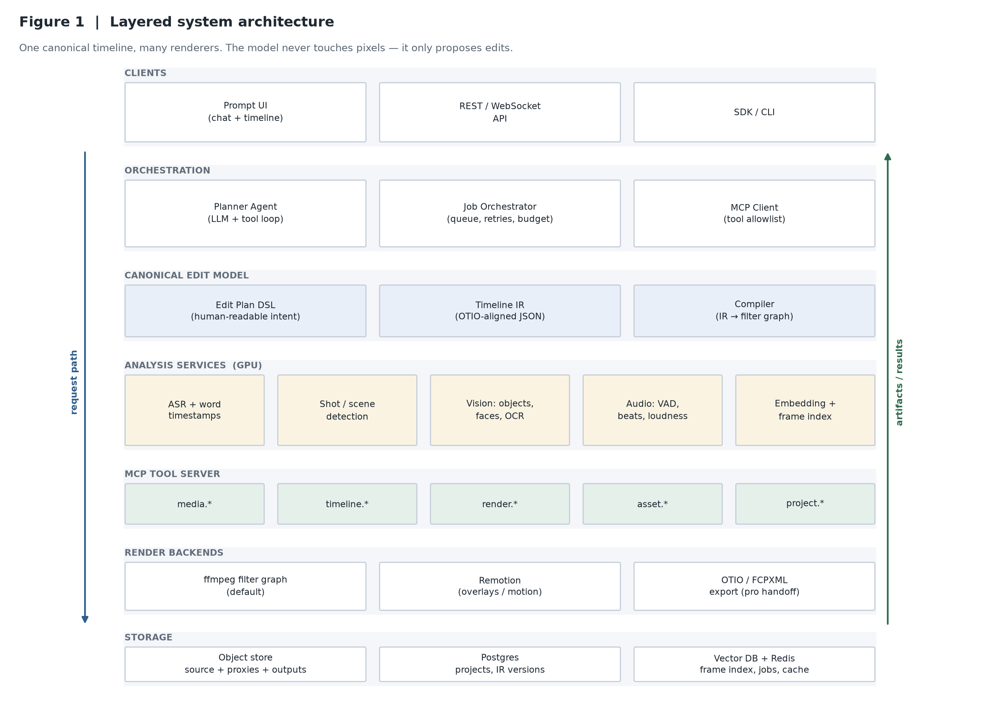
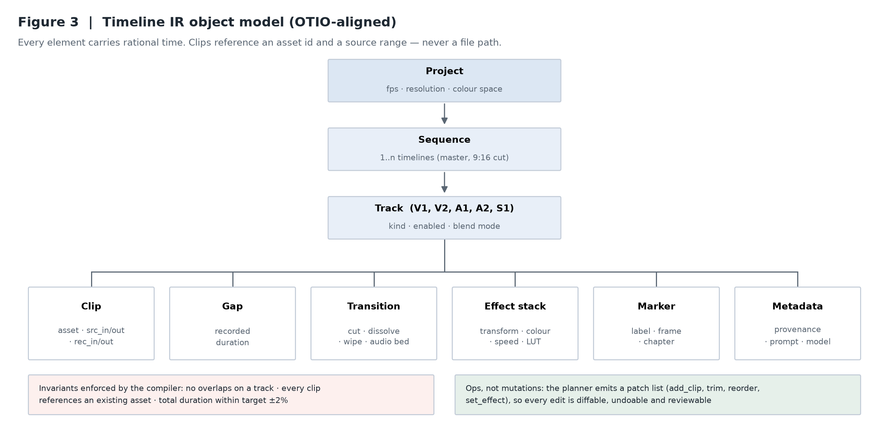
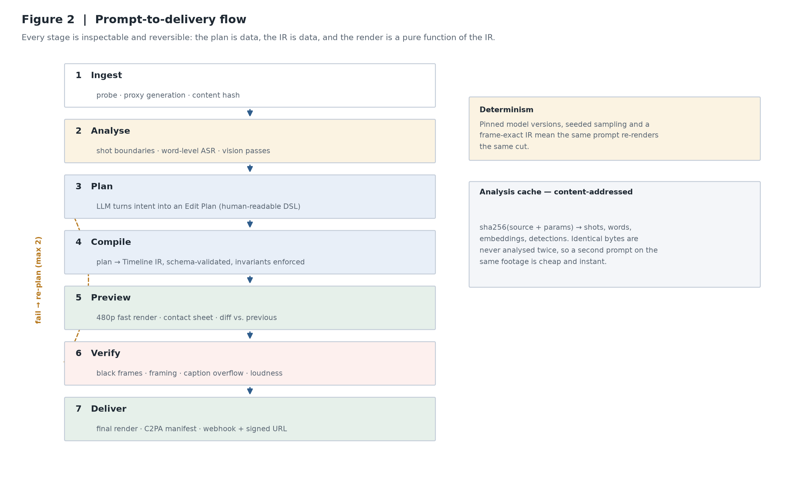

SYSTEM ARCHITECTURE & DESIGN  ·  VERSION 2.17

Prompt-Driven AI Video Editor

The second judge has exactly one thing only it can see, and the gate now needs both judges because of it.

| Document | Technical design specification, v2.17 (supersedes v2.16) |
|---|---|
| Status | P0-ready on contracts; performance figures remain targets |
| Change basis | Twenty-seventh technical review — 6 findings resolved (§0) |
| Verified in build | 91 figures, 365 tests including a slideshow that passes every threshold and is refused by the gate |
| IR version | timeline/1.9 — unchanged, because nothing in this version breaks the schema |
| Date | 22 November 2026 |

# Contents

- 0   What changed in this version
- 1   Executive summary
- 2   Requirements
- 3   Engine decision
- 4   System architecture
- 5   Time and frame model
- 6   The Timeline IR, version 1.9
- 7   Prompt to plan
- 8   Identity and constraint resolution
- 9   The MCP tool layer
- 10  Vision and media analysis
- 11  The render engine
- 12  Performance, hardware and 4K60
- 13  Data model and database design
- 14  Multi-tenancy and isolation
- 15  API contracts
- 16  Security and privacy
- 17  Observability and operations
- 18  Recovery, retries and cancellation
- 19  Testing and evaluation
- 20  Cost model
- 21  Roadmap
- 22  Risks and open questions

A   Appendix A — worked end-to-end example

B   Appendix B — MCP tool schemas

C   Appendix C — glossary

# 0  What changed in this version

v2.17 closes the six findings that v2.16 left open. The sixth said the labelled set contained no plan that only the shape judge could catch, and the honest way to close it was to decide the judgement the finding asked for: is a film that passes every threshold and divides its body evenly a bad film?

It is. Fifteen identical shots are a slideshow, and the threshold judge accepts them because every threshold is met — the hook is short enough, the total is right, there are enough cuts, and the mean shot length is fine. The shape judge rejects them because the spread is zero. That single plan is the shape judge's entire unique domain, and it is enough to make the gate require both judges rather than either.

The measurement changed with it. The rubric alone now orders 21 of 22 pairs and accepts one plan a viewer would reject; the coverage report says the shape judge catches one plan the threshold judge misses and five the other way. Two judges with different blind spots, used together, and a number for what each contributes — which is the first time this repository has had that.

Alongside the version, `PADDING-AUDIT.md` measures what twenty-seven versions actually changed. The last seven each added between four and eleven net lines to a 2,770-line specification, and four of them were the same activity at larger scale. The audit says so in the repository's own voice, because a project that cannot measure its own padding will keep producing it.

Table 0  |  Twenty-seventh-review findings and their resolution

| Finding | What was wrong | Resolution in v2.17 |
|---|---|---|
| The capacity model is unmeasured | §12's figures are targets. | Unchanged and stated. A GPU is a purchase. |
| Three GPU signals remained unemitted | They need a worker with a GPU. | Unchanged and stated. |
| No model has produced a plan | The seam and the scoring exist; no model has run. | Unchanged. |
| The identity corpus has no data | Procurement. | Unchanged, and stated. |
| The blind judge still has one author | The expectations and the rubric were written by the same person. | Unchanged: `compare_expectation_lists()` is the harness, and the second author is still missing. |
| No labelled plan the shape judge alone catches | v2.16 measured zero unique catches and concluded the judge added nothing. | The judgement was made rather than deferred: fifteen identical shots are a slideshow, they pass every threshold, and the shape judge rejects them. That is its unique domain, and the gate now requires both judges. |

# 1  Executive summary

This specification describes an AI video editor in which a user states an intent and the system produces a finished, frame-accurate video. The engineering problem is not calling a language model. It is making a model's output land on exact frames, deterministically, on media it has never seen, without the model ever touching a pixel.

Six decisions carry the architecture, and twenty-seven reviews have endorsed them. v2.17 changes none of them and does not change the IR: it makes the one judgement that gives the second judge a domain, and it measures the project's own padding.

A canonical timeline IR. The model never emits video. It emits a declarative edit description with rational time, which a compiler turns into a render.

Three-stage separation: plan, compile, render. Each stage is independently testable and independently editable.

Tools over free text. The model selects among frame-accurate candidate identifiers; it never writes a timestamp from memory.

Analysis is cached and content-addressed, per tenant. Computed once per unique byte, reused forever.

The IR is independent of everything downstream. It knows nothing of the language model, ffmpeg or Remotion. That independence is why 4K60 support is a capacity problem rather than a rewrite (§12.10).

**One conform map, and one owner for time.** Every frame belongs to exactly one of three domains, and exactly one function converts between them. v1.4 makes that function a stored, versioned artefact per asset rather than an assumption spread across the compiler. It is the smallest change in this document and it removes the largest class of bug.

The render engine is a Python core compiling the IR into an ffmpeg filter graph, with Remotion for motion-graphics overlays and OTIO/FCPXML for professional handoff.

On 4K60: the architecture renders it, and nothing structural changes. 4K60 is encode-bound, an L4 is estimated at roughly 2.8 concurrent realtime streams after a 65% pipeline allowance, and the T4 cannot sustain realtime under that workload — it can encode 4K60 output, just not keep up. Those are estimates, not vendor figures, and §12.3 labels each one. The production strategy that makes 4K60 affordable is to edit on a proxy and conform at UHD only on export.

# 2  Requirements

Each requirement has a test. Anything absent is out of scope, and saying so is part of the specification.

## 2.1  Functional requirements

Table 1  |  Functional requirements

| ID | Requirement | Acceptance test | Phase |
|---|---|---|---|
| FR-1 | Ingest mixed codecs, frame rates, resolutions, rotation and dynamic range; preserve the original bit-exact. | Ten heterogeneous clips ingest; original checksum unchanged; 4K60 HEVC Main10 accepted. | P0 |
| FR-2 | Convert a natural-language prompt into an edit that renders without manual intervention. | 80% usable first attempt, 95% after one repair, on the §19 corpus. | P1 |
| FR-3 | Select moments semantically rather than by timestamp. | Correct shot in the top 3 candidates on a labelled set. | P1 |
| FR-4 | Frame-accurate cuts, trims, reorders, speed changes, transitions and multi-track composites, at any rate up to 60 fps and any resolution up to UHD. | Output matches the IR frame-for-frame; 4K60 and mixed-rate fixtures in CI. | P0 |
| FR-5 | Captions with word-level timing and per-language styling, rasterised at output resolution. | Word timing within ±1 frame; no cue exceeds its line budget; crisp at 4K. | P2 |
| FR-6 | Derive 16:9, 9:16, 1:1 and 4:5 outputs from one edit. | Subject stays inside the safe box in every output. | P2 |
| FR-7 | Fast low-resolution preview before committing to a full render. | Preview of a 3-minute timeline under 15 s on reference hardware (§12.9). | P0 |
| FR-8 | Every capability exposed as a typed tool callable by an external agent. | An external MCP client completes a full edit using only the published surface. | P3 |
| FR-9a | The timeline is correctable without discarding prompt context, through the API. | A hand-applied ops batch persists across re-plan and re-render. | P0 |
| FR-9b | The same correction is available through a visual timeline UI. | A user drags a boundary; the preview updates; the revision is recorded. | P3 |
| FR-10 | Export the timeline to a professional NLE. | OTIO export opens in Resolve with correct in/out points and track structure. | P3 |
| FR-11 | Preserve originals; never transcode destructively or delete implicitly. | Originals remain byte-identical and retrievable for the retention period. | P0 |
| FR-12 | Isolate tenants at the data layer, from the first commit. | Cross-tenant probe suite cannot read, write or enumerate any foreign row, object or cache entry. | P0 |
| FR-13 | Resolve a person-identity constraint, and never silently ignore a hard constraint. | Constraint resolves to a filter, or the job holds; never proceeds degraded without explicit acceptance. | P2 |
| FR-14 | Support 3840×2160 at 60 fps end to end, including 10-bit HDR sources. | 4K60 fixtures render frame- and PCM-identically; HDR passes through or tone-maps correctly. | P0 (SDR) / P2 (HDR) |
| FR-15 | A fresh database is buildable from the migration set alone. | Migration applies to an empty PostgreSQL instance with no manual steps; CI asserts it. | P0 |
| FR-16 | Never lose or duplicate a frame at a domain boundary. Every native range resolves to exactly one conformed range and back within a stated tolerance. | Round-trip property test over 10,000 random (rate, range) pairs; conform delta never exceeds one frame per clip; Appendix A's five clips at four rates match their record durations exactly. | P0 |
| FR-17 | Honour a deletion request across every derived artefact, cache entry, index entry and delivered render. | An erasure removes derivatives and cache entries, clears index entries and quarantines dependent renders within the stated deadline, and is recorded in the erasure log. | P2 |

## 2.2  Non-functional targets

Table 2  |  Non-functional targets and status

| Dimension | Target | Status |
|---|---|---|
| Preview latency | < 15 s for a 3-minute timeline | Target — unvalidated |
| Final render (1080p30) | ≥ 1.5× realtime with transitions and captions | Target — unvalidated |
| Final render (4K60) | ≥ 1.0× realtime per stream; ≈2.8 streams per L4 | Derived target — §12.3, benchmark required |
| Plan latency | < 8 s median for 10–30 tool calls | Target |
| Edit success rate | ≥ 80% first attempt, ≥ 95% after one repair | Target — §19 corpus |
| Frame accuracy | 100% of cuts land on the requested frame, at any rate | Invariant — enforced by tests |
| Conform fidelity | Conform delta ≤ 1 frame per clip; 0 when source and project rates match | Invariant — FR-16 property test |
| Compiler determinism | Identical IR, assets and manifest → bit-identical raw frames at the graph sink | Invariant — asserted in CI (§11.6) |
| Delivered-byte reproducibility | Same IR + manifest + GPU/driver → identical bytes; cross-GPU bit-identity is not promised | Invariant — asserted in CI, same hardware (§11.6) |
| Identity matching | False positive ≤ 1%, false negative ≤ 2% | Target — §8.6 |
| Cost per prompt | Recurring planning cost ≈ 10–15 US cents | Estimate — §20 |

## 2.3  Non-goals for v1

Generative video synthesis. The system assembles existing footage.

Speed ramps and time-remapping curves. The field is reserved (§5.6); constant factors only.

8K. Not forbidden by the IR, but the capacity model stops at UHD.

Bit-identical output across different GPU models or driver versions. Same-hardware determinism only (§11.6).

# 3  Engine decision

Table 3  |  Render engine options

| Option | Strengths | Where it breaks | Verdict |
|---|---|---|---|
| ffmpeg filter graph, driven by a compiler | Frame-exact, fast, wide filter coverage, hardware encode | Steep learning curve; complex graphs hard to debug | Default renderer |
| MoviePy / Python compositing | Easy to prototype | Re-encodes per operation, memory-heavy | Prototyping only |
| Remotion (React → video) | Best-in-class motion graphics; deterministic | Per-frame React render is impractical at 4K60 for anything long | Overlay renderer only |
| NLE-native (OTIO / FCPXML / AAF) | Perfect fidelity | Requires an NLE in the loop; lossy for custom effects | Export target only |
| Managed cloud render API | No infrastructure | Per-minute pricing, limited control, lock-in | Burst capacity |

# 4  System architecture



Figure 1  |  Layered architecture. The request path descends through orchestration and tools to the renderer; artefacts flow back up.

Table 4  |  Component responsibilities and boundaries

| Component | Responsibility | Must not |
|---|---|---|
| Prompt UI | Capture intent, show plan and timeline, allow correction | Talk to the renderer directly |
| API gateway | Auth, rate limits, signed URLs, idempotency | Hold long-lived render state |
| Planner agent | Intent + manifest → Edit Plan → ops | Touch media or write free-form timestamps |
| Job orchestrator | Queue, retries, budgets, cancellation, webhooks | Interpret edit semantics |
| MCP tool server | Typed, validated operations | Allow shell, path or network access |
| Analysis workers | Shots, ASR, embeddings, detection, audio features | Mutate the timeline |
| Compiler | Validate the IR, resolve assets, emit a filter graph | Call a language model |
| Render workers | Execute the graph, verify output, publish artefacts | Decide what the edit should be |
| Storage | Object store, Postgres, vector index | Be the only copy of anything user-visible |

# 5  Time and frame model

The most load-bearing section. Every frame-accuracy bug originates in a decision described here.

## 5.1  Exact arithmetic and the wire format

All rates are rationals, never floating point. A project at 29.97 fps stores fps = 30000/1001. A rate is never written as 29.97 in code, storage or the IR, because 29.97 is a rounding of a frame rate, not a frame rate.

v1.2 required arbitrary-precision integers internally. That introduced a new problem the review caught: native BigInt cannot pass through JSON.stringify, and JSON.parse hands back a double. Internal exactness is worthless if the boundary silently degrades it. v1.3 therefore defines the wire format explicitly, so no developer has to decide.

Rates are decimal strings. num and den are quoted integers in JSON, parsed into BigInt on entry and serialised as strings on exit. A schema that accepts a bare number for a rate is invalid.

Frame indices are JSON integers. They are parsed as numbers and asserted to be ≤ 2^53−1 (9,007,199,254,740,991), which at 60 fps is about 4.7 million years of timeline. Any value beyond that is rejected at parse rather than silently losing precision.

Sample counts are JSON integers. Same bound, same assertion.

No arithmetic at the boundary. Parsing converts representation; it never computes. All computation happens inside the exact type.

Listing 1  |  The canonical wire format and its parse contract.

```
// on the wire
{ "fps": { "num": "30000", "den": "1001" },
  "record": { "in": 0, "out": 311 } }

// parse: strings -> BigInt, numbers -> BigInt after a range check
parseRational(s: {num: string, den: string}): Rational
parseFrame(x: number): bigint        // throws if !Number.isSafeInteger(x)

// serialise: BigInt -> decimal string (rates), -> number (frames, range-checked)
// forbidden: JSON.stringify on a Rational; Number() on a rate
```

Listing 2  |  The single conversion surface.

```
type Rational = { num: bigint; den: bigint };   // reduced, den > 0

framesAt(rate: Rational, seconds: Rational): bigint
secondsAt(rate: Rational, frame: bigint): Rational
samplesAt(rate: Rational, frame: bigint, hz: 48000n): bigint
```

## 5.2  Half-open intervals

Every range is half-open: [in, out). Duration is out − in, so an empty range is not expressible and the classic off-by-one cannot be written. The validator rejects out ≤ in.

Listing 3  |  Consequences the compiler relies on.

```
duration(item) = item.record.out - item.record.in
adjacent(a, b) = a.record.out === b.record.in
lastFrame(seq) = render_duration_frames - 1    // seeking only
```

## 5.3  Three frame domains

Table 5  |  Frame domains

| Domain | Rate | Used for | Stored where |
|---|---|---|---|
| Native source frames | The asset's own rate | Referring to a moment in the original file | IR source.in/out with source.rate |
| Conformed frames | Project rate, after ingest | What analysis and the renderer decode | Derivative metadata + pts_map |
| Project record frames | Project rate | Positions on the sequence timeline | IR record.in/out |

## 5.4  Variable frame rate

Detection at probe compares r_frame_rate against avg_frame_rate and inspects packet PTS deltas; a spread beyond 1% of the nominal interval marks the asset VFR. VFR sources are conformed to constant rate at ingest and a pts_map sidecar — (conformed_frame, source_pts, source_duration) — keeps every conformed frame resolvable back to an original timestamp.

## 5.5  Audio: samples, rounding, and what the invariant actually asserts

Audio is not frame-quantised. It runs at 48,000 samples per second and stores in_sample/out_sample. Record positions stay in project frames so A/V alignment is defined once.

The conversion is a rounding, and v1.2 was wrong to call it exact. A sequence of 1349 frames at 30000/1001 is 45.011633 s, and 1349 × 48000 × 1001/30000 = 2160558.4 samples, which rounds to 2,160,558. The sample count is therefore the correctly rounded value under a stated policy, not a mathematical identity, and the specification now says so everywhere.

Rounding policy. Round half away from zero, applied once, at the boundary. Never accumulate.

Absolute conversion. Every boundary converts from its absolute frame index: sample(frame) = round(frame × 48000 × den / num). Segment sample ranges are differences of absolute conversions, so rounding error cannot accumulate across a split.

The invariant also needed restating. v1.2 compared the audio sample total with the frame-derived duration, which is wrong once tracks run in parallel: two overlapping audio tracks legitimately contain more source samples than the output has. What must match is the final mixed bus.

Listing 4  |  The corrected audio invariants.

```
// 1. the mixed output bus, not the sum of source clips
mixed_bus_samples == samplesAt(project.fps, render_duration_frames)

// 2. every segment boundary derives from an absolute conversion
segment[i].in_sample  == samplesAt(fps, segment[i].record_in)
segment[i].out_sample == samplesAt(fps, segment[i].record_out)

// 3. chunked and single-pass are compared by decoded PCM, not by count alone
pcm_hash(chunked) == pcm_hash(single_pass)

// a 1-sample mismatch is a hard failure
```

## 5.6  Speed changes across different frame rates

Source consumption is not round(R × s). A record duration of R frames spans R/fps_project seconds; at speed s that consumes R/fps_project × s seconds of source, which is (R × s × fps_source)/fps_project source frames.

Listing 5  |  The rule, in exact rational arithmetic.

```
S = R * s * (fps_source / fps_project)     // exact, then round half away
// VFR sources: map the record range through pts_map instead of multiplying
```

Table 6  |  Worked conversions. Row one is a 25 fps clip on a 29.97 timeline.

| Record frames | Speed | Source fps | Project fps | Source frames |
|---|---|---|---|---|
| 300 | 1 | 25 | 30000/1001 | 250 |
| 300 | 1 | 30000/1001 | 30000/1001 | 300 |
| 300 | 2 | 25 | 30000/1001 | 501 |
| 300 | 1/2 | 60000/1001 | 30000/1001 | 300 |
| 300 | 1 | 60 | 60000/1001 | 300 |

## 5.7  Transitions

Model. A transition of T frames overlaps two clips and consumes T frames of record time: track total = sum(clip durations) − sum(transition frames).

No cut type. A cut has zero duration, so it is the absence of a transition entry, not a transition with frames = 0. The enum is dissolve, wipe, fade, each with frames ≥ 1.

Alignment. align: center (default) centres the overlap; the perceptual cut is the middle of the overlap, and that is what beat alignment snaps to.

Bounds and handles. T ≤ min(duration(A), duration(B)); a centred dissolve needs T/2 frames of handle on each side. If the handle is missing the compiler shortens the transition and records a warning rather than reading past the asset.

**The handle is measured in record frames, and the source requirement follows from the speed.** v1.4 left this open and it is the kind of gap that passes a validator: a clip can have six frames of handle in source space and need twelve, because at 2× speed six record frames consume twelve source frames. The compiler derives the source requirement through the same transform §5.10 uses, never by comparing T/2 to a source duration.

Listing 6  |  The handle rule, with the case that breaks a naive check.

```
handleRecord = T / 2                       // record frames, rounded up
handleSource = handleRecord * s            // conformed source frames
handleNative = handleSource * fps_src / fps_proj   // for the authoring bound

// T = 12 centred dissolve, same-rate source:
//   s = 1    -> 6 record -> 6 source frames
//   s = 2    -> 6 record -> 12 source frames   <- a clip with 6 is short
//   s = 1/2  -> 6 record -> 3 source frames    <- slack the naive check would miss
// short by any amount: shorten T until it fits, warn, never read past the asset
```

**Audio follows the same rule in the samples domain, and the naive form is one sample wrong.** An acrossfade consumes audio from both sides of the cut, so a record handle of T/2 frames is samplesFor(T/2) samples of each clip's audio — and at 2× the source audio required is twice that. The conversion must happen once, at the source boundary:

Listing 7  |  The audio handle, and the arithmetic that makes the obvious version wrong.

```
audioHandleRecord  = T / 2                     // record frames
audioHandleSamples = samplesFor(audioHandleRecord)        // what the output consumes
sourceSamples      = samplesFor(audioHandleRecord * s)    // what the source must hold

// T = 12, s = 2, 30000/1001:
//   samplesFor(6)        = 9,610
//   2 x 9,610            = 19,220   <- rounds twice, one sample too many
//   samplesFor(6 x 2)    = samplesFor(12) = 19,219   <- correct
```

The one-sample difference is the whole point. A compiler that doubles a rounded half-handle asks the source for a sample it does not have, and the failure appears at the end of a clip as a truncated fade rather than as an error. §5.9.3 makes the same argument for pictures; this is the audio instance of it.

## 5.8  Originals are preserved

The uploaded original is written once, checksummed with SHA-256, and never modified or re-encoded in place.

Proxies, preview proxies, conforms and analysis artefacts are derivatives, safe to regenerate or delete.

Deletion is explicit and cascades to derivatives. Nothing removes an original implicitly.

## 5.9  The conform map

This is the section the fourth review asked for, and the only structurally new part of the time model.

A **conform map** is a total, monotone function from a native frame index to a conformed frame index for one asset against one project rate. It is produced at ingest, stored as a versioned artefact beside the derivative, and named on the asset row. Every consumer of source time reads it; none recomputes it.

Listing 8  |  The interface. Two implementations, one contract.

```
ConformMap {
  toConformed(nativeFrame: bigint): bigint      // monotone, total on [0, nativeDuration]
  toNative(conformedFrame: bigint): Rational    // exact, may be fractional
  kind: "affine" | "table"
  version: string                               // algorithm version, part of the cache key
}

// affine implementation, constant-rate source
toConformed(n) = round(n * fps_proj / fps_src)  // exact rational, round half away
toNative(c)    = c * fps_src / fps_proj         // rational, never rounded

// table implementation, VFR source
toConformed(n) = index of the first conformed frame whose source_pts >= pts(n)
toNative(c)    = source_pts of conformed frame c, as a rational
```

Three properties are required and tested rather than assumed.

**Monotone.** toConformed is non-decreasing. A map that steps backwards reorders frames inside a clip, and the property test in §19 fails the build on any violation.

**Total at the boundary.** toConformed is defined on the closed interval [0, nativeDuration], not the half-open one. The endpoint is what bounds checks need, and defining it only on [0, nativeDuration) is how an off-by-one becomes a read past the end of an asset.

**Invertible within one frame.** |toConformed(toNative(c)) − c| ≤ 1 for every conformed frame c. The map is not a bijection — conforming 250 native frames to 300 conformed frames duplicates content by design — and pretending otherwise produces a validator that rejects legal media.

### 5.9.1  The worked case

Take the reviewer's own example, because it is the one that breaks.

Table 7  |  Ten seconds seen in three domains

| Quantity | Native (25 fps) | Conformed (30000/1001) | Record |
|---|---|---|---|
| A ten-second span | 250 frames | 300 frames | 300 frames |
| Duration, exactly | 10.000 s | 10.010 s | 10.010 s |
| Error against 10 s | 0 ms | +10.0 ms | +10.0 ms |

A 25 fps clip and a 29.97 timeline do not share a frame grid, and no arrangement of them does. Conforming 250 native frames yields 299.70 conformed frames, which rounds to 300, and 300 conformed frames are 10.010 s rather than 10.000 s. The asset is therefore 10 ms longer after conforming than before, and that is correct behaviour: the alternatives are resampling the audio or dropping a frame mid-shot.

What must not happen is for the system to be surprised by it. The difference is recorded.

Listing 9  |  Conform delta, recorded per asset and surfaced per clip.

```
conform_delta(asset) = conformedDuration - toConformed(nativeDuration)

// |conform_delta| <= 1 frame for any constant-rate source
// a non-zero delta is normal for mixed rates and is NOT an error
// it is an error only when it is silent: the validator warns,
// and the job report states the total drift in milliseconds
```

### 5.9.2  What the compiler consumes

The compiler never sees a native frame. It resolves each clip's native source range through the map once, at compile time, and emits trim and setpts against conformed indices.

Listing 10  |  Resolution order, applied to every clip before any filter is emitted.

```
1. source range in native frames      c.source = {in, out, rate: fps_src}
2. authoring bound                    out <= nativeDuration
3. resolve through the conform map    cIn  = map.toConformed(in)
                                      cOut = map.toConformed(out)
4. rendering bound                    cOut <= conformedDuration
5. hand cIn..cOut to the graph        every filter downstream is conformed
```

Step 4 is the check v1.3 could not perform, because it had no conformed index to compare against. It catches the case where a native range is legal but its conformed image is not — which happens whenever an asset is re-conformed at a different project rate, and is the exact scenario in which a user reopens a 29.97 project as 25.

### 5.9.3  Why speed is not computed in native space

The tempting repair is to take §5.6's 501 native frames and conform them: 501 × 30000/25025 = 600.60, which rounds to 601. The correct answer is 600. The error comes from rounding twice, once in each domain, and it is exactly one frame — the size of error the whole document exists to prevent.

The resolution is to name the two quantities and never let one stand in for the other.

Listing 11  |  One rounding, in the domain that renders.

```
// (a) native projection: what the original file loses. Reporting and bounds only.
S_native = round(R * s * fps_src / fps_proj)     = 501 for R=300, s=2, 25 -> 29.97

// (b) conformed consumption: what the renderer decodes. Exact, rounded once.
C = R * s                                        = 600 exactly

// C needs no rate term, because the derivative and the timeline share a rate.
// That is the whole point of conforming at ingest. The round() in (b) is a
// no-op for integer s and R, and is applied once for rational s.
```

The rule that follows is short enough to hold in mind: **speed multiplies record frames; the conform map translates native frames; the two never compose.** A compiler that multiplies by a rate ratio twice has reintroduced the v1.0 bug with more steps.

Table 8  |  The two figures side by side

| Case | Record R | Speed s | S_native (reporting) | C (decoded) |
|---|---|---|---|---|
| 25 fps source, 29.97 project | 300 | 1 | 250 | 300 |
| 25 fps source, 29.97 project | 300 | 2 | 501 | 600 |
| 59.94 source, 29.97 project | 300 | 1 | 600 | 300 |
| Same rate | 300 | 3/2 | 450 | 450 |

Row three makes the distinction obvious: a 59.94 source on a 29.97 timeline is half as long in seconds, so 300 record frames consume 600 native frames and 300 conformed ones. Quoting 600 to the renderer would render a clip twice its intended length.


### 5.9.4  The VFR map, worked

The affine implementation has an algebraic inverse, so its properties can be reasoned about. The table implementation cannot: its monotonicity depends on ingest having sorted the packet timestamps, and its inverse is a lookup rather than a division. v1.4 specified it and never exercised it, which is the defect this subsection closes.

Take a screen recording with a nominal 30 fps and one dropped frame. Six native frames arrive at these presentation timestamps, in microseconds:

Table 9  |  A six-frame VFR excerpt through the table map

| Native frame | PTS (µs) | Seconds | × 30000/1001 | Conformed frame |
|---|---|---|---|---|
| f0 | 0 | 0.000000 | 0.00 | 0 |
| f1 | 33333 | 0.033333 | 1.00 | 1 |
| f2 | 66667 | 0.066667 | 2.00 | 2 |
| f3 | 133333 | 0.133333 | 4.00 | 4 |
| f4 | 166667 | 0.166667 | 5.00 | 5 |
| f5 | 200000 | 0.200000 | 6.00 | 6 |

Two things are visible in that table and neither is visible in the affine case.

**The map is strictly increasing here, but only non-decreasing in general, and its image skips an index.** Conformed frame 3 is unvisited: the conformer fills it by repeating native frame f2, which is what a constant-rate output from a variable-rate input requires. Two packets sharing a timestamp — which real encoders do emit — would make two native frames map to the same conformed frame, so the property that must hold is non-decreasing, not strict increase. A validator that demands strict increase rejects legal media. The skipping is the separate fact: the map is injective but not surjective, and the skipped indices are recorded in the asset report so the repetition is visible rather than assumed.

**A VFR source without packet timestamps is refused, not approximated.** v2.8's ingest emitted an affine map for every source, which over variable-rate media places every frame after the first irregularity in the wrong position and reports success. The map builder now returns a table when it has timestamps and raises when it does not; an affine map is only ever produced for a constant-rate source, where it is true.


**The delta is one frame, and it is the drop that causes it.** Six native frames span 200 ms of presentation plus one nominal interval, 233.333 ms, which is 6.99 conformed frames and rounds to 7. So the asset is one frame longer after conforming than before — the same class of drift as §5.9.1's +10 ms, produced by a different mechanism and handled by the same field.

Listing 12  |  What the tests assert for a table-backed map.

```
// monotonicity:      toConformed(n+1) >= toConformed(n)  for every n
// totality:          defined on the closed interval [0, nativeDuration]
// invertibility:     |toConformed(toNative(c)) - c| <= 1  for every conformed c
//                    (frame 3 -> native f2 -> conformed 2, so the bound is 1)
// determinism:       two ingests of the same bytes produce the same table
// recorded:          skipped conformed indices are listed in the asset report

// the corpus fixture: a 60 s phone screen recording with a PTS spread
// beyond 1% of nominal, plus one stream with reordered packets
```

The reordered-packet fixture is the one that matters. Ingest sorts by PTS before building the table, so a stream whose packets arrive out of order produces the same table as the same stream in order — and if it does not, the sort is the bug rather than the map.

Both fixtures are generated rather than captured, by `tests/vfr_fixture.py`: a nominal-30 fps stream with dropped frames and sub-millisecond jitter, plus a reordered delivery of the same packets. A captured screen recording is not reproducible in CI; a seeded generator is, so a failing assertion has a fixed example to point at.


### 5.9.5  The table map under speed

§5.9.4 proves the table map on a clip at rest, and §5.10 divides by speed. For an affine map those compose cleanly, because dividing by speed is a uniform stretch. For a table map they do not, and v1.5 left the order unstated — which matters, because the two orders give different source frames for the same record frame.

The order is fixed: **record frame, then divide by speed, then the conformed frame, then the table lookup, then the source timestamp.** Speed is applied in the conformed domain, which is where §5.9.3 already put it, and the table is consulted last because it is the only thing that knows the irregular spacing.

Listing 13  |  The walk, for a clip whose source starts at conformed frame 0.

```
conformed(r)  = conform_map.toConformed(clip.source.in) + r * s
native(r)     = last native frame whose toConformed is <= conformed(r)

// s = 2 on the §5.9.4 excerpt, whose conformed images are
//   f0->0  f1->1  f2->2  f3->4  f4->5  f5->6
```

Table 10  |  Four record frames at 2× through the excerpt

| Record frame | Conformed frame | Native frame visited | Source PTS (µs) |
|---|---|---|---|
| 0 | 0 | f0 | 0 |
| 1 | 2 | f2 | 66667 |
| 2 | 4 | f3 | 133333 |
| 3 | 6 | f5 | 200000 |

Two native frames are skipped, and they are not the ones a uniform walk would skip. A walker that assumed every second native frame would visit f0, f2, f4 — but f4's conformed image is 5, which the record grid never lands on, so f4 is skipped and f3 is taken instead. The irregularity of the source is exactly what the table exists to carry, and applying speed before the lookup is what preserves it.

The alternative order — look up first, then divide — walks native frames on an even stride and lands on source timestamps that the conform map never produced. It is wrong for the same reason §5.9.3's double rounding is wrong: it applies a uniform transform to a quantity that is not uniform.

## 5.10  Captions, markers and every other timed annotation

A caption cue, a marker, a chapter point and a ducking envelope are all time annotations, and all of them arrive in source time. v1.3 specified caption rasterisation in detail and never said how a word's timestamp becomes a record frame, which left the drift for the implementer to discover.

One affine map per clip serves all of them.

Listing 14  |  The source-to-record transform, derived from the conform map.

```
recordFrame(nativeFrame) =
    clip.record.in + (map.toConformed(nativeFrame) - map.toConformed(clip.source.in))
                     / speed

// properties the tests assert:
// recordFrame(clip.source.in)  == clip.record.in
// recordFrame(clip.source.out) == clip.record.out
// recordFrame is monotone across every clip on the track
```

Three consequences, stated once so they are not rediscovered.

Caption cues are stored in **record time** in the IR, not source time. A cue that spans a cut is split into one cue per clip, because a caption that survives a cut is a rendering question rather than a data question.

A marker attached to a source moment moves with its clip. A marker attached to the sequence does not. The IR distinguishes the two by which node owns the marker.

Beat snapping operates in record time, so a tempo map derived from a music asset needs no conform map of its own: the music asset has one, and the beat grid is projected through it like any other annotation.

**The grid scales with the speed, and v1.4 did not say so.** Projecting a tempo map through the conform map fixes where each beat lands; it does not fix how far apart they are. A 124 BPM track played at 1.05× is 130.2 BPM, and the interval between beats shrinks from 14.5016 record frames to 13.8111. A compiler that projects positions but keeps the source interval snaps every cut after the first beat to the wrong place, and the error compounds.

The rule is one sentence: a tempo map is stored in source time and projected through the full transform of §5.10, which divides by speed — so positions and intervals scale together, because they are the same arithmetic applied to two different numbers. The tolerance does not scale: it is authored in milliseconds against the record timeline (§5.12), and a 120 ms tolerance stays 120 ms however fast the music plays.

The acceptance test is a property rather than a fixture. For every word in a transcript, the record frame computed by this transform must equal the frame at which the rendered caption becomes visible, within one frame. §19 makes it a gate.

## 5.11  Speed applies to sound too

The `speed` field changes the duration of a picture and says nothing about its audio. There are three defensible answers and they produce three different products.

Table 11  |  Speed modes and what each does to sound

| Mode | Picture | Sound | Use |
|---|---|---|---|
| atempo (default) | R frames at speed s | Same duration as picture, pitch preserved, samples = samplesFor(R) | Any editorial speed change |
| resample | R frames at speed s | Pitch shifted with the rate | Deliberate effect only |
| mute | R frames at speed s | Absent | B-roll under a music bed |

The IR carries the choice explicitly: required when speed ≠ 1, forbidden when speed = 1, so an IR cannot be ambiguous about it.

Listing 15  |  The field, and the arithmetic the compiler must satisfy.

```
"speed": { "num": "2", "den": "1", "audio": "atempo" }

// audio invariant, asserted at compile time:
// source samples consumed = samplesFor(C)   where C = R * s
// record samples emitted  = samplesFor(R)
// for s = 2, R = 300 at 30000/1001:  960,960 in, 480,480 out
```

atempo is valid only in the range 0.5 to 2.0, so a speed outside it compiles as a cascade. The cascade is generated from the exact rational with the residual tracked after each stage, so the last stage is not rounded from an already-rounded product. Speed zero, negative speed and speed beyond 16× are rejected — past that point the audio is unintelligible and the honest answer is a different edit rather than a longer filter chain. Neither term of the ratio exceeds 16. That bound is now in the schema as a pattern (§6.4) as well as in the validator, because a schema that can say something should say it.

**16× is supported, and it is four stages.** v1.7's prose implied 16 was the edge of usable while the schema admitted it, which left a reader unable to tell whether the value was a limit or a mistake. It is a limit: 16 = 2.0 × 2.0 × 2.0 × 2.0, four atempo passes, and the audio at that speed is unintelligible — which is the user's decision to make, not the engine's to refuse. The cascade is therefore bounded at four stages for any legal speed, and a test asserts both the count and that no stage falls outside 0.5–2.0.

**“Tracked” was not a number, and 4× proves nothing.** A factor of four decomposes into 2.0 × 2.0 exactly, so the friendly example exercises no residual at all. Two things have to be specified: the precision at which a residual is passed to the filter, and what happens when the source sample count is not an integer.

Table 12  |  Two ratios that do not decompose, worked to the sample

| Speed | Cascade | Record frames R | Conformed C = R × s | Source samples | Output samples |
|---|---|---|---|---|---|
| 3.7× | 2.0 × 1.85 | 300 | 1110 | 1,777,776 | 480,480 |
| 1/3.7× | 0.5 × 0.540541 | 300 | 81 | 129,729.6 → 129,730 | 480,480 |

Row one is exact in both directions: 1,777,776 source samples against 480,480 output samples is a ratio of exactly 3.7, and no rounding is involved. Row two is the case that forces a policy — 81 conformed frames at 30000/1001 is 2.7027 s, which is 129,729.6 samples, and there is no integer to round to that preserves the ratio.

The policy is two rules. The source sample count is rounded half away from zero and the invariant is stated with a tolerance of one sample, because a rational speed does not in general land on a sample boundary and pretending otherwise produces a validator that rejects legal edits. And the residual passed to atempo carries seven decimal places: at six, the drift on a 45-second output is 2.16 samples, which breaks the one-sample invariant; at seven it is 0.216. The validator computes the predicted drift from the cascade before rendering and rejects an edit whose drift exceeds one sample, so the precision is enforced rather than hoped for.

## 5.12  Tolerances are not frames

`tolerance_frames: 4` appears in the Edit Plan and in the beat-snapping rules. Four frames is 133 ms at 29.97 and 67 ms at 59.94, so the same plan tolerates twice the sloppiness in a 30 fps project as in a 60 fps one. That is not a rounding nuisance; it changes what the user gets.

Every tolerance is therefore authored in milliseconds or in beats, and converted to frames exactly once at compile time.

Listing 16  |  The conversion, and the plan field it replaces.

```
// plan (v1.4)
pacing: cut_every: {min_ms: 3000, max_ms: 5000}, on_beat: true, tolerance_ms: 120

// compile
toleranceFrames = round(tolerance_ms * fps.num / (1000 * fps.den))   // exact
// 120 ms at 30000/1001 -> 4 frames
// 120 ms at 60000/1001 -> 7 frames

// a tolerance that rounds to 0 frames is rejected: it is an exact
// requirement expressed as an approximate one
```

The same rule governs the duration target (§7.2), the transition handle check (§5.7) and the identity grey band (§8.6). Frames are an output of the design, never an input to it.

# 6  The Timeline IR, version 1.4



Figure 2  |  Object model. Project holds sequences; sequences hold tracks; tracks hold items — clips, gaps, transitions, effects and markers.

## 6.1  Why an IR rather than generated code

Asking a model to write ffmpeg commands fails four ways: unverifiable until it runs, one wrong flag wastes a render, two attempts cannot be diffed, and nothing can be corrected by hand. An IR is small enough to validate, stable enough to diff, and deterministic enough that a compiler bug is an ordinary bug. It is aligned with OpenTimelineIO so professional export is a translation rather than a rewrite.

## 6.2  Three durations, not one

v1.2 defined sequence.duration as the maximum track endpoint and also required it to equal the primary video duration. Those rules disagree the moment a music bed outlasts the picture, which is normal. v1.3 separates the three quantities that were being conflated.

Table 13  |  The reviewer's example, resolved

| Track | Content | Track end |
|---|---|---|
| V1 | Primary video | 1,349 frames (45.0 s) |
| A1 | Music bed, trailing | 1,499 frames (50.0 s) |
| A2 | Dialogue | 1,349 frames |
| S1 | Subtitles | 1,349 frames |

Listing 17  |  Three quantities with three different jobs.

```
track_end_frames[t]        = max(item.record.out) on track t
content_duration_frames    = track_end_frames[primary_video_track]
render_duration_frames     = max(track_end_frames)   // when trailing audio is included
                           = content_duration_frames  // otherwise
include_trailing_audio     = render_duration_frames > content_duration_frames
                           // DERIVED, never stored: one decision, one field

// invariants
content_duration_frames == trackDuration(primary_video_track)     // hard failure
render_duration_frames  >= content_duration_frames                // hard failure
track_end_frames[t] > content_duration_frames  and t != primary
   -> not an error; surfaced to the user as 'trailing audio' with
      a one-click choice: include (render_duration = max) or trim

// v1.6: the duration is authoritative and the boolean is derived from it.
// Storing both was the v1.2 defect in miniature: two fields, one decision.

// in the reviewer's example: content = 1349, render = 1349 by default,
// and 1499 if the user elects to keep the music tail
```

This is the difference between a fade-out that works and one that silently adds five seconds of black to every export. The default is to trim to the picture, the trailing element is reported rather than hidden, and the choice is recorded on the sequence so it survives re-render.

## 6.3  Gaps and intentional silence

Gaps are first-class items with a record range and no asset, so a deliberate pause can be authored. The distinction that matters: a gap is intentional and accepted by the validator; a hole where no item exists is a defect and is reported with positions.

Listing 18  |  Items are a discriminated union.

```
{ "kind": "clip",  "id": "c1", "asset": "ast_a91", "source": {...}, "record": {...} },
{ "kind": "gap",   "id": "g1", "record": { "in": 311, "out": 335 } },
{ "kind": "title", "id": "t1", "text": "...", "record": {...} }
```

## 6.4  Schema

Listing 19  |  timeline/1.9, abridged only in the effect union.

```
{ "$schema": "https://json-schema.org/draft/2020-12/schema",
  "$id": "https://spec.example/timeline/1.9.json",
  "type": "object", "required": ["schema","project","sequence"],
  "additionalProperties": false,
  "properties": {
    "schema": { "const": "timeline/1.9" },
    "project": { "type": "object", "additionalProperties": false,
      "required": ["id","fps","resolution","color_space"],
      "properties": {
        "id": { "type": "string" },
        "fps": { "$ref": "#/$defs/rateString" },
        "resolution": { "type":"array","items":{"type":"integer","minimum":2},
                        "minItems":2,"maxItems":2 },
        "color_space": { "enum": ["rec709","rec2020-hlg","rec2020-pq"] } } },
    "sequence": { "type":"object","additionalProperties":false,
      "required": ["id","primary_video_track","content_duration_frames",
                   "render_duration_frames","tracks"],
      "properties": {
        "id": { "type": "string" },
        "primary_video_track": { "type": "string" },
        "content_duration_frames": { "$ref": "#/$defs/frameIndex" },
        "render_duration_frames":  { "$ref": "#/$defs/frameIndex" },
        "tracks": { "type":"array","items":{"$ref":"#/$defs/track"} } } } },
  "$defs": {
    "frameIndex": { "type": "integer", "minimum": 0,
                    "maximum": 9007199254740991 },
    "speedTerm": { "type": "object", "additionalProperties": false,
      "required": ["num"],
      "properties": { "num": { "type": "string", "pattern": "^([1-9]|1[0-6])$" } },
      "description": "§5.11: both terms of a speed ratio are bounded at 16. The bound is a pattern rather than a validator rule so a caller learns it from the contract." },
    "rateString": { "type": "object", "additionalProperties": false,
      "required": ["num","den"],
      "properties": { "num": { "type":"string","pattern":"^[1-9][0-9]*$" },
                      "den": { "type":"string","pattern":"^[1-9][0-9]*$" } } },
    "range": { "type":"object","additionalProperties":false,
      "required": ["in","out"],
      "properties": { "in": {"$ref":"#/$defs/frameIndex"},
                      "out":{"$ref":"#/$defs/frameIndex"} } },
    "track": { "type":"object","additionalProperties":false,
      "required": ["id","kind","items"],
      "properties": { "id":{"type":"string"},
        "kind":{"enum":["video","audio","subtitle","overlay"]},
        "enabled":{"type":"boolean","default":true},
        "items":{"type":"array","items":{"$ref":"#/$defs/item"}},
        "transitions":{"type":"array","items":{"$ref":"#/$defs/transition"}} } },
    "item": { "oneOf": [ {"$ref":"#/$defs/clip"}, {"$ref":"#/$defs/gap"},
                         {"$ref":"#/$defs/title"} ] },
    "gap": { "type":"object","additionalProperties":false,
      "required": ["kind","id","record"],
      "properties": { "kind":{"const":"gap"}, "id":{"type":"string"},
                      "record":{"$ref":"#/$defs/range"} } },
    "title": { "type":"object","additionalProperties":false,
      "required": ["kind","id","text","record"],
      "properties": { "kind":{"const":"title"}, "id":{"type":"string"},
                      "text":{"type":"string","maxLength":2000},
                      "style":{"type":"string"},
                      "record":{"$ref":"#/$defs/range"} } },
    "clip": { "type":"object","additionalProperties":false,
      "required": ["kind","id","asset","source","record"],
      "properties": { "kind":{"const":"clip"},
        "id":{"type":"string","pattern":"^[a-z0-9_]{1,32}$"},
        "asset":{"type":"string"},
        "source": { "oneOf": [
          { "type":"object","required":["in","out","rate"],
            "properties":{"in":{"$ref":"#/$defs/frameIndex"},
                          "out":{"$ref":"#/$defs/frameIndex"},
                          "rate":{"$ref":"#/$defs/rateString"}} },
          { "type":"object","required":["in_sample","out_sample","rate"],
            "properties":{"in_sample":{"type":"integer","minimum":0},
                          "out_sample":{"type":"integer","minimum":1},
                          "rate":{"const":48000}} } ] },
        "record": {"$ref":"#/$defs/range"},
        "speed": { "type":"object","additionalProperties":false,
          "required": ["num","den","audio"],
          "properties": { "num": {"$ref":"#/$defs/speedTerm"},
                          "den": {"$ref":"#/$defs/speedTerm"},
                          "audio": {"enum":["atempo","resample","mute"]} } },
        "effects": {"type":"array","items":{"$ref":"#/$defs/effect"}} } },
    "transition": { "type":"object","additionalProperties":false,
      "required": ["between","type","frames"],
      "properties": {
        "between":{"type":"array","items":{"type":"string"},"minItems":2,"maxItems":2},
        "type":{"enum":["dissolve","wipe","fade"]},
        "frames":{"type":"integer","minimum":1},
        "align":{"enum":["center","start","end"],"default":"center"} } },
    "effect": { "type":"object","additionalProperties":false,
      "required": ["type"],
      "properties": { "type": { "enum": ["transform","color","gain","loudnorm",
        "lut","fade_in","fade_out"] },
        "params": {"type":"object"} } }
  }
}
```

## 6.5  Invariants

Table 14  |  Invariants and enforcement

| Invariant | Checked | On violation |
|---|---|---|
| out > in for every range | Schema + validator | Reject |
| No overlapping items on a track (transitions excepted) | Every write | Reject; return the conflict |
| Every asset id exists in the project manifest | Every write | Reject; name the unknown id |
| source.out ≤ nativeDuration (authoring bound) | Every write | Clamp and warn, or reject |
| conformed(source.out) ≤ conformedDuration (rendering bound) | Compile | Hard failure |
| Every clip's asset names a conform map version | Compile | Hard failure; never recompute silently |
| Conform map is non-decreasing and total on the closed interval | Ingest + compile | Hard failure; the asset report names the skipped indices |
| Speed in conformed frames matches record × speed | Compile | Hard failure (§5.9.3) |
| speed.audio present when speed ≠ 1, absent when speed = 1 | Schema + validator | Reject |
| atempo cascade drift ≤ 1 sample | Compile | Hard failure; names the cascade and the predicted drift |
| Transition handle measured in record frames, source requirement derived through speed | Compile | Shorten and warn, or reject |
| Audio sample total equals the frame-derived total, within 1 sample | Compile | Hard failure |
| Every caption cue lies inside one clip's record range | Compile | Reject, naming the cue |
| Tempo map projected through the full transform, intervals included | Compile | Hard failure; names the asset |
| record positions contiguous except across gaps | Compile | Reject |
| No hole on an enabled track (a gap must be authored) | Compile | Warn with positions |
| Transition ≤ min(neighbours); handles exist | Compile | Shorten and warn, or reject |
| content duration = primary video track duration | Compile | Hard failure |
| render duration = max track end when trailing audio is included, else content duration | Compile | Hard failure |
| include_trailing_audio is derived, never accepted as input | Schema | Reject; `additionalProperties: false` enforces it |
| Total duration within target ± 2% | Plan validation | Repair loop (§7.7) |
| Referenced fonts, LUTs and overlays exist and are licensed | Compile | Fail closed before spending render time |

## 6.6  Ops

The planner never rewrites the document. It emits a patch list applied transactionally against a base revision. The diff drives the review UI, the repair loop and the audit trail.

v1.3 claimed that every op has an inverse and that undo is therefore free. Three ops make that false as written: `remove_clip` carries a clip id and nothing else, so its inverse needs the clip's full definition; `trim` carries the new range and not the old one; and `snap_to_beat` recomputes from an audio analysis, so it has no value inverse at all.

The corrected statement is that **an inverse is a function of (base revision, op)**, not of the op alone, and that an op whose inverse is not a value is never applied.

Listing 20  |  Three mechanisms, stated separately.

```
1. value ops       add_clip, remove_clip, trim, move, reorder, roll,
                   add_gap, set_effect, set_transition
                   inverse = f(revision_at_base, op), materialised at apply time
                   and stored in the revision record, so undo is a read
                   rather than a re-derivation against current code

2. resolution ops  snap_to_beat
                   the planner expands these into concrete move and reorder
                   ops BEFORE apply_ops; the tool rejects an unexpanded one
                   with SNAP_NOT_EXPANDED

3. history         undo(r) = apply(inverse_ops_of(r-1 -> r), base: r)
                   redo is the same operation against the other revision
```

The storage cost is one extra JSON array per revision. The benefit is that the repair loop can propose a change, fail to apply it, and roll back without asking the planner to reconstruct anything — and that undo stays correct across a code change, which a re-derived inverse does not.

Listing 21  |  Ops, with the partial-range trim fix from §Appendix B.1.

```
{ "base_revision": 5,
  "ops": [
    { "op": "trim", "clip": "c3", "source": { "out": 254 } },      // partial range is legal
    { "op": "roll", "boundary": ["c2","c3"], "delta_frames": -1 },
    { "op": "add_clip", "track": "V1", "after": "c3", "asset": "ast_e44",
      "source": { "in": 120, "out": 300 }, "record": { "in": 746, "out": 926 } },
    { "op": "set_effect", "clip": "c1", "effect": "fade_in", "params": { "frames": 12 } },
    { "op": "set_transition", "between": ["c4","c5"], "type": "dissolve",
      "frames": 18, "align": "center" }
  ],
  "dry_run": true }
// -> { ok, new_revision, diff, violations[] }
```

## 6.7  Versioning and migration

The schema string is the contract: a reader accepts the major version it was built for, a writer never emits a version it cannot read back. Migrations are forward-only functions between adjacent versions, tested by replaying a corpus of stored revisions and asserting the rendered output is frame- and PCM-identical before and after. Without that test, a schema change silently becomes a re-render of every customer's project.


## 6.8  Asset provenance

In a single-engine system every asset came from an upload. In a platform with a 3D engine, a dubbing engine and a character platform, most assets arrive from another engine, and v1.3 recorded none of that.

The consequence is diagnostic rather than cosmetic: a video that looks wrong because a sting was rendered with the wrong camera is indistinguishable from a video that was cut badly, and the render manifest cannot say which.

Listing 22  |  The asset manifest entry, and the render manifest field that copies it.

```
"asset": {
  "id": "ast_sting",
  "content_hash": "sha256:...",
  "origin": { "engine": "3d", "job_id": "job_8x1", "version": "0.9.4",
              "params_hash": "sha256:..." },
  "licence": { "kind": "generated", "terms": "platform-owned" }
}

// the render manifest records origin for every input asset, so a
// disputed output resolves by inspection rather than by argument
```

Four rules make the field useful rather than decorative. `origin` is written by the engine that produced the asset and never edited downstream. `params_hash` covers the parameters that materially change the output, so two jobs with the same hash are interchangeable and two with different hashes are not. An asset with no `origin` is an upload, which is a legitimate and distinct case rather than a missing value.

And the hash is **opaque and namespaced by engine**. v1.4 claimed interchangeability without saying what was hashed, and in a platform of several engines that claim is false: a 3D engine hashes a scene graph, a dubbing engine a voice profile and a language, a generative engine a prompt and a seed. Comparing them across engines is comparing three functions and calling the result a match.

So each engine publishes its own `params_hash` definition in its contract, the video engine treats the value as bytes, and a comparison across two differing `engine` values is rejected with `ORIGIN_INCOMPARABLE` rather than answered. Within one engine the hash is a guarantee; across engines it is an identifier, and the two uses are never mixed.

# 7  Prompt to plan



Figure 3  |  The seven stages from upload to delivery, with the verify-and-repair loop.

## 7.1  Two passes

Pass 1 — orient. The model receives the manifest plus a cheap summary: shot list with durations, transcript, speakers, object tags, and a contact sheet. It may call retrieval tools. It outputs an Edit Plan in a small DSL.

Pass 2 — compile. A fresh context receives the plan and the candidate ids it named, and emits the ops batch.

## 7.2  The Edit Plan DSL

Listing 23  |  Readable, editable, re-renderable without the model.

```
plan:
  goal: "45s vertical product reel for Instagram"
  duration_target_ms: 45011        # 1349 frames at 30000/1001; tolerance 2%
  aspect: 9:16
  pacing: cut_every: {min_ms: 3000, max_ms: 5000}, on_beat: true, tolerance_ms: 120
  structure:
    - hook:    0-311    shot: ast_a91@1440-1689  (product close-up)
    - build:   311-746  shots: [ast_b07@96-317, ast_c13@60-254]
    - develop: 746-1065 shot: ast_d22@900-1562
    - payoff:  1065-1349 shot: ast_a91@2160-2397  (end card)
  captions: language: hi, style: bold-bottom, max_chars_per_line: 32
  audio: music: "upbeat-electronic", duck_under_speech: true
  must_keep:  ["product close-up", "logo"]
  must_avoid: ["person:ceo", "shaky footage"]
  duration_ladder: repair_above_ms: 3000, fallback_above_ms: 5000, fallback: extend_payoff
```

## 7.3  Grounding rules

Tools return candidates. A search returns {asset, in, out, score, thumb}; the model may reference only those identifiers.

No free-form numbers in ops. The ops schema has no field for an absolute timestamp.

Arithmetic is a tool. Duration sums, beat alignment, speed conversion and caption fitting are deterministic functions.

Absence must be sayable. If nothing satisfies a must_keep constraint, the tool says so and the planner surfaces it.

## 7.4  Repair loop and budgets

The loop exists as `tests/repair.py` since v2.1, and what it proves is not that repair works — that depends on the planner — but that it stops, and that it says why. Three outcomes are named: a repaired plan, `REPAIR_EXHAUSTED` after the attempt ceiling, and a budget code that distinguishes a call ceiling from a deadline. Since v2.2 the loop is also exercised through the band it exists for — a planner that under-delivers by a known amount, rather than a structure broken by hand — because a loop only ever tested against artificial damage is a loop nobody knows will close a real gap. A loop whose failure mode is "it hung" is a cost incident with a stack trace.

After compilation the system renders a preview and runs checks: schema, invariants, black or frozen frames, framing, caption overflow, loudness, duration. A failure becomes a structured diff fed back to the planner for up to two attempts. Each attempt is budgeted with a call ceiling, a token ceiling and a deadline; exceeding a budget fails the job with a specific reason.

## 7.5  Determinism

Pinned model versions, fixed seeds, deterministic tool ordering, and an IR containing no wall-clock or path-dependent values. Divergence then comes only from model upgrades, versioned in metadata so an old render is reproducible.

## 7.6  P0 has no model

The first phase contains no language model. A deterministic template planner maps structured request fields onto the same Edit Plan DSL and the engine renders it.

****A plan can be scored, which matters more than it sounds.** `rubric.score()` judges four things a plan either has or does not: a hook short enough to hold attention, a payoff at least as long as the median shot, a total within a frame of the target, and cuts at roughly one per six seconds — capped by the material the request actually offers, because a planner honouring a hard constraint is not under-cutting. It also reports what it cannot judge: whether the hook is *interesting* needs a human, and a score that silently omitted that would look more complete than it is.

Pointed at the template planner, the rubric's first verdict was that the hook was 22.5 seconds. That is §7.2 being contradicted by §7.2's own fallback, and it is the argument for scoring rather than comparing: agreement would have called that plan perfect.

**A second judge's domain can be one plan wide and still be worth a gate.** v2.16 measured zero unique catches. v2.17 asked the question the finding had left open — is a film that passes every threshold and divides its body evenly a bad film? — answered it, and found the answer is yes and the class is narrow: fifteen identical shots are a slideshow, the threshold judge accepts them, and the shape judge does not. A quality gate that used either judge alone would be wrong about some plan; one that requires both is wrong about neither on this set.

**A second judge that adds nothing is worth having if you measured it.** The shape judge catches evenly divided plans, raises no false alarms, and catches nothing the threshold judge misses on twenty labelled plans — because a bounded hook already makes an evenly divided plan detectable by thresholds. The two judges are correlated by the product's own rules rather than by shared constants, which is a more interesting fact than agreement would have been, and it was only visible by counting coverage rather than agreement.

**Two judges disagreeing is the most useful thing that happened last version.** Writing the expectations before the plan produced a second judge, and it disagreed with the rubric on seven of twenty plans. Every disagreement was one rule written twice: a 3000 ms hook cap that rejected the planner's 90-frame hook by three milliseconds, a cut floor that rejected slow films the rubric accepts, and no hook floor at all, so a two-frame opening passed. Three of the seven were the same class, and the correction in each case was to read one number from one place rather than to pick a winner.

**A calibration set that never disagrees proves nothing.** v2.14 doubled the set to twenty plans and the rubric failed two of them. The first failure was a missing criterion: forty cuts in forty-five seconds scored a perfect 1.0, because pacing asked only whether there were *enough* cuts and never whether there were too many. A shot shorter than a second and a half on average leaves nothing to read. The second failure was a label of mine — a plan 3.7 per cent short of its target is inside delivery tolerance, and calling it a rejection said more about my caution than about the plan. One disagreement fixed the rubric and one fixed the label, and the report exists so that the next one is read rather than assumed absent.

**A rubric is only worth its thresholds if it was calibrated somewhere else.** The set in `calibration.py` has ten plans, each labelled by a rule stated in its `why` — one unbroken take, a thirty-second opening, a film two thirds too long — and no label mentions a number, so nothing in it encodes the thresholds it checks. The rubric orders all twenty-one accepted/rejected pairs correctly. Two of the labels had to be corrected first, because they described plans that violated §7.2's bounded hook, and two criteria had to be loosened because they were unsatisfiable by construction: a payoff required to exceed the median fails half of all plans on its own definition, and a pacing rule capping a shot at a third of the film cannot be met by a two-shot reel.

The second phase now has a seam, which is the part that did not need a budget.** `ModelClient` is one call; `plan_two_pass()` makes it twice — orient, then compile, with pass two receiving the plan pass one produced — and `RecordedModel` replays a recorded response for each pass. That is enough to prove the plumbing, the schema hand-off and the failure modes, and it means a model budget buys evaluation rather than plumbing. `check_against_template()` compares a model's plan to the deterministic planner's decisions — same shots, same order, same total — which is the measurement §19.2's corpus exists to make.

That planner now exists as `tests/planner.py`, and it is worth saying what it does and does not do. It takes shots in the order it is given, filters anything a hard constraint excludes *before* choosing, puts the must-keep footage first, divides the target duration evenly and gives the remainder to the payoff — never to the hook. It does not search, rank or judge. What it proves is the DSL, the grounding rules and the ladder, without a model in the loop; what it does not prove is that a model's output would be good, which is §19.2's corpus and a different question. This proves the compiler before a model writes to it, gives the team a fixture generator, and provides a production fallback.


## 7.7  The duration ladder

v1.3 had two thresholds and no statement of the space between them: a 2% validation tolerance and a 5% fallback trigger. An edit 3% short satisfied neither rule's stated behaviour, and because the fallback was prose the planner wrote rather than a rule the validator enforced, a planner that omitted it produced a short edit that passed everything.

Three bands, one owner, no gap.

Table 15  |  The duration ladder

| Band | Deviation from target | Behaviour | Owner |
|---|---|---|---|
| Accept | ≤ 2% | Render. No message. | Validator |
| Repair | 2% to 5% | Return the deficit or surplus in frames; up to two attempts | Repair loop |
| Fallback | > 5% | Apply the plan's declared fallback operation once, then re-enter Repair | Validator |
| Reject | > 5% after fallback | Fail with DURATION_UNREACHABLE, naming the best achieved duration | Validator |

Two details make the ladder enforceable rather than advisory. The validator flags the repair band as a problem, not only the fallback band — a 3% shortfall is exactly what the loop is for, and a validator that calls it acceptable leaves the loop with nothing to do. The fallback is a named operation from a closed set — extend_payoff, trim_build, hold_end_card, drop_tail_shot — each of which the validator applies mechanically to the IR, so a planner cannot invent a fallback the engine does not implement. And the deviation is computed against `content_duration_frames`, not the render duration, so a music tail cannot mask a short video.

The 2% figure is itself a policy, and it is worth being honest about what it buys. At 45 s, 2% is 900 ms, which is 27 frames at 29.97 — far more than the frame accuracy the rest of this document argues for. It is deliberately loose because the failure it prevents is different: a plan that lands 900 ms short is a pacing problem, not a timing bug, and rejecting it would send the planner into a loop over something a human would not notice.

# 8  Identity and constraint resolution

## 8.1  Identity is an assertion, not an inference

Object detection yields “person”. Face clustering yields “cluster 3”. Neither yields “the CEO”. Identity is a claim made by an authorised party, so the system accepts an enrolment and then matches against it.

## 8.2  The person registry

Each tenant has a person registry: (person_id, display_name, role_label, enrolled_by, consent_ref). Enrolment is explicit — 3–10 reference frames plus a name and label — and reference media is not retained beyond the enrolment window.

## 8.3  Constraint resolution

A constraint such as must_avoid: ["person:ceo"] compiles into a filter before the planner sees candidates, so excluded footage is never offered.

## 8.4  Unknown faces

Faces matching no enrolled person are grouped into unknown-N clusters labelled by position and frequency. The planner may use them but may not name them.

## 8.5  Hard constraints block

A hard constraint has no silent degraded path. If resolution is uncertain, the job holds in awaiting_input; it does not proceed. Proceeding without the guarantee requires explicit user acceptance, recorded on the job and shown in output metadata. A timeout is not consent: an unanswered hold expires as failed, not as delivered. The state machine that enforces it is implemented in `tests/identity.py` and tested without any biometrics — uncertainty holds, only uncertainty can hold, a confirmation resolves, an explicit acceptance proceeds degraded, and a timeout fails (§19.1).

Listing 24  |  Resolution states for a hard constraint.

```
1. resolve   registry match above threshold, or user confirms via contact sheet
2. uncertain match distance inside the grey band -> DO NOT guess
3. hold      state = awaiting_input; render not started; one question, one deadline
4. proceed   only if resolved, or the user explicitly accepts a degraded result
```

## 8.6  Accuracy criteria

Table 16  |  Identity matching acceptance

| Metric | Definition | Target |
|---|---|---|
| False positive rate | A face matched to the wrong enrolled person | ≤ 1% |
| False negative rate | An enrolled person not matched in their own footage | ≤ 2% |
| Grey band | Matches between accept and reject thresholds | ≤ 8% of detections, never auto-accepted |
| Grey-band routing | Must reach §8.5 step 2 | 100%, asserted in tests |

The measurement now exists as `tests/accuracy.py`: it takes labelled distances and reports false positives, false negatives and the grey-band rate against these thresholds. What it does not have is a corpus — the repository carries none, and a harness that has never seen a labelled set is one that will report 0% because it counted nothing. What it has instead, since v2.2, is the corpus *contract*: `tests/corpus.py` requires an id, a distance in range, a boolean ground truth and coverage of all four conditions this section names. A set that arrives missing the age variation is rejected before it is measured, which is the difference between a number and a claim.

Since v2.3 the pipeline also runs end to end on a committed synthetic corpus, clearly labelled as synthetic in the file itself. It proves the loader, the validator and the rate computation work together; it proves nothing about accuracy, and the file says so in its first line so that nobody quotes it. A test therefore feeds it a deliberately bad threshold and asserts that it fails, which is the only way to know the harness is looking at anything.

## 8.7  Privacy boundary

Identity matching is biometric processing, off by default per tenant. Enrolment records consent from the person being enrolled, not only the uploader. Deleting a person removes their embeddings and re-labels clusters as unknown. §16.3 sets out the obligations.

# 9  The MCP tool layer

## 9.1  Why MCP

MCP decouples the editing capability from the agent that drives it. The same server backs an internal planner, a third-party agent, a CLI and a future partner integration, and every tool carries a schema so validation happens before execution.

## 9.2  The canonical catalogue: nineteen tools

Table 17  |  The nineteen tools

| # | Tool | Purpose |
|---|---|---|
| 1 | media.probe | Container and stream facts, VFR and HDR detection |
| 2 | media.ingest | Normalise, conform, proxy, hash, register |
| 3 | media.scene_detect | Shot boundaries with thumbnails |
| 4 | media.transcribe | Word-level speech to text |
| 5 | media.search | Semantic shot retrieval |
| 6 | media.detect | Objects, faces, on-screen text |
| 7 | media.audio_features | Beats, loudness, silence, VAD |
| 8 | media.quality | Blur, shake, exposure, aesthetic |
| 9 | person.match | Match embeddings to the tenant registry |
| 10 | timeline.get | Read the IR or a revision |
| 11 | timeline.apply_ops | Transactional patch |
| 12 | timeline.validate | Check invariants only |
| 13 | timeline.reframe | Derive another aspect ratio |
| 14 | render.preview | Fast low-resolution render |
| 15 | render.final | Full-quality render |
| 16 | render.status | Poll or stream progress |
| 17 | asset.register_music | Attach a licensed track |
| 18 | project.create | Create a project |
| 19 | project.get | Read project settings |

## 9.3  Tool design rules

Return handles, not payloads. Ids and thumbnail URLs, never base64 frames.

Mutating tools are idempotent. Idempotency keys mandatory on apply_ops and render.*.

Responses are self-describing. Errors carry a machine code and an actionable sentence.

Reads are cheap, writes are gated. The orchestrator caps writes per job and requires a preview before a final render.

No tool takes a path or URL. Only ids, resolved server-side inside the caller's tenant.

The machine-readable schema is authoritative. Appendix B is generated from it and validated against it in CI; a divergence fails the build.

## 9.4  Security posture

The model may call only the tools on the current job's allowlist; the server has no egress except to the object store and the render queue; and no tool accepts a URL, path or shell string. Text extracted from media is data, never instruction, and is wrapped as untrusted content before it reaches the model.

# 10  Vision and media analysis

## 10.1  Shots

Shot boundary detection runs on the conformed proxy, producing shots with in/out frames, a thumbnail and quality scores. Since v2.8 it runs: cuts are detected from ffmpeg's scene score and returned as contiguous half-open ranges, so an off-by-one shifts every clip in the timeline — which is why the test asserts the boundaries rather than the count.

**Ingest owns the conform map, and that is the point.** §5.9 defines the map as a property of the asset, computed once, and until v2.8 nothing computed it: the compiler assumed a conformed derivative existed. Ingest now writes the derivative and the map together, so the assumption the compiler makes has a producer. A 25 fps upload onto a 29.97 timeline conforms 250 frames to 300 — delta +50 — and the map records it.

One detail is worth stating because it is easy to get wrong and expensive to discover. ffmpeg reports a frame rate as a decimal — `29.97` — and a probe that stored that decimal would corrupt every conform downstream, because §5.1 forbids exactly that. The probe therefore snaps a decimal rate back to the rational it rounds: `29.97` becomes `30000/1001`, and the test asserts it does. Everything downstream indexes into this table. At 4K60 the decode is eight times the pixel work of 1080p30, which is why analysis never touches the original.

## 10.2  Semantic index

Each shot gets a visual embedding from a mid-shot frame and a text embedding from its transcript, keyed by (tenant, asset, shot_index). Retrieval is nearest-neighbour with structured filters.

## 10.3  Objects, faces and text

Object detection gives labels and boxes for framing and constraint enforcement.

Face detection and matching groups shots by identity as described in §8; off by default.

OCR recovers on-screen text for search and to avoid duplicating burned-in captions; treated as untrusted data.

## 10.4  Audio intelligence

Word-level transcription with diarisation drives captions, silence removal and sentence-boundary cuts. Beat detection drives rhythmic cutting. Integrated loudness feeds the mix.

The reference implementation has the contract and one recorded instance, and no model — which is the honest state and a useful one. `Transcriber` is the interface any ASR adapter satisfies; `RecordedTranscriber` reads a recorded transcript so the pipeline can be tested end to end. A transcript whose words have no timings is rejected, because a caption without a time is not a caption. Word times are in *source* frames and reach the timeline through §5.10's remap, which is the same transform the picture uses.

## 10.5  Cache key and versioning

Every artefact is addressed by SHA-256 over (tenant_id, source content hash, algorithm version, parameters). Algorithm upgrades bump the version string and invalidate cleanly.

# 11  The render engine

## 11.1  Compilation

The compiler walks the IR and emits one filter_complex graph: trim/setpts per clip, transform and colour chains, xfade and acrossfade for transitions, overlays, ASS subtitles, and a mixed, loudness-normalised audio bus.

The mix is not a detail. v1.8's reference compiler emitted one audio chain per item and no mix, so a timeline with a music bed and dialogue produced two streams and the renderer took the first. That is a failure that looks like a missing file, and it is why §19.1 now compiles a two-track fixture rather than trusting a one-track example. Compilation is a pure function of the IR, and the graph is stored with the job.

## 11.2  One compiler, two quality levels

Preview and final share one compiler and one filter graph, differing in decode source, output resolution and encoder preset. That keeps edit decisions identical, which is what a preview is for. It does not make the pixels identical: a proxy is a lossy transcode, and the contract is identical decisions with a visual difference that a perceptual metric can measure and a hash cannot.

That distinction is now implemented rather than described. When a render hash mismatches across two ffmpeg builds, `renderer.perceptual()` compares a downscaled greyscale fingerprint and reports a mean absolute difference, so the question becomes whether the picture changed rather than which binary ran. A hash answers the second question and cannot answer the first — which is why the render tests record the build beside every hash.

## 11.3  Proxy workflow

Ingest produces a 1080p editing proxy with a fixed keyframe interval, and a second, small preview proxy (540p) used only for previews. The second proxy exists because a 480p preview rendered from a 1080p proxy still decodes 1080p — §12.5 shows that this is a 2.7× cost difference, not a rounding error.

## 11.4  Captions, audio and colour

Captions are generated as ASS with per-language fonts and safe-area margins, then burned in or delivered as SRT/VTT. Rasterisation happens at output resolution: a 1080p caption scaled to 4K is visibly soft, so font size and outline derive from project resolution.

Audio is normalised to a platform-appropriate loudness target with a true-peak ceiling, music ducked under speech with a sidechain, dialogue high-passed and lightly compressed.

Colour is normalised to a working space at ingest, with per-shot matching and a creative LUT applied at the end of the chain.

Two of the three are compiled. The LUT is `lut3d` with `interp=tetrahedral`, resolved from a manifest id rather than a file path, because §9.3 forbids a tool taking a path. The working-space conversion is the pair of maps in §12.6 — tone map one way, expansion the other — so a project's colour space is reachable end to end from any source.

Per-shot matching is not compiled, and it is not a compiler problem: it needs a measurement pass over the conformed proxies and a gain and offset per clip, which is analysis work. It therefore moves into §21 as an analysis feature with its own acceptance test rather than sitting here as an unimplemented compiler step. An IR that asks for it still raises, so nothing renders quietly wrong.

The tolerance it will be held to is now a number: `tests/colour.py` implements CIE76, and a test asserts that a two per cent exposure difference lands under ΔE 2.0 while a twenty per cent one does not. Defining the tolerance before the feature is the difference between a roadmap item that can be estimated and one that cannot. HDR handling is in §12.6.

## 11.5  Chunked rendering and verification

Splitting at clip boundaries and concatenating is not sufficient, and v1.1's acceptance test was wrong: it added a seam crossfade and then verified only video frames, which proves nothing about audio. v1.3 keeps the corrected design and states the test in full.

Boundaries fall only at cut points with no transition spanning them. That rule is now code: `split_at_cuts()` marks a position unsafe exactly when a transition joins the pair either side of it, which is the only place a split would cut a transition in half and render it twice.

**The claim is now tested on a real timeline, not two synthetic clips.** Appendix A has four dissolves, so `split_at_cuts` must resolve the whole timeline to a single segment — cutting anywhere would slice a transition in half. That is the rule being exercised rather than assumed, and it is the fixture that would have caught the first, wrong version of the rule.

**The claim is also tested twice, and the second test is the one a customer sees.** A render split into chunks and concatenated is byte-identical to a single pass — the test asserts the raw frames match, not that the files are similar. Segments are published content-addressed, so a resume renders only what is missing; a second run of the same timeline renders nothing and returns the same bytes. Without that, §12's 4K60 capacity model describes a render that cannot be resumed, and a ten-minute encode that fails at segment six starts again from zero.

Raw frames prove the graph; a file proves the product. Segments encode with a closed GOP so each is independently decodable, join at the container level, and the test asserts the joined file contains every frame the parts did — 48 for two 24-frame chunks. A segment also encodes identically twice, which is the property a resume actually depends on: the second run reuses bytes rather than re-deriving them. Byte equality across two *different* encodes is not claimed, because it is not true — §11.8 makes exactly this distinction for whole renders, and a chunk is no different.


Since v2.3 the audio half of the acceptance test is run on a real `acrossfade`: two clips on one track, a 12-frame dissolve, and an assertion that the decoded sample count equals the frame-derived total exactly — 941,741 samples for 588 frames at 30000/1001. That is §5.7's handle rule and §11.5's acceptance test meeting in one fixture, which is the only place either of them can be wrong in a way a hash would miss.

Each segment renders with pre-roll and post-roll windows exceeding the longest transition.

Audio segments concatenate sample-aligned with no additional seam crossfade; any smoothing is part of the compiled graph and therefore identical in both paths.

Acceptance is two comparisons against a single-pass render: frame-hash of video, and decoded-PCM hash of audio.

Post-render verification checks container duration, frame count, first and last frame hash, decoded audio length, and black or frozen stretches at joins.

Listing 25  |  What actually proves chunking is safe.

```
chunked.frames     == render_duration_frames  == single.frames
chunked.video_hash == single.video_hash
chunked.pcm_hash   == single.pcm_hash        // decoded audio, not container bytes
chunked.samples    == samplesAt(fps, render_duration_frames)
```

## 11.6  Renderer manifest and what determinism means

Storing the filter graph is not enough to reproduce a render. Every render stores a manifest, and reproducibility is defined precisely — including its limits.

Table 18  |  Renderer manifest

| Field | Why it is needed |
|---|---|
| ffmpeg version and build flags | Filter behaviour and encoder defaults change between builds |
| Container image digest | Pins the whole userland |
| GPU model, driver and Video Codec SDK version | NVENC output differs across driver generations |
| Encoder, preset, tune and rate control | P1 vs P7 is a different picture, not just a different speed |
| Source asset checksums | Proves the same bytes went in |
| Fonts, LUTs and their checksums | Caption rasterisation and grade are part of the output |
| Remotion and browser version (overlays) | Frame-accurate overlay rendering is version-sensitive |
| Colour management configuration | Matrix, transfer, primaries and tone-map operator |
| Mux settings | Container metadata is not automatically stable |
| Output frame hash and PCM hash | The verification that the render matched the manifest |

Two consequences that v1.2 left implicit. First, byte-identity requires controlling the muxer: ffmpeg writes creation timestamps and encoder tags by default, so renders use -fflags +bitexact, -flags:v +bitexact, -flags:a +bitexact and -map_metadata -1, with a fixed creation_time. Second, bit-identity is promised only for the same manifest on the same GPU model and driver. A render on a different card is expected to differ by a few least-significant bits, and the spec says so rather than pretending otherwise.

## 11.7  Overlays and export

**v1 overlays are text only, and this section says so.** Titles, lower-thirds and end cards compile to `drawtext`, rasterised at output resolution. A graphics failure degrades to "no titles" rather than "no video", which is the property that matters at 4K60 where §12.8 says the overlay path is expensive.

Designed titles, motion graphics and alpha compositing are **not in v1**. They were specified through v2.3 as a Remotion render into an alpha-capable intermediate, and nothing ever built it; two versions of "scheduled" is one version too many for a document that names its gaps, so the claim is withdrawn rather than re-scheduled. If it returns it will be as a version of this section with a fixture behind it. At 4K60 this path is expensive and §12.8 says when to avoid it. OTIO export preserves clip selection, in/out points, track structure, markers and cuts; effects with no NLE equivalent export as a flattened pre-render plus a note.

The export now exists as `tests/otio_export.py`, and its test is a round trip rather than an assertion: emit the document, read it back, and compare tracks, clips, durations, assets and gaps. That is the cheapest proof that the IR maps onto OTIO without loss, and it needs no NLE. **What is built and what is not.** The export is built and round-tripped. The Remotion path is not: overlays compile as `drawtext`, which means no motion graphics, no designed titles and no alpha compositing. v2.0's text described the specified behaviour without saying so, which is the failure §6.4 names for enum values — a promise the compiler does not keep — applied to prose. It is stated here instead, and the implementation is a roadmap item rather than an implication.

# 12  Performance, hardware and 4K60

Does this architecture work at 3840×2160 and 60 fps? Yes, and nothing in the IR, the tool contracts or the compiler changes. What changes is capacity, colour handling and cost — and v1.3 corrects two figures in the previous version's arithmetic.

## 12.1  The arithmetic of 4K60, corrected

v1.2 computed a 10-bit 4:2:0 4K frame as 16.59 MB, which assumes two bytes per pixel — that is a full-resolution chroma plane, which 4:2:0 does not have. P010 stores luma at full resolution in 16-bit words and chroma at quarter resolution, also in 16-bit words, giving three bytes per pixel.

Listing 26  |  The corrected frame size.

```
frame_bytes(w,h) = w*h*2  +  (w/2)*(h/2)*2*2
                 = w*h*2  +  w*h                // chroma is one byte per pixel in total
                 = w*h*3

1080p : 1920*1080*3 =  6,220,800 bytes =  6.22 MB   (v1.2 said 4.15)
2160p : 3840*2160*3 = 24,883,200 bytes = 24.88 MB   (v1.2 said 16.59)
4320p : 7680*4320*3 = 99,532,800 bytes = 99.53 MB   (v1.2 said 66.40)

// actual GPU surfaces are larger still, because rows are padded to alignment
```

Table 19  |  Pixel rates and P010 frame sizes

| Format | Pixels per frame | Pixels per second | P010 frame | Relative to 1080p30 |
|---|---|---|---|---|
| 1080p | 2,073,600 | 62.2 Mpx/s | 6.22 MB | 1× |
| 1080p60 | 2,073,600 | 124.4 Mpx/s | 6.22 MB | 2× |
| 4K30 | 8,294,400 | 248.8 Mpx/s | 24.88 MB | 4× |
| 4K60 | 8,294,400 | 497.7 Mpx/s | 24.88 MB | 8× |
| 8K30 | 33,177,600 | 995.3 Mpx/s | 99.53 MB | 16× |

For one 4K60 stream the pipeline moves 5.97 GB/s across four passes of the frame (decode write, filter read, filter write, encode read). On an L4 with 300 GB/s that is a theoretical ceiling of about 50 concurrent streams — still not the binding constraint, but 50 rather than the 75 v1.2 claimed, and enough of a difference to matter on a worker that is also running analysis.

## 12.2  Where the bottleneck is

Decode is not the wall. NVDEC on Ada does about 1,520 fps of 1080p HEVC Main10 per engine; 4K is four times the pixels, so roughly 380 fps per engine, and an L4 has four engines.

Encode is the wall. NVENC HEVC at 4K in HQ tuning is estimated near 128 fps per encoder at P4 on Ada, so about 256 fps on an L4 — 4.3× realtime before filtering.

The preset is a capacity decision. The same encoder spans roughly 288 fps at P1 to 46 fps at P7. Choosing P7 for a 4K60 render means one encoder cannot keep up with realtime at all.

Filters add passes. Dissolves, overlays and tone mapping each read and write full frames, which is why §12.4 applies a pipeline allowance rather than quoting encoder numbers as throughput.

## 12.3  Hardware selection, with the evidence labelled

The review was right that these numbers must not read like vendor specifications. The L4's engine counts and bandwidth are hardware facts; the per-engine 4K throughput is an estimate; the pipeline allowance is an assumption; the stream count is a derived target. They are separated below and every one of them is replaced by a measurement in P0.

Table 20  |  Evidence status of each capacity figure

| Figure | Status | Source |
|---|---|---|
| Engine counts (NVENC/NVDEC per card) | Hardware specification | NVIDIA product data |
| Memory bandwidth per card | Hardware specification | NVIDIA product data |
| Per-engine 1080p decode throughput | Indicative vendor measurement | NVDEC application note |
| Per-engine 4K encode throughput | Estimate | Derived from 1080p and 4K figures, scaled by pixel count |
| Pipeline allowance of 65% | Assumption | Engineering judgement, to be replaced |
| Concurrent streams per GPU | Derived target | Product of the above |
| Actual simultaneous renders | Unknown | P0 benchmark (§12.9) |

Table 21  |  Derived 4K60 capacity

| GPU | Arch | NVENC | NVDEC | Enc fps @4K P4 (est.) | Encode × rt | Streams @1× (est.) | Binding |
|---|---|---|---|---|---|---|---|
| L4 | Ada | 2 | 4 | 256 | 4.27× | 2.77 | encode |
| L40S | Ada | 3 | 3 | 384 | 6.4× | 4.16 | encode |
| A10G | Ampere | 1 | 2 | 109 | 1.82× | 1.18 | encode |
| T4 | Turing | 1 | 2 | 88 | 1.47× | 0.95 | encode |

Read the table as a planning estimate, not a specification. Three conclusions survive the uncertainty, because each has margin.

A T4 cannot sustain realtime 4K60 under this workload. Its single encoder is estimated near 88 fps at 4K P4 — 1.47× before overhead, 0.95× after. It can encode 4K60 output; it cannot keep up with a realtime 4K60 render. Those are different claims and v1.2 overstated the second.

An A10G is estimated at about one realtime 4K60 stream, an L4 about 2.8, an L40S about four.

Consumer GeForce cards are unsuitable for multi-tenant use regardless of raw speed: NVENC session counts are driver-limited and there is no ECC memory.

## 12.4  Capacity planning

Listing 27  |  Capacity arithmetic, to be re-run with measured numbers.

```
streams_per_gpu = min(encode_capacity, decode_capacity, bandwidth) / 60
                  * pipeline_allowance (0.65 until measured)

gpus_for_finals   = ceil(concurrent_final_renders / streams_per_gpu)
gpus_for_previews = ceil(concurrent_previews / (streams_per_gpu * 12))
total             = gpus_for_finals + gpus_for_previews + 1 spare

// 10 concurrent 4K60 finals on L4: ceil(10 / 2.77) = 4, plus previews and a spare
```

## 12.5  Preview cost, recomputed

v1.2 claimed a 480p preview costs 0.11× of a full render, counting only output pixels. The review is right that this ignores decode: rendering 480p from a 1080p proxy still decodes every 1080p frame. Relative work is therefore decoded pixels plus output pixels.

Table 22  |  Relative work per second of timeline (1080p30 final = 1.0)

| Path | Decode | Output | Relative work |
|---|---|---|---|
| Final 4K60 from original | 4K60 | 4K60 | 8 |
| Final 1080p30 from original | 1080p30 | 1080p30 | 1 |
| Preview 480p from 1080p proxy | 1080p30 | 480p30 | 0.599 |
| Preview 480p from 540p preview proxy | 540p30 | 480p30 | 0.224 |

The correction is material: a preview from the 1080p proxy costs 0.599×, not 0.11×. Adding a small 540p preview proxy brings it to 0.224×, which is why §11.3 now requires two proxies. A user who iterates ten times and exports once pays 10.2 units of pixel work instead of 88 if every iteration were rendered at UHD.

## 12.6  HDR: two paths, not one

4K60 source is frequently 10-bit HDR — HLG on phones and broadcast cameras, PQ/HDR10 on others — in BT.2020. v1.2 gave one command for both, which is the kind of example that gets copied and then fails on half the footage. HLG and PQ are different transfer functions with different reference levels, and each needs its own tested chain with explicit input interpretation.

Both paths share four rules. Preserve 10-bit end to end (P010) when the project is HDR; never drop to 8-bit mid-chain and back. Tag output correctly, or a player will assume BT.709 and render HDR as neon. Strip mastering-display and content-light metadata when the output is SDR, or the file carries SEI describing a signal it no longer contains. And record the operator and peak luminance in the render manifest, because two legitimate tone maps are different pictures.

Listing 28  |  PQ (HDR10) to SDR BT.709.

```
zscale=tin=smpte2084:min=bt2020nc:pin=bt2020:rin=tv:t=linear:npl=100,
format=gbrpf32le,
zscale=pin=bt2020:p=bt709,
tonemap=tonemap=hable:desat=0,
zscale=t=bt709:m=bt709:r=tv,format=yuv420p,
sidedata=mode=delete:type=MASTERING_DISPLAY_METADATA,
sidedata=mode=delete:type=CONTENT_LIGHT_LEVEL

// output tags: -color_primaries bt709 -color_trc bt709 -colorspace bt709 -color_range tv
```

Listing 29  |  HLG to SDR BT.709. Different input transfer, and npl is not applied.

```
zscale=tin=arib-std-b67:min=bt2020nc:pin=bt2020:rin=tv:t=linear,
format=gbrpf32le,
zscale=pin=bt2020:p=bt709,
tonemap=tonemap=hable:desat=0,
zscale=t=bt709:m=bt709:r=tv,format=yuv420p,
sidedata=mode=delete:type=MASTERING_DISPLAY_METADATA,
sidedata=mode=delete:type=CONTENT_LIGHT_LEVEL

// treating HLG as PQ is the single most common HDR bug: dark, wrong-gamma output
```

HDR is a test category, not a checkbox. The fixture corpus includes an HLG phone capture and a PQ HDR10 clip, and §19 gates release on: 10-bit preservation, correct metadata on output, highlight roll-off without clipping, no banding in gradients, acceptable skin tones, and an SDR version that does not look washed out.

**Both directions are conversions, and only one of them is a tone map.** HDR to SDR compresses; SDR to HDR expands, and there is no scene metadata to expand from, so the result is a plausible HDR picture rather than the original one. The compiler implements the second as a display-referred expansion — linearise, map to BT.2020 primaries, encode with the project's transfer — and does not call it a tone map, because a reader who believes it is one will expect an inverse that does not exist.

The operator, reference white and desaturation are read from `metadata.tonemap`, not hardcoded. v1.8's compiler held `hable` and 100 nits as constants, which contradicted the reason §11.6 records them: a constant in the compiler is not a record of what the render used.

## 12.7  Storage and transfer

Table 23  |  Storage per hour of footage

| Material | Bitrate | Per hour |
|---|---|---|
| 4K60 HEVC, phone or consumer capture | ≈ 45 Mbps | 20.3 GB |
| 4K60 HEVC, high quality | ≈ 100 Mbps | 45.0 GB |
| 4K60 ProRes 422 HQ, intermediate | ≈ 1.8 Gbps | 810 GB |
| 1080p proxy, for editing | ≈ 12 Mbps | 5.4 GB |
| 540p preview proxy, required by §11.3 | ≈ 6 Mbps | 2.7 GB |
| 4K60 final deliverable | ≈ 40 Mbps | 18.0 GB |

A 40 GB upload on a 100 Mbps link takes about 53 minutes, so the product must make that tolerable: resumable multipart upload with per-part retry, a visible ETA, and analysis starting the moment the last part lands. The 540p preview proxy is generated first because it is small enough to be useful within a minute of the upload finishing.

## 12.8  60 fps edit semantics

59.94 and 60 are different rates. A project is created at 60000/1001 or 60, chosen from its highest-rate source. A 60.000 source on a 59.94 timeline conforms by dropping one frame per thousand.

Slow motion becomes a product feature. 60 fps captured into a 30 fps project is genuine 2× slow motion with no interpolation.

The beat grid gets finer. At 124 BPM a beat is 29.0 frames at 59.94 rather than 14.5 at 29.97.

Captions must rasterise at output resolution. A 1080p caption scaled to UHD is soft.

Overlays are the expensive path at 4K60. A per-frame React render at UHD is impractical beyond a few seconds. Simple titles composite as ASS or drawtext in the graph; Remotion is for short designed sequences, cached and reused.

Audio is unaffected by frame rate. The sample timebase is independent (§5.5), which is exactly why a 60 fps project needs no special audio handling.

## 12.9  Benchmark protocol

Table 24  |  Benchmark matrix

| Dimension | Values | Gate |
|---|---|---|
| Duration | 30 s, 3 min, 10 min, 45 min | Scales sub-linearly |
| Resolution and rate | 1080p30, 1080p60, 4K30, 4K60 | 4K60 within 8× of 1080p30, not worse |
| Source codec | H.264, HEVC, HEVC Main10, ProRes, VFR phone | No codec exceeds 1.5× the H.264 baseline |
| Timeline shape | cuts only; 20 dissolves; 3 tracks + captions; overlays; tone-mapped HDR | Each addition within its stated allowance |
| Preset | P1, P4, P7 at 4K60 | P7 documented as a throughput cost, not a default |
| Chunking | 1, 2, 4, 8 workers | Frame- and PCM-identical to single-pass |
| Concurrency | 1, 4, 16 simultaneous jobs per GPU | Linear queue growth; no VRAM pressure |
| Reproducibility | Same manifest, same GPU, run twice | Byte-identical output |

Results are committed as a file per release, so a regression is a diff rather than an argument, and the derived numbers in §12.3 are replaced by measured ones the first time the matrix runs.

## 12.10  What does not change

The honest answer to “will it work at 4K60” is that the architecture already does. The IR stores frame indices and rational rates, not pixels, so resolution and frame rate are properties of the project rather than of the edit model. The tool contracts take asset ids and frame ranges, which are rate-agnostic. The compiler emits a filter graph parameterised by resolution and rate. What genuinely needs work is what this section specifies: proxy-first editing, an HDR colour pipeline, a capacity model, and an honest cost per output minute.


## 12.11  Three operating points, and which one the money uses

§12.3 derives 2.77 concurrent realtime 4K60 streams per L4 and §12.4 sizes a fleet at ceil(concurrent / 2.77). §20 then prices a 4K60 output minute at 1.5× realtime, which is 40 GPU-seconds per output minute — the cost of one job owning the whole card at 36% utilisation. Both figures are correct. They describe different operating points, and v1.3 presented them as though they were the same one.

Table 25  |  The three operating points, on one L4 at $0.50 per GPU-hour

| Operating point | Streams per GPU | Realtime per stream | GPU-seconds per output minute | Cost per output minute |
|---|---|---|---|---|
| Dedicated | 1 | 1.5× | 40.0 | $0.00556 |
| Headroom-adjusted | 2.0 | 1.0× | 30.0 | $0.00417 |
| Packed | 2.77 | 1.0× | 21.7 | $0.00301 |

The arithmetic is short enough to check by hand: at 2.77 streams a card-minute produces 2.77 output minutes, so each costs 60 / 2.77 = 21.7 GPU-seconds, and 21.7 / 3600 × $0.50 = $0.00301. The dedicated figure is 40 / 3600 × $0.50 = $0.00556, and the ratio between them is 1.85.

**Planning uses the headroom point.** Packing to 2.77 saturates the encoder, and the encoder is already the binding constraint (§12.2), so there is no slack left for the p95 job — the one that adds three dissolves and a tone map. Two streams per card leaves a third of the encoder free and still halves the cost of the dedicated assumption. The dedicated point survives as the tail case: a single large job on a quiet fleet really does cost $0.00556 per output minute, and a quote for one bespoke render should say so.

The lesson generalises beyond this document. A capacity model and a cost model built in different sections will describe different fleets, because each is written to answer its own question. They have to be reconciled in one place, with the operating point named, or the business case is computed from a fleet nobody will run.

# 13  Data model and database design

## 13.1  What changed and why

The review's requirement was blunt and correct: a fresh PostgreSQL instance must be buildable from the migration set alone, without a developer creating missing tables by hand. v1.2 referenced seven tables it never created, left renders.revision unconstrained, and duplicated some unique constraints between inline and ALTER TABLE forms. v1.3 replaces it with one complete, ordered migration.

## 13.2  Tenant-safe relationships

Row-level security on a child row does not constrain what its foreign key points at: a row in tenant A could reference an asset id belonging to tenant B, and RLS would allow it because the child row is in tenant A. Composite keys make that structurally impossible. Every tenant-scoped table declares UNIQUE (tenant_id, id), and every relationship carries tenant_id in the key.

Listing 30  |  The pattern, applied throughout.

```
UNIQUE (tenant_id, id),
FOREIGN KEY (tenant_id, project_id) REFERENCES projects (tenant_id, id) ON DELETE CASCADE

// a mismatched pair cannot be inserted, whatever the application layer does
```

**The rule applies to tables that can be referenced, not to every table with a tenant.** v1.6 stated it as "every tenant-scoped table", and its own migration contradicted that: `audit_log` and `ops_log` are append-only, nothing points at them, and giving them a composite unique would add an index that no query uses. The rule that matters is the one with a reason — a table that is the *target* of a relationship must expose a unique key beginning with `tenant_id` — `(tenant_id, id)` for most, `(tenant_id, sequence_id, revision)` for revisions — and every tenant-scoped table must have a primary key. §13.5's static check now asserts exactly that, on the migration as published rather than on a live database.

## 13.3  The complete migration

Reproduced verbatim from the tested file. It creates 16 tables in dependency order, applies RLS to all 14 tenant-scoped tables in one loop, and creates the runtime roles. No ALTER TABLE constraint additions remain, so no constraint is declared twice.

Listing 31  |  schema.sql — complete and executable.

```
-- =====================================================================
--  Prompt-Driven AI Video Editor — schema, v1.9
--  Complete, executable migration. Dependency order; every tenant-scoped
--  relationship carries tenant_id so cross-tenant references cannot exist.
-- =====================================================================

CREATE EXTENSION IF NOT EXISTS pgcrypto;
CREATE EXTENSION IF NOT EXISTS citext;

CREATE SCHEMA IF NOT EXISTS app;

-- ---------------------------------------------------------------------
-- Tenancy
-- ---------------------------------------------------------------------
CREATE TABLE tenants (
  id          uuid PRIMARY KEY DEFAULT gen_random_uuid(),
  name        text NOT NULL,
  plan        text NOT NULL DEFAULT 'free',
  settings    jsonb NOT NULL DEFAULT '{}',
  created_at  timestamptz NOT NULL DEFAULT now()
);

CREATE TABLE users (
  id          uuid PRIMARY KEY DEFAULT gen_random_uuid(),
  email       citext UNIQUE NOT NULL,
  created_at  timestamptz NOT NULL DEFAULT now()
);

CREATE TABLE memberships (
  tenant_id  uuid NOT NULL REFERENCES tenants(id) ON DELETE CASCADE,
  user_id    uuid NOT NULL REFERENCES users(id)   ON DELETE CASCADE,
  role       text NOT NULL CHECK (role IN ('owner','editor','viewer')),
  created_at timestamptz NOT NULL DEFAULT now(),
  PRIMARY KEY (tenant_id, user_id)
);

-- ---------------------------------------------------------------------
-- Projects and media
-- ---------------------------------------------------------------------
CREATE TABLE projects (
  id             uuid PRIMARY KEY DEFAULT gen_random_uuid(),
  tenant_id      uuid NOT NULL REFERENCES tenants(id) ON DELETE CASCADE,
  name           text NOT NULL,
  fps_num        integer NOT NULL CHECK (fps_num > 0),
  fps_den        integer NOT NULL CHECK (fps_den > 0),
  width          integer NOT NULL CHECK (width  > 1),
  height         integer NOT NULL CHECK (height > 1),
  color_space    text NOT NULL DEFAULT 'rec709'
                 CHECK (color_space IN ('rec709','rec2020-hlg','rec2020-pq')),
  retention_days integer NOT NULL DEFAULT 30 CHECK (retention_days >= 0),
  created_at     timestamptz NOT NULL DEFAULT now(),
  UNIQUE (tenant_id, id)
);
CREATE INDEX projects_tenant_created_idx ON projects (tenant_id, created_at DESC);

CREATE TABLE assets (
  id              uuid PRIMARY KEY DEFAULT gen_random_uuid(),
  tenant_id       uuid NOT NULL,
  project_id      uuid NOT NULL,
  content_hash    text NOT NULL,
  original_key    text NOT NULL,
  bytes           bigint NOT NULL CHECK (bytes > 0),
  duration_frames integer NOT NULL CHECK (duration_frames > 0),
  fps_num         integer NOT NULL CHECK (fps_num > 0),
  fps_den         integer NOT NULL CHECK (fps_den > 0),
  width           integer NOT NULL,
  height          integer NOT NULL,
  bit_depth       smallint NOT NULL DEFAULT 8 CHECK (bit_depth IN (8,10,12)),
  transfer        text CHECK (transfer IN ('arib-std-b67','smpte2084')),
  is_vfr          boolean NOT NULL DEFAULT false,
  rotation        integer NOT NULL DEFAULT 0,
  status          text NOT NULL DEFAULT 'uploading'
                  CHECK (status IN ('uploading','probing','ready','failed')),
  created_at      timestamptz NOT NULL DEFAULT now(),
  UNIQUE (tenant_id, id),
  UNIQUE (tenant_id, project_id, content_hash),
  FOREIGN KEY (tenant_id, project_id) REFERENCES projects (tenant_id, id) ON DELETE CASCADE
);
CREATE INDEX assets_tenant_project_status_idx ON assets (tenant_id, project_id, status);

CREATE TABLE asset_derivatives (
  id         uuid PRIMARY KEY DEFAULT gen_random_uuid(),
  tenant_id  uuid NOT NULL,
  asset_id   uuid NOT NULL,
  kind       text NOT NULL CHECK (kind IN ('proxy','preview_proxy','conform','thumbnail','pts_map')),
  object_key text NOT NULL,
  params     jsonb NOT NULL DEFAULT '{}',
  created_at timestamptz NOT NULL DEFAULT now(),
  UNIQUE (tenant_id, id),
  UNIQUE (asset_id, kind, params),
  FOREIGN KEY (tenant_id, asset_id) REFERENCES assets (tenant_id, id) ON DELETE CASCADE
);

CREATE TABLE analysis_artifacts (
  id           uuid PRIMARY KEY DEFAULT gen_random_uuid(),
  tenant_id    uuid NOT NULL,
  asset_id     uuid NOT NULL,
  kind         text NOT NULL CHECK (kind IN ('shots','transcript','embeddings','detections','audio','quality')),
  algo_version text NOT NULL,
  params_hash  text NOT NULL,
  object_key   text NOT NULL,
  created_at   timestamptz NOT NULL DEFAULT now(),
  UNIQUE (tenant_id, id),
  UNIQUE (asset_id, kind, algo_version, params_hash),
  FOREIGN KEY (tenant_id, asset_id) REFERENCES assets (tenant_id, id) ON DELETE CASCADE
);

CREATE TABLE persons (
  id            uuid PRIMARY KEY DEFAULT gen_random_uuid(),
  tenant_id     uuid NOT NULL REFERENCES tenants(id) ON DELETE CASCADE,
  display_name  text NOT NULL,
  role_label    text,
  consent_ref   text NOT NULL,
  embedding_ref text NOT NULL,
  created_at    timestamptz NOT NULL DEFAULT now(),
  UNIQUE (tenant_id, id)
);

CREATE TABLE music_licences (
  id          uuid PRIMARY KEY DEFAULT gen_random_uuid(),
  tenant_id   uuid NOT NULL,
  asset_id    uuid NOT NULL,
  licence_ref text NOT NULL,
  terms       jsonb NOT NULL DEFAULT '{}',
  created_at  timestamptz NOT NULL DEFAULT now(),
  UNIQUE (tenant_id, id),
  FOREIGN KEY (tenant_id, asset_id) REFERENCES assets (tenant_id, id) ON DELETE CASCADE
);

-- ---------------------------------------------------------------------
-- Timeline
-- ---------------------------------------------------------------------
CREATE TABLE sequences (
  id                     uuid PRIMARY KEY DEFAULT gen_random_uuid(),
  tenant_id              uuid NOT NULL,
  project_id             uuid NOT NULL,
  name                   text NOT NULL,
  aspect                 text NOT NULL DEFAULT '16:9'
                         CHECK (aspect IN ('16:9','9:16','1:1','4:5')),
  primary_video_track    text NOT NULL DEFAULT 'V1',
  current_revision       integer NOT NULL DEFAULT 0 CHECK (current_revision >= 0),
  content_duration_frames integer NOT NULL CHECK (content_duration_frames > 0),
  render_duration_frames  integer NOT NULL CHECK (render_duration_frames  > 0),
  created_at             timestamptz NOT NULL DEFAULT now(),
  UNIQUE (tenant_id, id),
  CHECK (render_duration_frames >= content_duration_frames),
  -- include_trailing_audio is derived in the API response, not stored (§6.2)
  FOREIGN KEY (tenant_id, project_id) REFERENCES projects (tenant_id, id) ON DELETE CASCADE
);

CREATE TABLE sequence_revisions (
  tenant_id   uuid NOT NULL,
  sequence_id uuid NOT NULL,
  revision    integer NOT NULL CHECK (revision >= 0),
  document    jsonb NOT NULL,
  author      text NOT NULL,
  created_at  timestamptz NOT NULL DEFAULT now(),
  PRIMARY KEY (sequence_id, revision),
  UNIQUE (tenant_id, sequence_id, revision),
  FOREIGN KEY (tenant_id, sequence_id) REFERENCES sequences (tenant_id, id) ON DELETE CASCADE
);

CREATE TABLE ops_log (
  id           bigserial PRIMARY KEY,
  tenant_id    uuid NOT NULL,
  sequence_id  uuid NOT NULL,
  revision     integer NOT NULL,
  ops          jsonb NOT NULL,
  inverse_ops  jsonb NOT NULL,
  created_at   timestamptz NOT NULL DEFAULT now(),
  FOREIGN KEY (tenant_id, sequence_id) REFERENCES sequences (tenant_id, id) ON DELETE CASCADE
);
CREATE INDEX ops_log_sequence_idx ON ops_log (sequence_id, revision);

-- ---------------------------------------------------------------------
-- Jobs and renders
-- ---------------------------------------------------------------------
CREATE TABLE jobs (
  id              uuid PRIMARY KEY DEFAULT gen_random_uuid(),
  tenant_id       uuid NOT NULL,
  project_id      uuid NOT NULL,
  kind            text NOT NULL CHECK (kind IN ('ingest','analyse','plan','render')),
  state           text NOT NULL CHECK (state IN ('queued','running','awaiting_input',
                                                 'verifying','succeeded','failed',
                                                 'cancelled','quarantined')),
  idempotency_key text,
  budget          jsonb NOT NULL DEFAULT '{}',
  attempt         integer NOT NULL DEFAULT 1 CHECK (attempt >= 1),
  error_code      text,
  error_detail    jsonb,
  hold_question   jsonb,            -- §8.5, non-null while awaiting_input
  hold_deadline   timestamptz,      -- §15.4, reported so the client can count down
  created_at      timestamptz NOT NULL DEFAULT now(),
  started_at      timestamptz,
  finished_at     timestamptz,
  CHECK ((state = 'awaiting_input') = (hold_deadline IS NOT NULL)),
  UNIQUE (tenant_id, id),
  UNIQUE (tenant_id, idempotency_key),
  FOREIGN KEY (tenant_id, project_id) REFERENCES projects (tenant_id, id) ON DELETE CASCADE
);
CREATE INDEX jobs_tenant_state_idx ON jobs (tenant_id, state, created_at DESC);

CREATE TABLE renders (
  id              uuid PRIMARY KEY DEFAULT gen_random_uuid(),
  tenant_id       uuid NOT NULL,
  sequence_id     uuid NOT NULL,
  revision        integer NOT NULL,
  job_id          uuid NOT NULL,
  quality         text NOT NULL CHECK (quality IN ('preview','final')),
  manifest        jsonb NOT NULL,
  object_key      text,
  bytes           bigint,
  duration_frames integer,
  frame_hash      text,
  pcm_hash        text,
  created_at      timestamptz NOT NULL DEFAULT now(),
  UNIQUE (tenant_id, id),
  FOREIGN KEY (tenant_id, sequence_id, revision)
    REFERENCES sequence_revisions (tenant_id, sequence_id, revision) ON DELETE CASCADE,
  FOREIGN KEY (tenant_id, job_id) REFERENCES jobs (tenant_id, id) ON DELETE CASCADE
);
CREATE INDEX renders_sequence_idx ON renders (tenant_id, sequence_id, created_at DESC);

CREATE TABLE webhook_endpoints (
  id         uuid PRIMARY KEY DEFAULT gen_random_uuid(),
  tenant_id  uuid NOT NULL REFERENCES tenants(id) ON DELETE CASCADE,
  url        text NOT NULL,
  secret_ref text NOT NULL,
  enabled    boolean NOT NULL DEFAULT true,
  failures   integer NOT NULL DEFAULT 0,
  created_at timestamptz NOT NULL DEFAULT now(),
  UNIQUE (tenant_id, id)
);

CREATE TABLE erasures (              -- §16.6, §16.6.1
  id            uuid PRIMARY KEY DEFAULT gen_random_uuid(),
  tenant_id     uuid NOT NULL,
  subject_type  text NOT NULL CHECK (subject_type IN ('asset','person')),
  subject_id    uuid NOT NULL,
  requested_at  timestamptz NOT NULL DEFAULT now(),
  jurisdiction  text NOT NULL DEFAULT 'IN'
                CHECK (jurisdiction ~ '^[A-Z]{2}(-[A-Z0-9]{1,3})?$'),   -- ISO 3166-2
  outcome       text NOT NULL DEFAULT 'pending'
                CHECK (outcome IN ('pending','withdrawn','retained_lawful','restored')),
  deadline      timestamptz NOT NULL,
  decided_by    text, decided_at timestamptz,
  UNIQUE (tenant_id, id),
  CHECK ((outcome = 'pending') = (decided_at IS NULL)),
  CHECK (deadline > requested_at)
);
CREATE INDEX erasures_unresolved_idx ON erasures (tenant_id, deadline)
  WHERE outcome = 'pending';

CREATE TABLE tokens (
  token       text PRIMARY KEY,
  tenant_id   uuid NOT NULL,
  role        text NOT NULL DEFAULT 'tenant' CHECK (role IN ('tenant','admin')),
  subject     text NOT NULL DEFAULT '',
  issued_at   timestamptz NOT NULL DEFAULT now(),
  expires_at  timestamptz NOT NULL
);

CREATE TABLE revocations (
  token       text PRIMARY KEY,
  tenant_id   uuid NOT NULL,
  revoked_at  timestamptz NOT NULL DEFAULT now()
);

CREATE TABLE buckets (
  tenant_id   uuid PRIMARY KEY,
  tokens      double precision NOT NULL,
  updated_at  timestamptz NOT NULL DEFAULT now()
);

CREATE TABLE usage (
  tenant_id       uuid NOT NULL,
  period          text NOT NULL,
  render_minutes  double precision NOT NULL DEFAULT 0,
  PRIMARY KEY (tenant_id, period)
);

CREATE TABLE deliveries (
  id               uuid PRIMARY KEY DEFAULT gen_random_uuid(),
  tenant_id        uuid NOT NULL,
  endpoint_id      uuid NOT NULL,
  job_id           uuid,
  event            text NOT NULL,
  body             jsonb NOT NULL,
  state            text NOT NULL DEFAULT 'pending'
                   CHECK (state IN ('pending','delivered','dead')),
  attempts         integer NOT NULL DEFAULT 0,
  next_attempt_at  timestamptz NOT NULL DEFAULT now(),
  created_at       timestamptz NOT NULL DEFAULT now(),
  UNIQUE (tenant_id, job_id, event),
  UNIQUE (tenant_id, id)
);

CREATE TABLE audit_log (
  id          bigserial PRIMARY KEY,
  tenant_id   uuid NOT NULL,
  actor       text NOT NULL,
  action      text NOT NULL,
  target_type text,
  target_id   uuid,
  detail      jsonb NOT NULL DEFAULT '{}',
  created_at  timestamptz NOT NULL DEFAULT now()
);
CREATE INDEX audit_log_tenant_created_idx ON audit_log (tenant_id, created_at DESC);

-- ---------------------------------------------------------------------
-- Row-level security: every tenant-scoped table, enabled AND forced
-- ---------------------------------------------------------------------
DO $$
DECLARE t text;
BEGIN
  FOREACH t IN ARRAY ARRAY[
    'projects','assets','asset_derivatives','analysis_artifacts','persons',
    'music_licences','sequences','sequence_revisions','ops_log','jobs',
    'renders','webhook_endpoints','audit_log','memberships','erasures',
    'tokens','revocations','buckets','usage','deliveries'
  ] LOOP
    EXECUTE format('ALTER TABLE %I ENABLE ROW LEVEL SECURITY', t);
    EXECUTE format('ALTER TABLE %I FORCE  ROW LEVEL SECURITY', t);
    EXECUTE format(
      'CREATE POLICY tenant_isolation ON %I '
      'USING (tenant_id = current_setting(''app.tenant_id'', true)::uuid) '
      'WITH CHECK (tenant_id = current_setting(''app.tenant_id'', true)::uuid)', t);
  END LOOP;
END $$;

-- ---------------------------------------------------------------------
-- Roles. Neither runtime role owns a table, so FORCE RLS applies to both.
-- ---------------------------------------------------------------------
DO $$
BEGIN
  IF NOT EXISTS (SELECT 1 FROM pg_roles WHERE rolname = 'app_rw') THEN
    CREATE ROLE app_rw NOLOGIN;
  END IF;
  IF NOT EXISTS (SELECT 1 FROM pg_roles WHERE rolname = 'worker_rw') THEN
    CREATE ROLE worker_rw NOLOGIN;
  END IF;
  IF NOT EXISTS (SELECT 1 FROM pg_roles WHERE rolname = 'readonly_ops') THEN
    CREATE ROLE readonly_ops NOLOGIN;
  END IF;
END $$;

GRANT USAGE ON SCHEMA public TO app_rw, worker_rw, readonly_ops;
GRANT SELECT, INSERT, UPDATE, DELETE ON ALL TABLES IN SCHEMA public TO app_rw, worker_rw;
GRANT SELECT ON ALL TABLES IN SCHEMA public TO readonly_ops;
GRANT USAGE, SELECT ON ALL SEQUENCES IN SCHEMA public TO app_rw, worker_rw;
```

## 13.4  Validation

The migration is not asserted to work; it is checked. Two automated gates run in CI and both were run on the text printed above.

Listing 32  |  What the gate proves.

```
$ pglast schema.sql
PARSE OK - 31 statements: 16 CREATE TABLE, 6 CREATE INDEX, 2 DO, 4 GRANT, 2 CREATE EXTENSION

$ check_forward_references schema.sql
FK targets not yet created at reference time: NONE

// then, on a throwaway instance:
$ psql -f schema.sql && psql -f ../tests/tenant_probe.sql
mismatched (tenant_id, asset_id) insert  -> ERROR: insert violates foreign key  [expected]
cross-tenant SELECT as app_rw            -> 0 rows                                [expected]
```

## 13.5  Design notes

Revisions are append-only. The current revision is a pointer, so rollback is a pointer move and the audit trail is complete by construction.

A render is pinned to a revision. The composite foreign key to sequence_revisions means a render cannot reference a revision that does not exist for that sequence.

The manifest is stored with the render. It is the only artefact that makes a disputed output reproducible without re-running the planner.

Analysis artefacts live in the object store, keyed in Postgres. Large JSON and Parquet never sit in the database.

The vector index is derived. Rebuildable from artefacts, so a reindex is an operational task, not a data-loss event.

# 14  Multi-tenancy and isolation

The review asked for enforcement, not description — and then asked the sharper question: what protects the tenant context itself?

## 14.1  Row-level security on every tenant table

Listing 33  |  Applied to all 14 tenant-scoped tables in one loop (from 13.3).

```
DO $$ DECLARE t text;
BEGIN
  FOREACH t IN ARRAY ARRAY['projects','assets','asset_derivatives','analysis_artifacts',
    'persons','music_licences','sequences','sequence_revisions','ops_log','jobs',
    'renders','webhook_endpoints','audit_log','memberships','erasures',
    'tokens','revocations','buckets','usage','deliveries'] LOOP
    EXECUTE format('ALTER TABLE %I ENABLE ROW LEVEL SECURITY', t);
    EXECUTE format('ALTER TABLE %I FORCE  ROW LEVEL SECURITY', t);
    EXECUTE format('CREATE POLICY tenant_isolation ON %I USING '
      '(tenant_id = current_setting(''app.tenant_id'', true)::uuid) WITH CHECK '
      '(tenant_id = current_setting(''app.tenant_id'', true)::uuid)', t);
  END LOOP;
END $$;
```

## 14.2  The threat model for the tenant context

This is the honest part, and v1.2 did not say it. current_setting('app.tenant_id') is a session variable, and any role that can execute SQL can set it to any value. RLS therefore does not defend against an attacker who already has SQL execution — it defends against a developer who forgets a WHERE clause. Those are different threats and they need different controls.

Table 26  |  Threat, control, residual risk

| Threat | Control | Residual |
|---|---|---|
| Forgotten tenant predicate in a query | RLS policy on every table, FORCE so the owner is not exempt | None |
| Cross-tenant reference through an id | Composite foreign keys (§13.2) | None |
| SQL injection reaching the SET statement | No dynamic SQL with user input; every SET is a bound parameter from a verified token, never string concatenation | Low; asserted by static analysis in CI |
| Tenant context leaking through a pooled connection | SET LOCAL inside an explicit transaction; transaction-mode pooler with DISCARD ALL on release; the value is never set at session level | Low; a long-lived session-mode pool would reintroduce it |
| A compromised app process setting another tenant | Out of scope for RLS by construction; contained by per-tenant object-store keys, signed URLs, and the audit log | Accepted; this is a process-compromise scenario |
| Support staff reading a tenant's data | readonly_ops role, explicit impersonation, every use audited | Low |

The rule that follows: the tenant id is a trust anchor, so it may only ever arrive from a verified token through a bound parameter. If any code path builds that SET by concatenation, the whole isolation model collapses, which is why it is a lint rule and a CI check rather than a code-review convention.

## 14.3  Roles that cannot bypass

Table 27  |  Database roles

| Role | Used by | RLS | Notes |
|---|---|---|---|
| app_rw | API and tool server | Subject to policy | Not a table owner; no BYPASSRLS |
| worker_rw | Analysis and render workers | Subject to policy | Scoped credential per job; tenant set per transaction |
| readonly_ops | Support and analytics | Subject to policy | Explicit impersonation, fully audited |
| migrator | Migrations only | Bypasses | Never used at runtime; no network path from app pods |

## 14.4  Cache namespacing

Every cache key is namespaced: SHA-256(tenant_id ‖ content_hash ‖ algo_version ‖ params). Deduplication is intra-tenant only. A global cache would confirm to one tenant that another holds the same file, and one tenant's purge would invalidate the other's data.

## 14.5  The release gate

Release is blocked on a cross-tenant probe suite: for every endpoint and every tool, a request authenticated as tenant A attempting to reach a resource of tenant B must fail with 404 (not 403, which discloses existence).

**The tenant comes from the token, and a header may narrow it, never widen it.** v2.4's reference implementation read `X-Tenant` and believed it, which made the probe suite a test between two values the client had chosen. A principal may name a different tenant only if it holds the admin role; anyone else attempting it receives 403 `TENANT_OVERRIDE_FORBIDDEN`, which is a different answer from the 404 above and deliberately so — the request is authenticated and refused, not hidden. No credential at all is 401, never a default tenant.

**A token has a life and the life is enforced.** v2.5 moved the tenant decision to the credential and left the credential a dictionary, so a token lived until the process ended and revocation meant a restart. Since v2.7 both the token record and the revocation list live in the store, so a token issued by one process is visible to another and a revocation reaches every process and survives a restart — a revocation list in memory is a list that does not revoke. Since v2.6 a principal carries `issued_at` and `expires_at`, revocation is consulted on every request rather than cached, and rotation issues a replacement in the same step that kills the old token — because a rotation that needs two coordinated calls will eventually be done with one. It also asserts that a direct SQL insert with a mismatched (tenant_id, asset_id) pair is rejected by the database.

# 15  API contracts

## 15.1  Conventions

Versioned path. /v1/…; breaking changes require /v2.

Idempotency. Every mutating POST accepts Idempotency-Key; replays return the original result.

**A concurrency cap and a rate limit are different mechanisms and conflating them is a mistake.** A cap delays: the job waits and the tenant is not told. A rate limit refuses: the response is 429 with `Retry-After` and the client is told to come back. Since v2.6 there is a per-tenant token bucket that allows a burst — a user uploading forty clips at once is a normal user — and bounds the sustained rate. Since v2.7 that bucket is one row in the store rather than a dictionary in a process, because a limit multiplied by the number of workers is not a limit.

**The quota that matters is render minutes, not submissions.** A tenant can submit inside the rate limit and still spend a thousand GPU-minutes, which is the cost §20 prices. Render minutes are counted against a monthly limit and a refused request does not consume. Stored bytes were deferred in v2.7 because there was no asset table to sum. Since v2.8 there is one: `stored_bytes()` counts originals and derivatives, and a request that would exceed the limit is refused rather than truncated — because truncating a stored asset is a data-loss bug wearing a quota's clothes.

Errors. One envelope with a stable machine code, a message, structured details and a request id.

Listing 34  |  Error envelope.

```
HTTP/1.1 422 Unprocessable Entity
{ "error": { "code": "RANGE_EXCEEDS_DURATION",
    "message": "clip c4 source.out 1689 exceeds asset ast_a91 duration 1600",
    "details": { "clip": "c4", "asset": "ast_a91", "requested": 1689, "limit": 1600 },
    "request_id": "req_01J9F3K2" } }
```

## 15.2  Endpoints

Table 28  |  Public API

| Endpoint | Method | Purpose |
|---|---|---|
| /v1/projects | POST | Create a project |
| /v1/projects/{id} | DELETE | Delete a project and all derivatives; audited, async |
| /v1/uploads | POST | Start a multipart upload; returns upload_id and part URLs |
| /v1/uploads/{id}/parts | GET | List received parts, for resume |
| /v1/uploads/{id}/complete | POST | Complete multipart; server verifies the checksum and registers the asset |
| /v1/assets/{id} | DELETE | Delete one asset and its derivatives |
| /v1/projects/{id}/persons | POST | Enrol a person |
| /v1/projects/{id}/persons/{pid} | DELETE | Delete a person and their embeddings |
| /v1/projects/{id}/edits | POST | Submit a prompt; returns job_id |
| /v1/jobs/{id} | GET | Poll state; SSE stream available |
| /v1/jobs/{id}/plan | GET | Fetch the Edit Plan and its candidate evidence |
| /v1/jobs/{id}/answer | POST | Answer a held question (§8.5); resumes or fails the job |
| /v1/jobs/{id}/cancel | POST | Cancel a queued or running job |
| /v1/sequences/{id} | GET | Fetch the current IR |
| /v1/sequences/{id}/ops | POST | Apply an ops batch (supports dry_run) |
| /v1/sequences/{id}/revisions | GET | List revisions |
| /v1/sequences/{id}/revisions/{r} | GET | Fetch one revision |
| /v1/renders | POST | Queue a preview or final render |
| /v1/webhooks | POST | Register callbacks |
| /mcp | POST | MCP endpoint exposing the nineteen tools |

## 15.3  The calls that changed

Listing 35  |  Multipart upload: start, resume, complete.

```
POST /v1/uploads
{ "project_id": "prj_8f2a", "filename": "a-roll.mov",
  "bytes": 41234567890, "sha256": "9f2c...", "parts": 206 }
-> { "upload_id": "upl_77", "part_urls": ["https://...?partNumber=1", "..."] }

GET /v1/uploads/upl_77/parts        // after a network failure: which parts landed?
-> { "received": [1,2,3,5,6], "missing": [4], "bytes_received": 398000000 }

POST /v1/uploads/upl_77/complete
{ "parts": [{"number":1,"etag":"..."}, ...] }
-> 201 { "asset_id": "ast_a91", "status": "probing" }

// the server recomputes sha256 over the assembled object and rejects a mismatch,
// so a corrupted upload never becomes an asset
```

Listing 36  |  Answer, cancel, delete.

```
POST /v1/jobs/job_2m4/answer
{ "question_id": "q1", "person_ids": ["per_ceo"], "accept_degraded": false }
-> 202 { "job_id": "job_2m4", "state": "running" }

POST /v1/jobs/job_2m4/cancel
-> 202 { "state": "cancelling" }        // reaches cancelled within 30 s or the worker is killed

DELETE /v1/assets/ast_a91
-> 202 { "deletion_id": "del_9", "state": "queued" }

// deletion is asynchronous and audited: originals, derivatives, analysis artefacts,
// cache keys and biometric artefacts are all removed in one logical operation
```

## 15.4  Held jobs

A held job (§8.5) is a first-class state, not an error. GET returns awaiting_input with a question payload and a deadline; POST answer resolves it; an expired hold fails the job rather than delivering a degraded edit.

Both come from columns rather than being derived at read time: `hold_question` and `hold_deadline` are written when the job enters the state, and a CHECK constraint ties their presence to it. A sweeper fails any held job past its deadline, which makes “a timeout is not consent” a database fact rather than a worker behaviour that three clients implement differently.

## 15.5  Webhooks

Delivery retries: exponential backoff with jitter for 24 hours per event, then the event is marked failed and can be replayed for 7 days.

Endpoint health: an endpoint with zero successful deliveries for 7 consecutive days is disabled and the tenant is notified in-product.

Callbacks are signed with HMAC-SHA256 over the raw body and a timestamp. Receivers must be idempotent on event id, because delivery is at-least-once.

**A dispatcher exists as of v2.7.** It drains the due rows, signs and posts, and feeds the result back into the retry policy — five attempts with the backoff shape §18 uses, then a dead letter that is retained rather than dropped. The test runs it over a real socket against a receiver that fails twice and then accepts, and verifies the signature on every attempt, because a retry that drops the signature is a retry that fails differently.

**Ordering is not guaranteed.** Deliveries are dispatched in creation order within a run and a retried delivery can overtake a later one. A receiver must be idempotent on event id and must not depend on arrival order; v2.7 left that unsaid, which is the kind of omission that becomes an argument with a customer.

The signature covers `timestamp.body`, not the body alone: a signature without a timestamp is replayable forever, which costs nothing to avoid and a great deal to retrofit. A receiver accepts a delivery within five minutes of its timestamp and refuses one further out in either direction. Since v2.5 this is implemented and tested — a wrong secret, a tampered body, a stale timestamp and a malformed one all fail without raising, and the comparison is constant-time.

# 16  Security and privacy

## 16.1  Untrusted media

Untrusted video is a parser exploit vector. Analysis and render workers run ffmpeg in a container with no network, a read-only root filesystem, seccomp and cgroup limits, a wall-clock timeout and only the specific asset mounted. Upload validation is a gate: file type by content inspection, container structure parsed with limits on nesting and element count, decompression bombs rejected by size ratio.

## 16.2  Encryption and keys

In transit: TLS 1.2+; uploads use pre-signed part URLs expiring in minutes, scoped to one object and one content length.

At rest: object store SSE-KMS with per-tenant keys where available; database and backups encrypted, restores tested.

Rotation is annual and documented. No key appears in a config file, a log line or a prompt.

## 16.3  Faces are personal data, and embeddings are not anonymous

A face embedding is a stable, machine-comparable representation of an identifiable individual. It is pseudonymous data, not anonymous data, because it still permits matching. Treating it as anonymous would understate obligations under India's Digital Personal Data Protection Act, 2023 and comparable regimes.

Identity matching is off by default per tenant and requires explicit enablement.

Enrolment records consent from the person being enrolled, not only the uploader.

Embeddings are stored as non-reversible vectors, tenant-scoped, never as images.

Deleting a person removes their embeddings and re-labels clusters as unknown; deleting an asset removes derived biometric artefacts in the same transaction.

This is a legal question as much as an engineering one. Have counsel review the consent flow, retention schedule and cross-border handling before the feature ships; treat this section as a starting point, not advice.

## 16.4  Model providers

Prompts, transcripts and thumbnails can contain personal data, so the provider is a data processor. No provider that trains on customer data by default; a data-processing agreement before the first prompt leaves the boundary; region pinning where required; transcripts and OCR text in preference to frames; and a per-tenant switch to disable third-party models entirely, falling back to the deterministic planner of §7.6.

## 16.5  Rights and provenance

Music comes only from a licensed library, registered through asset.register_music with the licence reference on the clip. Outputs carry a C2PA content-credential manifest recording that the video was assembled and edited with AI.


## 16.6  Erasure propagates

§16.3 deletes a person's embeddings and re-labels affected clusters in the same transaction as the asset. Three things survive that: analysis artefacts in the content-addressed cache, index entries that make the material findable, and renders already delivered that contain the person.

A deletion request that removes a row and leaves a searchable embedding and a delivered file has not been honoured. Under India's Digital Personal Data Protection Act, 2023 the obligation attaches to the processing, not to the row.

An erasure record drives four actions, each with a stated deadline.

Listing 37  |  What an erasure does, in order.

```
1. tombstone     write erasure(tenant, subject, requested_at, deadline)
                 the tombstone is append-only and is itself the audit trail
2. cache         invalidate every artefact whose key contains the subject's
                 asset hashes or embedding ids  (§10.6, §14.4)
3. index         delete vector-index entries; rebuild is derived, not authoritative
4. renders       mark every render whose manifest references the subject as
                 quarantined — not deleted — and stop serving it
5. notify        the platform decides withdrawal, deletion or retention
```

Quarantine rather than deletion is deliberate. A delivered output may be a lawful record of a transaction, and an engine that deletes it unilaterally has destroyed evidence it was not asked to destroy.

**Whether a quarantined render is withdrawn, deleted or retained is a legal decision, not an engineering one.** The engine's obligation is to make every affected artefact findable and to apply whichever policy counsel sets, and this section should be read as the mechanism for that policy rather than as advice about it.


### 16.6.1  Releasing a quarantine

v1.4 quarantined a render rather than deleting it, and said retention was a legal decision. It then left the state with no exit, which is worse for the data subject than deletion: the data still exists, is still stored, and nobody is accountable for it.

A quarantine has three terminal outcomes, each with an actor and a deadline.

Table 29  |  Outcomes of a quarantined render

| Outcome | What happens | Decided by | Default deadline |
|---|---|---|---|
| withdrawn | Render deleted, delivery revoked, CDN purged, event emitted | Platform, automatically, unless a hold is placed | 30 days from the erasure |
| retained_lawful | Render kept, serving stopped, retention justified in writing and logged | Legal, with a stated basis and review date | 90 days, then re-reviewed |
| restored | Quarantine lifted; the erasure was found to be in error or withdrawn | Legal or the tenant owner | Before the erasure's own deadline |

**Those deadlines are defaults, not commitments.** v1.5 stated them as though this document had authority to set them, and it does not: India's DPDP Act and its rules set their own expectations, and comparable regimes differ. The erasure record therefore carries a jurisdiction, and the deadline is a function of it.

v1.6 named that field and did not specify it, which is the defect §13.5 exists to catch one layer down. The specification is four sentences.

`jurisdiction` is an ISO 3166-2 code, defaulted to `IN`, stored on the erasure row (§13.3) and validated by a CHECK constraint rather than by application code.

The deadline is looked up from a table counsel owns as **data, not code** — a row per jurisdiction per outcome, versioned and reviewed like any other policy document. The engine never invents a number.

When the jurisdiction is absent or has no row, the deadline is the **stricter** of the configured values, never the looser. A missing policy must fail toward deleting sooner, because the failure mode of deleting too early is a support ticket and the failure mode of deleting too late is a regulatory finding.

The engine enforces the deadline and records the decision. It does not decide whether a retained render is lawful, which is the question §16.6.1 opened with and counsel answers.

The default is withdrawal, because a quarantine with no decision is an indefinite retention, and an indefinite retention is the failure the erasure was meant to correct. `retained_lawful` is the exception that must be argued for, not the state things drift into.

Two properties make the state auditable rather than merely present. Every quarantined render appears in the erasure log with its outcome, actor and timestamp, and the erasure itself has a terminal state so an unresolved one is countable. §17 exposes that count as a gauge, because a number that is not on a dashboard is a number nobody acts on.

# 17  Observability and operations

A media pipeline fails in ways that look like success: a render completes, the file exists, and it is four seconds short. Observability tracks correctness signals, not only latency and error rate.

Since v2.5 the reference implementation emits five of the signals below over `/metrics` in Prometheus text: jobs by state, queue depth, oldest job age, the retry count and the attempt histogram. The remaining four — GPU memory, encoder utilisation, heartbeat age and success rate by kind — need a worker or a GPU, and are listed rather than claimed. That distinction is the same one §19 draws everywhere else: a signal that is specified and not emitted is a promise, and three of this document's strongest claims rest on them.

Table 30  |  Signals and alerts

| Signal | Type | Alert |
|---|---|---|
| job_success_rate by kind | Counter | < 95% over 15 min → page |
| render_duration_seconds by resolution and preset | Histogram | p95 > 2× baseline → ticket |
| preview_latency_seconds | Histogram | p95 > 15 s → ticket |
| queue_depth, oldest_job_age | Gauge | oldest > 10 min → page |
| worker_gpu_memory_used | Gauge | > 92% → page |
| nvenc_session_utilisation | Gauge | > 90% sustained → scale out |
| worker_heartbeat_age | Gauge | > 60 s → page |

Six of the nine signals are now exported by the reference implementation — the five store-derived ones and the heartbeat, which comes from the claim timestamps the store already records. The three that remain — GPU memory, encoder utilisation and success rate by kind — need a worker with a GPU, and are listed rather than claimed.

Two of those signals are about the queue rather than about a worker, and since v2.4 they have something to measure. A claim caps a tenant at two running jobs, so `oldest_job_age` reflects a real wait rather than a bulk uploader's queue depth; and several workers drain one store without double-claiming, which is what makes `worker_heartbeat_age` a useful alert instead of a count of processes that are all working on the same job.
| render_verification_failures | Counter | any → page |
| chunked_vs_single_mismatch | Counter | any → page; disables chunking |
| audio_pcm_mismatch | Counter | any → page; disables chunking |
| identity_grey_band_rate | Gauge | > 8% → review thresholds |
| analysis_cache_hit_rate | Gauge | < 60% → investigate key churn |
| cross_tenant_denials | Counter | any 200 on a probe → page, security |
| erasure_quarantines_unresolved | Gauge | any older than its deadline → page, legal |
| atempo_drift_samples | Histogram | any render above 1 sample → page; correctness bug |
| conform_map_skipped_indices | Counter | per asset, recorded; a jump above the ingest baseline → ticket |

Every job carries a trace id spanning API, planner, tools, workers and render, with spans per stage and attributes for duration, resolution, preset and outcome.

# 18  Recovery, retries and cancellation

Table 31  |  Retry policy by failure class

| Class | Examples | Response |
|---|---|---|
| Transient | Network reset, 5xx from storage, worker eviction | Retry with backoff and jitter, up to 5 attempts |
| Resource | GPU OOM, disk full | Retry once on a larger worker, then fail |
| Permanent | Corrupt source, schema violation, missing asset | Fail immediately; return the actionable code |
| Budget | Deadline, call or token ceiling exceeded | Fail; no retry |
| Awaiting input | Hard constraint unresolved (§8.5) | Hold; expire to failed; never deliver degraded |
| Poison | Identical failure on 3 attempts | Quarantine, alert, retain artefacts |

The policy is implemented and tested since v2.3, and the distinction that matters is between a counter and a class. Since v2.4 a retry also waits: `base_delay × 2^(n−1)` plus a jitter derived from the job id, so twenty workers that failed together do not retry together. A claim ignores a job before its `retry_after`, which is what makes the delay real rather than advisory. A transient failure is retried because it may heal; a permanent one is not, because a corrupt source does not; a budget failure is not, because retrying spends more of the budget that just ran out. Three identical transient failures quarantine the job, and a quarantined job is never claimed again — which is what stops a crash-loop from becoming a cost incident with a stack trace.

Long jobs checkpoint at segment granularity, so a render that fails at segment six of eight resumes at six, because completed segments are published and content-addressed. Cancellation is cooperative and bounded. Since v2.2 both are tested properties rather than described ones: `tests/store.py` keeps the job in a file, an exclusive claim prevents two workers taking one job, a resume starts at the last checkpoint, and an orphaned job returns to the queue with its attempt count incremented — which is what §18 means by recovery, and what a dictionary could not do.

# 19  Testing and evaluation

Table 32  |  Test layers

| Layer | Scope | Gate |
|---|---|---|
| Conformance | The document's own worked examples, executed against `tests/spec_rules.py` | 29 tests, one per rule; a failure means the document and the code disagree (§19.1) |
| Compiler golden | Eight timelines compiled to filter graphs and diffed against `tests/golden/` | Byte-identical, or the diff is reviewed (§19.1) |
| Render | Two fixtures executed through ffmpeg and hashed on decoded frames before the encoder | Hash matches the golden, with the ffmpeg build recorded (§19.1) |
| Chunked render | A timeline split at cut points, rendered in segments, concatenated | Byte-identical to the single pass; a resume renders only what is missing |
| Encoded chunks | Segments encoded with closed GOPs and joined at the container level | The join loses no frame; a segment encodes identically twice |
| Model seam | Two passes behind one interface, replayed from a recording | Both passes run in order; the ops batch validates; failures are named |
| Rubric | Four computable criteria, plus the one that is not | A cut plan scores above a single take; taste is reported as unmeasured |
| Calibration | Twenty plans labelled by rule, none of them by a threshold | Every accepted plan outranks every rejected one, 96 pairs of 96 |
| Quality gate | The repair runs on submission and reports what it changed | A bad plan arrives repaired; a good one passes untouched |
| Refusal | A plan the repair cannot lift is refused before it is queued | 422 naming the criterion that would not move, and no job |
| Blind judge | Expectations written from the request, before a plan exists | Both judges agree on all twenty labelled plans |
| Shape judge | The spread of shot lengths, with no threshold anywhere | Evenly divided plans caught; a fast montage is not |
| Coverage | Which judge catches which bad plan | Every bad plan caught; the shape judge adds exactly one |
| Both judges | The gate requires the threshold judge and the shape judge to accept | A slideshow that passes every threshold is refused with 422 |
| Quality repair | A diff that names a criterion, then a bounded repair | A single take becomes acceptable without changing its total |
| Planner | The §7.6 template planner against three golden plans | Plans byte-identical; exclusion, ordering and the ladder asserted |
| Runtime | The job service over HTTP: submit, poll, answer, cancel | Idempotent, tenant-scoped, and a hold that expires to failed (§19.1) |
| Authorisation | A bearer token decides the tenant; a header may narrow it | No credential is 401; a non-admin override is 403 (§19.1) |
| Credentials | Expiry, rotation and revocation consulted per request | An expired or revoked token is 401 on the next request |
| Limits | A per-tenant token bucket | A burst is allowed; the request after it is 429 with `Retry-After` |
| Delivery | Events on terminal state, dispatched, retried, then dead-lettered | Finishing twice delivers once; a receiver that fails twice still gets the event |
| Quotas | Render minutes per period, shared buckets | A refused request does not consume; the limit holds across workers |
| Ingest | Probe, deduplicate, proxy, conform with its map | 250 frames at 25 fps conform to 300 at 29.97, and the file matches |
| Analysis | Shot detection and transcript remap | A hard cut is found; word times follow the conform map |
| Telemetry | `/metrics` in Prometheus text | The five signals the store can produce are exported and parseable |
| Durability | The job store on disk: exclusive claim, per-segment checkpoint, orphan requeue, retry by class | A restart loses nothing; a poison job is quarantined rather than retried (§19.1) |
| Scheduling | Several workers against one store, with a per-tenant cap and backoff | No tenant starves; no job is claimed twice; retries are spaced (§19.1) |
| Audio | An `acrossfade` rendered and measured | Decoded sample count equals the frame-derived total exactly |
| Repair | The §7.4 loop with its two budgets | Repairs within two attempts or names the ceiling it hit |
| Packaging | Round trip from `.docx` to markdown, build reproducibility, and a rendered-page smoke test | Nothing lost, nothing changed between builds, nothing blank (§19.1) |
| Unit | Time conversion including mixed rates, op algebra and inverses, schema validation | 100% of conversion functions; property-based tests over random rate pairs |
| Migration | schema.sql against an empty PostgreSQL, then the tenant probe suite | Applies with no manual steps; cross-tenant insert rejected |
| Compiler | IR → graph → frames, including 4K60 and HDR fixtures | Golden frame hashes match |
| Determinism | Same IR + manifest twice; chunked vs single-pass | Video hash and PCM hash both identical |
| Colour | HLG and PQ tone maps | Metadata correct, no banding, roll-off within tolerance |
| Contract | API and tool schemas against every documented example | Schemas validate the docs in CI |
| Isolation | Cross-tenant probes on every endpoint, tool and direct SQL | No foreign resource reachable |
| Identity | Labelled face set across lighting, angle, occlusion | FPR ≤ 1%, FNR ≤ 2%, grey band routed correctly |
| E2E | Prompt → file on the corpus | 80% first attempt, 95% after one repair |
| Load | The §12.9 matrix at 1/4/16 concurrent jobs | No super-linear degradation |


### 19.1  The conformance suite

Everything above tests the system. This tests the document, and it exists because a specification can be self-consistent and still describe something that does not work.

`tests/spec_rules.py` implements the deterministic rules — exact rationals, both conform map implementations, the speed arithmetic and its cascade, the handle conversions, the source-to-record transform, the duration ladder, the erasure deadline and the tiered egress. It is deliberately not the engine: it is the smallest code that can be wrong in the same way the document can be.

`tests/test_conformance.py` asserts every worked example the document contains. Twenty-nine tests, each naming its section: the 250-versus-300 conform case, the 501-versus-600 double rounding, Appendix A's five clips at four rates, the six-frame VFR excerpt, 3.7× and 1/3.7×, the 19,219-sample audio handle, the beat interval at 1.05×, the four duration bands, and the 0.9/1.0/1.1 per cent boundary that separates constant from variable rate.

`tests/compiler.py` is the second half, and the one that matters more. It now covers eight timelines rather than one: Appendix A, an overlay with a transform and a fade, a title rasterised at output resolution, an HLG source tone-mapped to SDR, and a wipe whose offset follows its alignment. Each has a golden file, so the compiler's coverage is proportional to its risk rather than to what one example happened to use — and since v1.9 each golden carries a line in `tests/golden/README.md` naming the fixture, the approving version and the reason for its last change. A test fails if a golden exists that the table does not list, because a golden nobody can explain is a golden nobody should trust.

`tests/test_packaging.py` is the third layer, and the one this version exists for. It builds the document, extracts it, and asserts that nothing was lost on the way — fenced blocks, `CREATE TABLE` statements, table captions and figure strings — then builds twice and asserts the two packages are byte-identical, then renders to PDF and reads the page. The round trip is not decoration: it is the check that would have caught the extractor defect on the day it was introduced, six versions earlier.

`tests/renderer.py` is the fourth layer and the one this version exists for. It executes a compiled graph with ffmpeg and hashes the decoded frames **before the encoder**, which is the split §11.8 makes: compiler determinism is a property of the filter graph, and delivered-byte reproducibility is a property of a pinned encoder. Hashing pre-encode tests the first without inheriting the second's variance.

Each hash is recorded beside the ffmpeg build that produced it, and a mismatch in the build reports both rather than failing with a mystery. That is §11.6's rule applied to the repository itself: a hash without its manifest is a number without a meaning.

`tests/service.py` is the fifth layer: a job service over HTTP, in one process, with no framework and no GPU. It proves the contracts a library cannot — that a retried submission with the same idempotency key returns the original job, that another tenant gets a 404 rather than a 403, that an unanswered hold expires to failed rather than to delivered, that an explicit acceptance is recorded on the job, and that a cancellation is terminal and cannot be revived by a later transition.

It is a reference, not a product: one dictionary instead of Postgres, one thread instead of a queue. What it establishes is that the state machine is coherent, which is the part that costs a customer when it is wrong.

A note on what that layer cannot do. It skips its layout tests when LibreOffice is absent, which means CI without it is weaker than a laptop with it. v1.8 stated that and left the skip silent; v1.9 makes the reason name what did not run, and the CI job fails if the layout tests skip rather than execute. A check that can pass by not running is a check that will.

The compiler's remaining gap is honest and named: colour management, LUT application and the OTIO export path are specified and not compiled. They are finding 1 of the v1.9 list. It compiles the Appendix A timeline into a filter graph, and `tests/golden/appendix_a.graph` is the approved output — so a change to the graph is a diff a reviewer reads rather than a behaviour nobody notices. Twelve tests cover it: the golden comparison, determinism, the absence of paths and timestamps, one producer per clip, four transitions at 0.4004 s, gaps compiling to black rather than to a hole, speed consuming record frames rather than source frames, the atempo cascade, and an unknown asset id rejected at compile.

That layer earned its place immediately. The first compiler multiplied the source span by speed instead of the record duration — the exact confusion §5.9.3 exists to prevent, in code written from the section that prevents it. The test caught it because its expected value came from the record duration; every rule-level test in the suite had passed.

Three things make it useful rather than decorative.

It runs in a fraction of a second with no dependencies, so it runs on every commit rather than in a nightly job nobody reads.

It is written to fail. `test_audio_handle_rounds_once` asserts both that the correct answer is 19,219 and that the naive answer is 19,220, so a future simplification that reintroduces the double rounding breaks a test rather than a render.

And where the document and the code disagree, the test does not decide which is right. That is a review decision, recorded in the version's §0 table — which is exactly what happened twice while writing this version.

## 19.2  The evaluation corpus

Thirty prompts over fixed media spanning talking head, product footage, fast montage, screen recording (VFR), vertical phone capture, multi-speaker interview, music-led content, 4K60 HDR, and at least two languages. Each is scored on a human rubric — correct moments, pacing, audio balance, caption accuracy, duration, constraint compliance — and committed per release.

Two properties matter more than the average. Constraint compliance must be absolute: a prompt saying “no footage of the CEO” that produces the CEO is a failure regardless of how good the edit looks. And regression must be visible: the corpus result is a file, so “the model got better” becomes a diff.

# 20  Cost model

Every constant is an assumption with a stated source, and the arithmetic is shown so it can be re-run with real prices. Two numbers dominate: GPU price per hour (P) and model token prices (I, O).

## 20.1  Scope: compute and tokens, and nothing else

The headline “$0.10–$0.15 per edit” describes the recurring planning cost of one prompt, not the cost of a first edit including analysis. Both are stated separately, and the exclusions are explicit.

Table 33  |  Compute and token cost by scenario, illustrative constants

| Scenario | Components | Cost (USD) |
|---|---|---|
| First edit (40 min of new footage) | Analysis 0.250 + planning 0.135 + previews 0.002 + final 0.004 | 0.391 |
| Each subsequent prompt | Planning 0.135 + previews 0.002 | 0.137 |
| Export only, no re-plan | Preview + final | 0.006 |
| 4K60 final, per output minute | 2.0 streams per L4, headroom point (§12.11) | 0.00417 |
| 1080p30 final, per output minute | One eighth the pixels | 0.00052 |
| 4K60 final, per output minute, dedicated GPU | 1.5× realtime, one job per card | 0.00556 |

Listing 38  |  The arithmetic.

```
P = GPU $/hour (illustrative 0.50)  I = input $/1M (3.00)  O = output $/1M (15.00)
analysis_per_footage_minute = (45 / 3600) * P                  = 0.00625
render_1080p30_per_minute   = (40 / 3600) * P                  = 0.00556
model_per_prompt            = 0.025*I + 0.004*O                = 0.135

// 4K60, three operating points (§12.11). Planning uses the middle one.
dedicated  = (40.0 / 3600) * P                                 = 0.00556
headroom   = (30.0 / 3600) * P     // 2.0 streams per L4       = 0.00417
packed     = (21.7 / 3600) * P     // 2.77 streams per L4      = 0.00301

// 1080p30 at the same operating point: one eighth of the pixels
render_1080p30_per_minute   = headroom / 8                      = 0.00052
```


## 20.3  Storage and egress, which are larger than the render

§20.1 is a compute-and-token model, and v1.4 presented its headline figure as though it were the cost of an edit. It is not, and at 4K60 the difference is not marginal. Two costs dominate a library and neither is in that table.

Listing 39  |  Storage and egress arithmetic at illustrative rates.

```
S = storage $/GB-month (illustrative 0.023)    E = egress $/GB (illustrative 0.09)

storage_per_footage_hour_month = 45.0 * S       = 1.035
egress_per_output_hour         = 18.0 * E       = 1.62
analysis_per_footage_hour      = (45/3600) * 60 * P = 0.375     // §20.1

storage / analysis             = 2.76
```

Read the ratio rather than the absolute figures, because the rates are illustrative and the ratio is structural. **Storing an hour of 4K60 source costs 2.8 times more per month than analysing it once.** Analysis is a one-off that the cache then makes free; storage recurs for as long as the retention period runs. A retention policy is therefore a cost decision of the same order as the render fleet, and it is made by a product manager rather than by capacity planning.

Egress has a different shape again: it is per delivery, not per month, and 18 GB per output hour is more than a hundred times the render cost of the same hour. For a platform that serves finished video to viewers, delivery is the dominant unit cost and compute is a rounding error. That is not a reason to optimise compute less; it is a reason not to quote a compute figure as though it were the price of the product.

A flat rate understates it at the top and overstates it at the bottom, because egress is tiered.

Listing 40  |  Two tiers, and the blended rate they produce.

```
first terabyte    1,000 GB x $0.09 = $ 90.00
above the first   rate falls to     $0.05 / GB
3 TB delivered    90 + 2,000 x 0.05 = $190.00
blended            190 / 3 TB       = $ 63.33 per TB

// and behind a CDN with a 95th-percentile commitment the bill is a
// function of peak, not of volume:
//   40 Mbps sustained for 30 days = 40e6 x 2,592,000 / 8 = 12,960 GB
//   that is 12.96 TB provisioned to deliver 3 TB  ->  4.3x the bytes
//   at a lower unit rate, so the comparison is a decision, not a rule
```

The structural point survives either way — delivery dominates compute — which is why this is a pricing refinement rather than a design change. The commitment arithmetic is worth reading twice, though: a spiky workload can provision four times the bytes it delivers and still come out ahead on unit rate, so "cheaper per gigabyte" and "cheaper" are different questions and only the second one is a budget.

Which of the two bills is smaller is therefore a question about volume, and it has an answer.

Listing 41  |  The break-even between a commitment and volume pricing.

```
committed capacity  12,960 GB provisioned at $0.012/GB = $155.52
                     (fixed: it does not depend on what is delivered)

volume            90.00 + (g - 1,000) x 0.05        for g > 1,000 GB

break-even        90 + (g - 1,000) x 0.05 = 155.52
                  g = 2,310 GB  = 2.31 TB

// above 2.31 TB delivered, the commitment is cheaper
// below it, the commitment charges for capacity nobody used
```

The number is the useful part, not the arithmetic. A workload that delivers three terabytes a month should commit and save $34; one that delivers two should not commit at all, because it would pay $65 for capacity it never touches.

Both inputs move, so the answer should be a function rather than a figure.

Listing 42  |  The break-even as a function of peak and committed rate.

```
provisioned = peak_mbps * 2,592,000 / 8 / 1,000        // GB, 30 days
g*          = 1,000 + (provisioned * R_c - 90) / 0.05  // GB delivered

// at peak 40 Mbps, R_c = $0.012/GB:  provisioned 12,960 -> g* = 2,310 GB
// double the peak, and g* doubles: a spikier workload must deliver
// twice as much before a commitment pays for itself
```

That proportionality is the finding worth keeping: the break-even scales linearly with the peak, so the question "should we commit" is really "is our peak twice our average". A workload with a flat profile should almost never commit; a spiky one should almost always.

What this section does not do is guess the retention period, the delivery mix or the storage tier. Those are decisions with numbers attached, and the arithmetic above is the form they take once the numbers exist.

## 20.2  What this model excludes

Table 34  |  Excluded costs

| Cost | Driver | Why it matters at 4K60 |
|---|---|---|
| Object storage | GB-months of originals + proxies + outputs | 20–45 GB per hour of source |
| Egress / CDN | GB delivered | 18 GB per hour of deliverable |
| Database | Rows, IOPS, backups | Small; included for completeness |
| Vector index | Embeddings per shot | Grows with footage, not resolution |
| Idle capacity | GPU-hours reserved but unused | The largest hidden cost in any render platform |
| Analysis GPU | Footage minutes × resolution | 4K60 decode is 8× the pixel work of 1080p30 |

The shape matters more than the digits. Analysis dominates the first edit and then disappears because it is cached; planning is the dominant recurring cost; rendering is cheap per minute but capacity-hungry at 4K60, which is a scheduling problem rather than a unit-cost problem.

# 21  Roadmap

The ordering is unchanged from v1.2 and remains the review's: prove the engine, then add the model. Tenant isolation sits in P0 because building globally and retrofitting tenancy is a rewrite with a security incident attached.

Table 35  |  Delivery plan

| Phase | Weeks | Scope | Exit criteria |
|---|---|---|---|
| P0 Engine | 1–8 | Originals, probe and conform (4K60, VFR), IR and validator, compiler, cuts/trims/gaps/transitions, preview and final render, API-level correction, migration and tenant isolation, determinism tests, 4K60 benchmark | Hand-written IR renders frame- and PCM-identically on three machines; chunked equals single-pass; migration applies clean; cross-tenant probes fail; §12.9 matrix recorded |
| P1 AI editing | 9–14 | Shot detection, semantic search, transcription, two-pass planner, template planner retained, repair loop, budgets | 80% usable first attempt; no ungrounded timestamps in any trace |
| P2 Quality | 15–22 | Beat-synced cutting, captions at output resolution, smart reframe, audio mixing, QC, HDR pipeline, identity constraints | 95% after one repair; constraint compliance 100%; HDR fixtures pass |
| P3 Product | 23–32 | Timeline UI, revisions and rollback, advanced tenant administration, Remotion overlays, OTIO export, external MCP, C2PA | A paying customer completes a 4K60 project without support |

Overlays are withdrawn from the roadmap in this version. v2.2 scheduled them as a phase-three feature and v2.3 kept the schedule, and neither had an owner — which is how a roadmap becomes a wish list. §11.7 now states that v1 overlays are text only. If designed titles return, they return with a fixture, a golden hash and a date, which is the same bar every other claim in this document meets.

Two sequencing notes. Identity work sits in P2 because it filters analysis that must already exist, and because it carries a legal dependency that should not gate the engine. The MCP surface ships internally in P0 with external exposure in P3, so the interface is proven by daily use before it becomes a public contract.

# 22  Risks and open questions

Table 36  |  Risks and the decision each requires

| Risk | Impact | Mitigation / decision needed |
|---|---|---|
| Model quality plateaus below the 80% bar | Unreliable product | Grounding and the eval corpus first; manual correction a first-class path |
| 4K60 capacity estimates prove optimistic | Queue latency spikes | The P0 benchmark replaces every derived figure before capacity is bought |
| HDR handling wrong in the field | Visibly broken output | Separate HLG and PQ fixtures; manifest records the operator |
| Long-form 4K footage breaks economics | Unviable | Proxy-first; sampled analysis; deep analysis only for chosen shots |
| ffmpeg graphs become unmaintainable | Slow velocity | Keep the compiler small; the IR is the API, not the graph |
| Biometric features raise legal exposure | Blocked feature | Off by default, consent flow, counsel review before P2 exit |
| Users expect generative editing | Scope creep | Be explicit that v1 assembles footage; the IR accepts generated clips as another asset type later |
| Open: 4K60 chunking on shared GPUs | Latency spikes | Measure; consider a dedicated UHD pool if p95 breaches |
| Open: tone-map operator default | Two renders differ legitimately | Fix a default per project and record it in the manifest |

# Appendix A — worked end-to-end example

Every number here is computed and asserted. This version also exercises the mixed-rate path the reviewer asked to see.

Two presentation corrections from v1.2 are applied. The beat table now distinguishes the planned midpoints that drove the snap decision from the final midpoints that resulted from the roll edits — the c1/c2 overlap ends up at 299–311, a midpoint of 305, not the 306 used during planning. And every source range now carries its asset's native rate, so five clips span four different frame rates.

A.1  The prompt

```
"Make a 45-second vertical reel from these four clips. Keep the product close-up.
 Add Hindi captions. Land the cuts on the beat. No footage of the CEO."
```

A.2  Tool trace

```
manifest: 4 assets, 41 min total, native rates 23.976 / 25 / 29.97 / 59.94
          mixed 1080p and 4K, one clip rotated 90°
shots:    318 shots, median 4.2 s
-> media.search("product close-up", k=8)
     4 candidates  [ast_a91@1440-1689 (0.91), ast_c13@60-254 (0.88), ...]
-> media.search("person talking to camera", exclude_person_ids=["per_ceo"])
     9 candidates, 2 excluded by identity filter
-> media.audio_features(asset=mus_04)
     tempo 124 bpm  ->  14.5016 frames per beat at 30000/1001
-> media.transcribe(asset=ast_b07, language=hi)
     412 words, 2 speakers, confidence 0.93
```

A.3  Arithmetic the compiler performs

Five clips, four centred dissolves of 12 frames. A transition consumes record time, so the primary track total is the sum of clip durations minus the overlaps — 1397 − 48 = 1349 frames. Source ranges are in native frames, so each clip consumes a different count for the same record duration.

Table A1  |  Final timeline. Source ranges are native; record ranges are project frames.

| Clip | Asset | Native fps | Source in–out | Src frames | Record in–out | Duration |
|---|---|---|---|---|---|---|
| c1 | ast_a91 | 24000/1001 | 1440–1689 | 249 | 0–311 | 311 |
| c2 | ast_b07 | 25/1 | 96–317 | 221 | 299–564 | 265 |
| c3 | ast_c13 | 30000/1001 | 60–254 | 194 | 552–746 | 194 |
| c4 | ast_d22 | 60000/1001 | 900–1562 | 662 | 734–1065 | 331 |
| c5 | ast_a91 | 24000/1001 | 2160–2397 | 237 | 1053–1349 | 296 |

Read row one against row four. Both clips last about the same on the timeline, but the 23.976 fps clip consumes 249 source frames while the 59.94 fps clip consumes 662 — because 311 project frames at 29.97 is the same wall-clock span as 249 frames at 23.976, and 662 at 59.94. Applying round(R × s) to either would have been wrong by a factor of nearly two, which is exactly the bug the second review found.

Table A3 is the §5.9 conform map applied to all five clips, and it is the table that makes the point v1.3 could not state. The renderer decodes the conformed span, not the native range. Handing it the native range would render four of these five clips the wrong length — one of them by 331 frames, or eleven seconds.

Table A3  |  Conform map applied. The renderer decodes the conformed span, never the native range.

| Clip | Native fps | Native range | Native frames | Conformed range | Conformed span | Record | Delta | If native were decoded |
|---|---|---|---|---|---|---|---|---|
| c1 | 24000/1001 | 1440–1689 | 249 | 1800–2111 | 311 | 311 | 0 | 62 frames short |
| c2 | 25/1 | 96–317 | 221 | 115–380 | 265 | 265 | 0 | 44 frames short |
| c3 | 30000/1001 | 60–254 | 194 | 60–254 | 194 | 194 | 0 | correct |
| c4 | 60000/1001 | 900–1562 | 662 | 450–781 | 331 | 331 | 0 | 331 frames long |
| c5 | 24000/1001 | 2160–2397 | 237 | 2700–2996 | 296 | 296 | 0 | 59 frames short |

Every conformed span equals its record duration exactly, so the conform delta per clip is zero even though the assets were conformed from four different rates — because the record durations were computed in conformed space in the first place. That is the property FR-16 asserts, and it is asserted here on real figures rather than on a fixture.

Target check: 45 s at 30000/1001 is 1348.65 frames, rounded to 1349. The sequence is 1349 frames = 45.011633 s, a deviation of 0 frames against a ±27-frame budget. Audio at 48 kHz is 2160558.4 samples, rounded to 2,160,558 under the §5.5 policy.

A.4  Beat alignment

At 124 BPM the beat interval is 14.5016 frames, so beats fall on frames 0, 15, 29, 44, 58, 73, 87, 102, … The snap decision uses the planned midpoint of each dissolve; the result is the final midpoint after roll edits, which are shown side by side.

Table A2  |  Beat analysis. Planned midpoints drive the decision; final midpoints are the outcome.

| Boundary | Planned mid | Nearest beat | Δ | Within tol | Roll | Final mid | Δ final |
|---|---|---|---|---|---|---|---|
| c1/c2 | 306 | 305 | -1 | yes | -1 | 305 | 0 |
| c2/c3 | 558 | 551 | -7 | no | — | 558 | -7 |
| c3/c4 | 738 | 740 | +2 | yes | +2 | 740 | 0 |
| c4/c5 | 1062 | 1059 | -3 | yes | -3 | 1059 | 0 |

Three of the four cuts land exactly on a beat after the rolls. The c2/c3 boundary stays 7 frames off because the nearest beat was outside the 4-frame tolerance, and the compiler leaves a cut alone rather than moving it somewhere worse. That is the intended behaviour: snapping is an optimisation, not a guarantee.

A.5  The resulting IR

Listing A1  |  Emitted from the state above. Rates are decimal strings (§5.1).

```
{
  "schema": "timeline/1.9",
  "project": { "id": "prj_8f2a",
    "fps": { "num": "30000", "den": "1001" },
    "resolution": [1080, 1920], "color_space": "rec709" },
  "sequence": {
    "id": "seq_reel_916",
    "primary_video_track": "V1",
    "content_duration_frames": 1349,
    "render_duration_frames": 1349,
        "tracks": [
      { "id": "V1", "kind": "video", "items": [
        { "kind": "clip", "id": "c1", "asset": "ast_a91",
          "source": { "in": 1440, "out": 1689, "rate": { "num": "24000", "den": "1001" } },
          "record": { "in": 0, "out": 311 } },
        { "kind": "clip", "id": "c2", "asset": "ast_b07",
          "source": { "in": 96, "out": 317, "rate": { "num": "25", "den": "1" } },
          "record": { "in": 299, "out": 564 } },
        { "kind": "clip", "id": "c3", "asset": "ast_c13",
          "source": { "in": 60, "out": 254, "rate": { "num": "30000", "den": "1001" } },
          "record": { "in": 552, "out": 746 } },
        { "kind": "clip", "id": "c4", "asset": "ast_d22",
          "source": { "in": 900, "out": 1562, "rate": { "num": "60000", "den": "1001" } },
          "record": { "in": 734, "out": 1065 } },
        { "kind": "clip", "id": "c5", "asset": "ast_a91",
          "source": { "in": 2160, "out": 2397, "rate": { "num": "24000", "den": "1001" } },
          "record": { "in": 1053, "out": 1349 } }
      ], "transitions": [
        { "between": ["c1","c2"], "type": "dissolve", "frames": 12, "align": "center" },
        { "between": ["c2","c3"], "type": "dissolve", "frames": 12, "align": "center" },
        { "between": ["c3","c4"], "type": "dissolve", "frames": 12, "align": "center" },
        { "between": ["c4","c5"], "type": "dissolve", "frames": 12, "align": "center" }
      ] },
      { "id": "A1", "kind": "audio", "items": [
        { "kind": "clip", "id": "a1", "asset": "mus_04",
          "source": { "in_sample": 0, "out_sample": 2160558, "rate": 48000 },
          "record": { "in": 0, "out": 1349 },
          "effects": [ { "type": "gain", "db": -6 } ] } ] },
      { "id": "S1", "kind": "subtitle", "items": [] }
    ]
  },
  "metadata": { "prompt_id": "pmt_31c", "plan_id": "pln_77",
    "model": "planner-v3@2026-11-01", "revision": 6 }
}
```

A.6  Validation

```
schema: timeline/1.9            OK
range:  out > in, all items    OK
record: contiguous, overlaps   OK   (5 clips, 4 x 12-frame dissolves)
source: within native duration OK   (max src_out 2397 <= ast_a91 3600)
rate:   consumed = R*s*fps_src/fps_proj for every clip   OK
sum:    1397 - 48 = 1349   OK
audio:  2160558 samples (rounded per 5.5)   OK
budget: 1349 vs target 1349 +/-27   OK
durations: content 1349 = render 1349 (no trailing audio)   OK
```

A.7  Render and verification

Timings are illustrative placeholders until the §12.9 benchmark runs.

```
render.preview(seq_reel_916, scale=0.25)   -> 11.4 s (illustrative), 480p, contact sheet
qc: black_frames=0 | frozen=0 | caption_overflow=0 | lufs=-14.2 | framing=OK
render.final(seq_reel_916, preset=h264_1080x1920)  -> 94 s on 2 workers (illustrative)
verify: duration 45.012 s | frame hash match | pcm hash match | chunked == single-pass
        | C2PA written | manifest recorded (ffmpeg build, driver, fonts, LUTs, mux)
deliver: signed URL (24 h) + webhook job.succeeded
```

# Appendix B — MCP tool schemas

This appendix is the canonical catalogue: nineteen tools. The machine-readable schema file in the repository is authoritative; this appendix is generated from it and validated against it in CI, so a divergence fails the build. Every input and output schema sets additionalProperties: false at every level, including outputs.

B.1  timeline.apply_ops (complete op union)

```
{ "name": "timeline.apply_ops",
  "inputSchema": {
    "type": "object", "additionalProperties": false,
    "required": ["base_revision","ops"],
    "properties": {
      "base_revision": { "type": "integer", "minimum": 0 },
      "dry_run": { "type": "boolean", "default": false },
      "ops": { "type": "array", "minItems": 1, "maxItems": 100,
        "items": { "oneOf": [
          {"$ref":"#/$defs/opAddClip"}, {"$ref":"#/$defs/opRemoveClip"},
          {"$ref":"#/$defs/opTrim"},    {"$ref":"#/$defs/opMove"},
          {"$ref":"#/$defs/opReorder"}, {"$ref":"#/$defs/opRoll"},
          {"$ref":"#/$defs/opAddGap"},  {"$ref":"#/$defs/opSetEffect"},
          {"$ref":"#/$defs/opSetTransition"}, {"$ref":"#/$defs/opSnapToBeat"} ] } } } },
  "$defs": {
    "frameIndex": { "type":"integer","minimum":0,"maximum":9007199254740991 },
    "range": { "type":"object","additionalProperties":false,
      "required":["in","out"],
      "properties":{"in":{"$ref":"#/$defs/frameIndex"},
                    "out":{"$ref":"#/$defs/frameIndex"}} },
    "partialRange": { "type":"object","additionalProperties":false,
      "minProperties":1,
      "properties":{"in":{"$ref":"#/$defs/frameIndex"},
                    "out":{"$ref":"#/$defs/frameIndex"}} },
    "effectType": { "enum": ["transform","color","gain","loudnorm","lut",
                              "fade_in","fade_out"] },
    "opAddClip": { "type":"object","additionalProperties":false,
      "required":["op","track","after","asset","source","record"],
      "properties":{"op":{"const":"add_clip"},"track":{"type":"string"},
        "after":{"type":["string","null"]},"asset":{"type":"string"},
        "source":{"$ref":"#/$defs/range"},"record":{"$ref":"#/$defs/range"}} },
    "opRemoveClip": { "type":"object","additionalProperties":false,
      "required":["op","clip"],
      "properties":{"op":{"const":"remove_clip"},"clip":{"type":"string"}} },
    "opTrim": { "type":"object","additionalProperties":false,
      "required":["op","clip","source"],
      "properties":{"op":{"const":"trim"},"clip":{"type":"string"},
        "source":{"$ref":"#/$defs/partialRange"}} },
    "opMove": { "type":"object","additionalProperties":false,
      "required":["op","clip","track"],
      "properties":{"op":{"const":"move"},"clip":{"type":"string"},
        "track":{"type":"string"},"record":{"$ref":"#/$defs/range"}} },
    "opReorder": { "type":"object","additionalProperties":false,
      "required":["op","track","order"],
      "properties":{"op":{"const":"reorder"},"track":{"type":"string"},
        "order":{"type":"array","items":{"type":"string"},"minItems":1}} },
    "opRoll": { "type":"object","additionalProperties":false,
      "required":["op","boundary","delta_frames"],
      "properties":{"op":{"const":"roll"},
        "boundary":{"type":"array","items":{"type":"string"},"minItems":2,"maxItems":2},
        "delta_frames":{"type":"integer"}} },
    "opAddGap": { "type":"object","additionalProperties":false,
      "required":["op","track","after","frames"],
      "properties":{"op":{"const":"add_gap"},"track":{"type":"string"},
        "after":{"type":"string"},"frames":{"type":"integer","minimum":1}} },
    "opSetEffect": { "type":"object","additionalProperties":false,
      "required":["op","clip","effect","params"],
      "properties":{"op":{"const":"set_effect"},"clip":{"type":"string"},
        "effect":{"$ref":"#/$defs/effectType"},"params":{"type":"object"}} },
    "opSetTransition": { "type":"object","additionalProperties":false,
      "required":["op","between","type","frames"],
      "properties":{"op":{"const":"set_transition"},
        "between":{"type":"array","items":{"type":"string"},"minItems":2,"maxItems":2},
        "type":{"enum":["dissolve","wipe","fade"]},
        "frames":{"type":"integer","minimum":1},
        "align":{"enum":["center","start","end"],"default":"center"}} },
    "opSnapToBeat": { "type":"object","additionalProperties":false,
      "required":["op","track","tolerance_frames"],
      "properties":{"op":{"const":"snap_to_beat"},"track":{"type":"string"},
        "tolerance_frames":{"type":"integer","minimum":0}} }
  },
  "outputSchema": { "type":"object","additionalProperties":false,
    "required":["ok","new_revision","violations"],
    "properties":{"ok":{"type":"boolean"},"new_revision":{"type":"integer"},
      "diff":{"type":"object"},"violations":{"type":"array"}} } }
```

B.2  render.final

```
{ "name":"render.final",
  "inputSchema": { "type":"object","additionalProperties":false,
    "required":["sequence_id","preset"],
    "properties":{
      "sequence_id":{"type":"string"},"revision":{"type":"integer"},
      "preset":{"enum":["h264_1080p","h264_vertical","h264_4k60","hevc_4k60_hdr","prores_422"]},
      "chunked":{"type":"boolean","default":true},
      "c2pa":{"type":"boolean","default":true},
      "tonemap":{"enum":["none","hable","mobius","reinhard"],"default":"hable"} } },
  "outputSchema": { "type":"object","additionalProperties":false,
    "required":["job_id"],
    "properties":{"job_id":{"type":"string"},"state":{"type":"string"}} } }
```

B.3  media.search

```
{ "name":"media.search",
  "inputSchema": { "type":"object","additionalProperties":false,
    "required":["query"],
    "properties":{
      "query":{"type":"string","minLength":1,"maxLength":200},
      "k":{"type":"integer","minimum":1,"maximum":20,"default":5},
      "min_duration_frames":{"type":"integer","minimum":1},
      "exclude_labels":{"type":"array","items":{"type":"string"},"maxItems":20},
      "exclude_person_ids":{"type":"array","items":{"type":"string"},"maxItems":20},
      "min_quality":{"type":"number","minimum":0,"maximum":1} } },
  "outputSchema": { "type":"object","additionalProperties":false,
    "required":["candidates"],
    "properties":{"candidates":{"type":"array","items":{
      "type":"object","additionalProperties":false,
      "required":["asset","in","out","score"],
      "properties":{"asset":{"type":"string"},
        "in":{"$ref":"#/$defs/frameIndex"},"out":{"$ref":"#/$defs/frameIndex"},
        "score":{"type":"number"},"thumb":{"type":"string"}} } } } } }
```

B.4  The remaining sixteen

Table B1  |  Field lists. The machine-readable file carries the full types and limits.

| Tool | Input fields | Output fields |
|---|---|---|
| media.probe | asset_id (R) | duration_frames, fps, codec, colour, bit_depth, transfer, rotation, is_vfr |
| media.ingest | upload_ref (R), project_id (R) | asset_id, proxy_ref, preview_proxy_ref, conform_ref, sha256 |
| media.scene_detect | asset_id (R), threshold (O), min_shot_frames (O) | shots[{in,out,thumb,quality}] |
| media.transcribe | asset_id (R), language (O), diarise (O) | words[], speakers[], confidence |
| media.detect | asset_id (R), classes (O), shot_range (O), min_confidence (O) | detections[{label,box,frames,embedding_ref}] |
| media.audio_features | asset_id (R) | beats[], lufs, silence_ranges[], tempo |
| media.quality | asset_id (R), shot_range (O) | per_shot scores[] |
| person.match | embedding_ref (R), threshold (O) | person_id\|null, distance, decision |
| timeline.get | sequence_id (R), revision (O) | IR document |
| timeline.validate | sequence_id (R) | violations[] |
| timeline.reframe | sequence_id (R), aspect (R), tracking (O) | new_sequence_id |
| render.preview | sequence_id (R), scale (O), watermark (O) | job_id, preview_url |
| render.status | job_id (R) | state, progress, artefacts[] |
| asset.register_music | library_id (R), track_id (R) | asset_id, licence_ref |
| project.create | name (R), fps (O), resolution (O), color_space (O) | project_id |
| project.get | project_id (R) | project, settings |

# Appendix C — glossary

Table C1  |  Terms

| Term | Meaning in this specification |
|---|---|
| IR | The Timeline IR: a declarative, frame-exact JSON description of an edit that compiles to a render |
| Edit Plan | The readable, editable statement of intent produced before any ops are written |
| Op | A transactional patch to the IR with an inverse, applied against a base revision |
| Roll edit | Moving a boundary between two adjacent clips: one lengthens, one shortens, total unchanged |
| Gap | An authored item occupying record time with no asset: black on video, silence on audio |
| content / render duration | Primary video length, and export length once trailing audio is included or trimmed (§6.2) |
| Half-open interval | A range [in, out) where out is exclusive; duration = out − in |
| VFR | Variable frame rate; conformed at ingest with a recoverable pts_map |
| P010 | 10-bit 4:2:0 in 16-bit words: three bytes per pixel, not two (§12.1) |
| NVDEC / NVENC | NVIDIA's fixed-function decode and encode engines; the limits in §12.2 |
| Pipeline allowance | The haircut applied to raw engine throughput for filters, muxing and scheduling |
| HLG / PQ | The two HDR transfer functions (arib-std-b67, smpte2084) |
| Tone mapping | Compressing HDR into SDR: linearise, compress highlights, map BT.2020 into BT.709 |
| LUFS | Loudness Units relative to Full Scale; the standard measure of perceived loudness |
| OTIO | OpenTimelineIO, an open interchange format for editorial timelines |
| MCP | Model Context Protocol; the typed tool interface through which an agent calls the editor |
| C2PA | Content Credentials; a signed manifest recording how a piece of media was produced |
| RLS | PostgreSQL Row-Level Security, the mechanism enforcing tenant isolation (§14.1) |
| Conform map | The stored, versioned function from native to conformed frames for one asset against one project rate (§5.9) |
| Conform delta | The difference between an asset's conformed duration and the conformed image of its native duration; ≤ 1 frame per clip (§5.9.1) |
| atempo | ffmpeg's pitch-preserving time-stretch filter, valid from 0.5× to 2.0× and cascaded outside that range (§5.11) |
| Erasure tombstone | The append-only record that drives cache invalidation, index removal and render quarantine (§16.6) |
| Quarantine outcome | One of withdrawn, retained_lawful or restored; a quarantine without one is an indefinite retention (§16.6.1) |
| params_hash | A per-engine digest of the parameters that change an output; opaque, and comparable only within one engine (§6.8) |
| Table-backed map | The conform map implementation for VFR sources: a sorted table of source timestamps, non-decreasing and total on the closed interval (§5.9.4) |
| Conformance suite | `tests/` — a reference implementation of the deterministic rules plus assertions of every worked example in this document (§19.1) |
| Drift bound | The worst-case length error of a cascade at a given precision: 10^-d × N samples, 2.16 at six decimals on a 45-second output (§5.11) |
| Golden file | The approved output of a compiler for a fixed input, committed so a change to the output is a reviewable diff (§19.1) |
| 95th percentile | The billing basis for a CDN commitment: the sustained peak, not the bytes delivered (§20.3) |
| Byte-reproducible | Same source, same bytes: the package is normalised so a diff is a content change (§11.6, §19.1) |
| Break-even | The delivered volume at which a commitment costs the same as volume pricing; linear in the peak, 2.31 TB at 40 Mbps and the §20.3 rates |
| Inverse map | SDR to HDR: a display-referred expansion, not the inverse of a tone map, because the scene metadata does not exist (§12.6) |
| Frame hash | SHA-256 of the decoded frames at the graph sink, taken before the encoder so it measures the graph rather than the codec (§11.8, §19.1) |
| Template planner | The deterministic §7.6 planner that P0 ships before any model; it proves the DSL and the ladder, not the model (§7.6) |
| Budget code | `REPAIR_EXHAUSTED`, `BUDGET_CALL_CEILING` or `BUDGET_DEADLINE` — a loop must name why it stopped (§7.4) |
| ΔE | CIE76 colour difference; the unit §11.4's per-shot matching tolerance is stated in |
| Perceptual fingerprint | A downscaled greyscale frame, compared by mean absolute difference when two ffmpeg builds disagree (§11.8) |
| Corpus contract | The fields and coverage a labelled set must have before §8.6's rates can be reported from it |
| Quarantined | A job that failed identically three times and is no longer retried; §18's poison class, terminal |
| Lease | How long a claim survives without a heartbeat before the job is presumed orphaned — 30 seconds (§18) |
| `retry_after` | The earliest instant a retried job may be claimed; exponential with a per-job jitter (§18) |
| Principal | The tenant and role derived from a verified token; a header may narrow it, never widen it (§14.5) |
| Replay window | Five minutes, in both directions, outside which a signed delivery is refused (§15.3) |
| Token bucket | A burst allowance plus a sustained rate; the mechanism that refuses where a concurrency cap only delays (§16.1) |
| Dead letter | A delivery that failed five times and will not be retried; retained for inspection, never silently dropped (§15.3) |
| Shared state | Anything a second process must see — tokens, revocations, buckets, usage — which therefore lives in the store and not in a module (§16) |
| Derivative | A proxy, conform or analysis artefact of an asset; regenerable, and counted against the storage quota (§10.1) |
| Segment | A rendered chunk of a timeline, published content-addressed so a resume skips it, and expired after an hour (§11.5) |
| Recorded transcriber | An implementation of the ASR contract that replays a recorded transcript, so the pipeline is testable without a model (§10.4) |
| Recorded model | An implementation of the model seam that replays a recorded response per pass, so both planning passes are testable without a budget (§7.1) |
| Rubric | The four criteria a plan is scored on — hook, payoff, duration, pacing — and the taste judgement it explicitly does not make (§19.2) |
| Bounded hook | A first shot of at most three seconds; the excess goes to the payoff, never to the hook (§7.2) |
| Calibrated rubric | A rubric checked against labels that do not mention its thresholds; separation is the fraction of good/bad pairs ordered correctly (§19.2) |
| Quality repair | A correction that moves a boundary rather than shifting shots, so the total cannot change (§7.5) |
| Disagreement report | The plans where the rubric and the labels part company, printed rather than assumed absent (§19.2) |
| Blind judge | A judgement made against expectations written from the request, so no label can be revised after a score (§19.2) |
| Shape judge | A judge that measures the spread of shot lengths rather than any threshold, so it can be wrong in different ways (§19.2) |
| Coverage | The count of bad plans each judge catches; the union is the measure, not the agreement (§19.2) |
| Slideshow | A plan whose shot lengths carry no spread; it passes every threshold and is still a bad film (§19.2) |
| Usable encoder | An encoder that completes a one-frame encode. Being listed by ffmpeg is not the same question (§12.3) |
